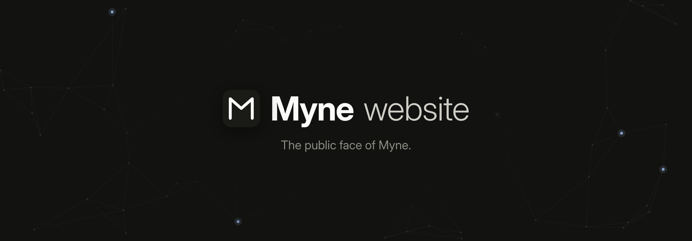

<p align="center"></p>

# Myne website

> The public face of Myne.

The marketing and documentation site for [Myne](https://github.com/myne-md/myne) — served at `myne.md`. Myne is an open-source, end-to-end-encrypted, local-first markdown notes app with optional zero-knowledge sync: no email at signup, a 20-character account number identifies you, recovery rides on a BIP-39 24-word phrase, and the crypto is Argon2id + XChaCha20-Poly1305.

This repo is one of several under [`myne-md`](https://github.com/myne-md). It holds the public landing page, the changelog/ledger, and the user guide — nothing cryptographic. The protocol, threat model, and specs live in the main repo under [`docs/`](https://github.com/myne-md/myne/tree/main/docs); copy here must stay within those guarantees.

## Status

Pre-alpha, like the rest of the project — but this site is functional and deployed, not a scaffold.

What exists today:

- **Landing page** (`/`) — single-page dark landing with how-it-works, comparison, and roadmap sections.
- **Ledger** (`/ledger`) — changelog/notes collection with `shipped` / `thinking` / `milestone` entries, filter views, per-entry OG images, and an RSS feed (`/ledger/rss.xml`).
- **User guide** (`/user-guide`) — 70+ articles across eight categories, served from a Markdown content collection with a validated sidebar. The subtree is currently `noindex` and excluded from the sitemap; per `design-notes.md`, real-content go-live drops the banner, `noindex`, and sitemap filter atomically in one PR.
- **Static surfaces** — `/download`, `/releases`, `/roadmap`, `/security`, `/spec`, a `404`, plus build-time `robots.txt`, `llms.txt`, and a sitemap.
- **`/.well-known/security.txt`** — RFC 9116 disclosure, served from the apex (`public/.well-known/security.txt`).
- **OG image generation** — built at compile time with `satori` + `@resvg/resvg-js` (no headless browser).
- **Deploy** — Dockerized Astro static output behind nginx, shipped via Woodpecker CI to `myne.md` (release) and `preview.example.com` (develop).

Marketing copy, pricing, and the bug-bounty page are intentionally conservative: the security page is acknowledgment-only (no monetary bounty yet), matching `docs/threat-model.md` §6.

## How it works

Astro builds the whole thing to static HTML at compile time. The `site` value (and therefore canonical URLs, the sitemap, and RSS absolute links) is set per environment by the Docker build — `https://myne.md` for release, `https://preview.example.com` for preview — so the same source produces both deployments. There is no server runtime: nginx serves the static `dist/`. No analytics, no third-party trackers.

## Structure

```
myne-website/
├── src/
│   ├── pages/         ← Astro routes: index, download, releases, roadmap,
│   │   │                security, spec, 404, ledger/, user-guide/
│   │   ├── ledger/    ← feed (index, [filter], [slug]), OG endpoint, rss.xml
│   │   ├── og/        ← build-time OG image endpoint
│   │   ├── robots.txt.ts · llms.txt.ts
│   ├── layouts/       ← BaseLayout, LandingLayout, ledger + user-guide shells
│   ├── components/    ← Nav, GlassNav, Footer, SubscribeDialog, ledger/, userguide/
│   ├── content/       ← ledger/ + user-guide/ Markdown collections
│   ├── content.config.ts  ← collection schemas (Zod)
│   ├── lib/           ← ledger.ts, og.ts, userGuide.ts
│   ├── data/          ← people.ts, platformIcons.ts
│   └── styles/        ← global, tokens, ledger, user-guide CSS
├── public/
│   └── .well-known/security.txt   ← RFC 9116, served from /
├── scripts/           ← validate-sidebar.mjs, wire-screenshots.mjs
├── astro.config.mjs   ← site/env wiring, sitemap filters
├── Dockerfile · nginx.conf · .woodpecker.yml
├── package.json · pnpm-lock.yaml
└── CLAUDE.md          ← marketing-copy discipline + content rules
```

## Development

```bash
pnpm install
pnpm dev               # Astro dev server
pnpm build             # validate sidebar, then build static output → dist/
pnpm preview           # serve dist/ locally
pnpm validate-sidebar  # check the user-guide sidebar against content
```

Node is pinned via `engines` (≥ 22.12) to match the main repo. Git hooks run through lefthook (`brew install lefthook && lefthook install`): pre-commit runs `astro check`, whitespace, EOF-newline, and a secret-pattern guard; pre-push runs `pnpm build`, `pnpm test` and `protected-branch`, which refuses a direct push to `develop` or `release` (myne-md/myne#592). If that refusal is deliberate, allow it once with `MYNE_ALLOW_PROTECTED_PUSH=1 git push ...`; do not reach for `--no-verify`, which skips the other two as well.

## Discipline

Marketing copy may **not** exceed the guarantees in the main repo's [`docs/threat-model.md`](https://github.com/myne-md/myne/blob/main/docs/threat-model.md) (normative) — this rule extends to every `/user-guide` article. Brand voice and the "Myne is / Myne is not" lists live in [`docs/vision.md`](https://github.com/myne-md/myne/blob/main/docs/vision.md). When a claim is in doubt, downgrade it. Adding a tracker or analytics requires a corresponding `design-notes.md` entry. See [`CLAUDE.md`](./CLAUDE.md) for the full content discipline.

## Related repos

- [`myne`](https://github.com/myne-md/myne) — main repo: Tauri desktop client, Rust crypto crate, and the `docs/` specs (protocol, threat model, account number).
- [`myne-server`](https://github.com/myne-md/myne-server) — sync server; self-hosted and hosted share the same zero-knowledge trust boundary (TB5).
- [`myne-test-vectors`](https://github.com/myne-md/myne-test-vectors) — byte-level cross-implementation agreement.

## License

Code in this repo is MIT — see [`LICENSE`](./LICENSE); marketing content does not need copyleft. This mirrors the project's split: the main repo's `docs/` specs stay permissive (CC-BY-4.0) so independent implementations can reuse them, while the Myne application code is AGPL-3.0.
