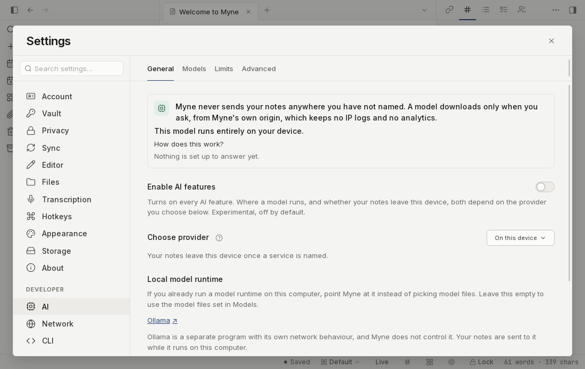

AI is off until you turn it on and give Myne a model to run. This page walks through enabling the beta opt-in, choosing the two model files, what "ready" means, and how to keep chosen folders out of AI entirely.

## Prerequisites

- An unlocked vault.
- Model files you have downloaded yourself. Myne never downloads a model, because that would mean sending data over the network. See [Choosing model files](#choosing-model-files) below.

## Enabling local AI

1. Open Settings from the gear in the bottom bar or with `⌘,`.
2. Open the **About** panel and turn on **Developer mode**. The AI features live in a **Developer** group that stays hidden until you do this.
3. In the panel rail, open **AI (Beta)** under the **Developer** group that now appears.
4. Turn on **Enable local AI**. The helper text states plainly that it runs a model you provide, entirely on your device, and is experimental and off by default.

Below the toggle, a headline states the posture for the configuration you are actually in — a model on your device, a program on your computer, or a provider you named — and Myne never sends your notes anywhere you have not named. The **How does this work?** disclosure expands the honest detail, including the part Myne does not protect against. That copy is worth reading once; it is the same boundary described in [AI privacy and limits](/user-guide/ai/ai-privacy-and-limits/).

## Choosing model files

Myne uses two model roles, listed under **Models** in the same panel. You bring both:

- **Text model — chat, summaries, writing.** Used for chat answers, summaries, tag suggestions, and writing help. The recommended starting point is Qwen2.5-1.5B-Instruct (GGUF). This role needs the `.gguf` file plus `tokenizer.json` in the same folder.
- **Search model — semantic search & Q&A.** Used to index your notes so questions can find the right passages. The recommended starting point is all-MiniLM-L6-v2. This role needs `model.safetensors`, `config.json`, and `tokenizer.json` in one folder.

Each role shows a recommended-model name as a link. Clicking it opens the page in your own browser as an operating-system handoff; Myne does not fetch anything. Download the files there, then:

1. Next to a role, click **Choose file…**.
2. Pick the file in the picker (the `.gguf` for the text model, the `.safetensors` for the search model).

The chosen path is stored on your device only and the file is never copied into your vault. The path must be outside your vault folder; if you pick a file inside the vault tree, Myne refuses it and tells you it must be outside your vault.

## What "ready" means

Enabling the toggle is not enough on its own. AI is ready only once a text model is selected, because without it every request would fail. The AI Chat tab shows this state in its header:

- **Off** — the toggle is off.
- **No model** — enabled, but no text model is selected yet. Choose one in Settings to continue.
- **Preparing** — enabled and indexing your notes for the first time in this session (see below).
- **Ready** — enabled, a model is selected, and indexing is done.

When you unlock the vault with AI on, Myne builds a search index of your notes on-device so that [Ask your notes](/user-guide/ai/ask-your-notes/) can find relevant passages. That index is encrypted at rest and reused across sessions, so after the first build it only reconciles what changed. It is never synced and never backed up.

## Excluding folders

The **Excluded folders** box lets you name folders that AI must never read or index. Enter one folder path per line. A note is excluded when its folder is one you listed or is nested inside one, so excluding `Private/` also excludes everything under it. The match ignores case, so a folder stays excluded regardless of how you capitalized the path.

Exclusion is enforced both when notes are indexed and when they are queried, and every AI surface checks it before the model is ever called. A note in an excluded folder is never embedded, never summarized, never used to ground a chat answer, and never offered tag suggestions or writing help.

## Limits

Turning on AI adds a model runtime to the Myne process. That process holds your decrypted notes and keys, and the model is not isolated from them; a model file you download is untrusted input that Myne does not vouch for. Excluding a folder keeps its notes out of AI reading and indexing, but it is a Myne-level control, not an operating-system boundary — it does not protect the folder against malware already running on your device, which can read app memory regardless. The encrypted index Myne builds for search is a rebuildable local cache; it is never uploaded. Full detail is in [AI privacy and limits](/user-guide/ai/ai-privacy-and-limits/).

## Shortcuts

| Action | macOS | Windows / Linux |
|---|---|---|
| Open settings | ⌘, | Ctrl , |
