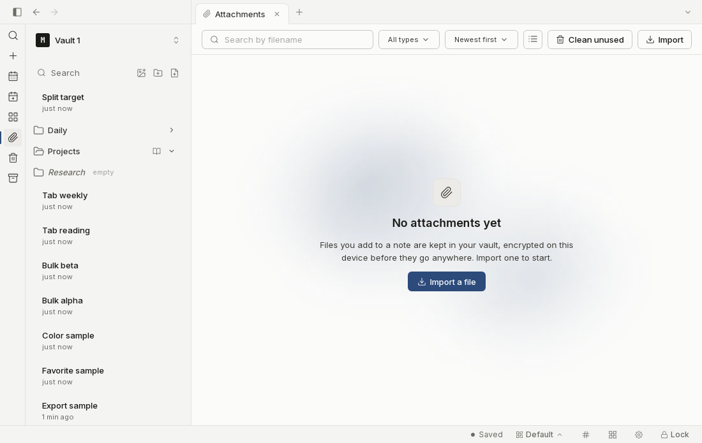

The attachments library is where every file in your vault lives in one place. It opens as its own tab in the tab strip, the same space your notes use, so you leave it by closing that tab or by opening a note. Because it is an ordinary tab, it can sit beside a note in a split pane, and the [left ribbon](/user-guide/getting-started/left-ribbon/) shows it as the surface you are looking at.

## Opening the library

Open it from the **Open attachments…** command in the palette, from its button on the left ribbon, or from the destinations listed in a new, empty tab.

## Browsing

The library shows your attachments as a grid or a list. To find one:

- **Search by filename**: the search box matches file names (it does not look inside the files).
- **Clear a search** with the × in the search box. When nothing matches, the empty state offers the same clear-search action; when the vault has no attachments at all, it offers Import instead.
- **Filter by type**: All types, Images, PDFs, Audio, or Other. A [voice note](/user-guide/attachments-and-import/voice-notes/) or an imported audio file is Audio. Video, documents, archives and everything else are Other.
- **Sort**: Newest first, Oldest first, or by name (A-Z / Z-A).

In list view the columns are Name, Type, Size, Created, and Used in, and the header stays put as you scroll.

## Seeing where a file is used

Each attachment shows **used in N notes**, computed from your current notes — rebuilt each time you unlock, so it is right from the first look rather than after a save. The count is what you would see in the sidebar: conflict copies, trashed, archived and template notes are not counted, so one note that has a conflict copy is listed once, not twice. Open the count to jump straight to a note that uses the file. A file that no note embeds shows **zero references**; it is not deleted on its own and stays in the library until you remove it.

## Cleaning unused attachments

Deleting a note never deletes the files it embedded, so files with zero references can build up. The **Clean unused attachments** command, run from the library, finds every file that nothing in the vault still references. It reads your notes **and your snapshots** at the moment you run it, so a file that has gone from a note but survives in a snapshot you could restore is never offered for cleanup — restoring that snapshot would otherwise bring back a note pointing at a file that no longer exists. If any note or snapshot can't be read, the sweep refuses rather than guessing, and nothing is deleted. What it does find, it shows you as a list to review before anything happens.

On a device that hasn't finished its first sync, Clean unused refuses to run at all: it would be deciding what is unused from a fraction of your notes. It says so, in those words: "Finish syncing first. This device doesn't have all your notes yet, so it can't tell which attachments are unused." Nothing is deleted. Wait for the sync to finish and run it again.

Deleting the files you confirm is permanent and cannot be undone, so read the list before you confirm. When you do confirm, Myne re-checks every note before erasing anything, so a file that became used between the review and the confirm is skipped instead of deleted; the closing summary reports what was removed, how much space that freed, and how many were skipped as now in use. Everything else on the list is erased from the vault. There is no trash tier for a cleanup, so the review-and-confirm step is the only undo.

## Acting on a file

A per-item menu (the `⋮` button, or a right-click anywhere on the card or row) gives you **Preview** (images and PDFs only), **Export**, **Rename**, and **Delete**, the same actions covered in [Attachments](/user-guide/attachments-and-import/attachments/) (rename changes the display name only; delete is explicit and leaves a tombstone in any note that embedded the file). On a computer, **Export** opens a native Save dialog and writes a plaintext copy of the file to a path you choose. On a phone or tablet you are not asked where it goes (see Limits, below). Either way the copy you save sits outside the vault and is no longer encrypted.

An audio attachment can be transcribed. **Transcribe** runs speech-to-text on this device, and it is hidden when speech-to-text is off in Settings → Transcription. A transcript an earlier run wrote opens read-only, under the line "This transcript was made by a small model running on your device and may be wrong — check it against the audio." That one stays available with speech-to-text turned off, because reading text you already have needs no model.

Where those two actions live depends on the client. On a computer they are entries in the item's `⋮` menu: **Transcribe**, and **View transcription** once a transcript exists. On a phone or tablet the file itself is the control: tap an audio file's name and its transcript opens in a sheet. The sheet shows the transcript an earlier run wrote, or offers **Transcribe** when there is none, and it is where a phone reads and keeps one. It scrolls a long transcript, sets the model's phrases as paragraphs, and carries **Copy** and **Save as note**; opened from the editor it also carries **Insert transcript into note**. **Save as note** writes a new note holding the audio embed, a **Transcript** heading and the text, so the transcript travels with its recording. Once a transcript exists, **Transcribe** stays available in the sheet's header so a newer model can re-derive it.

## Filing files into folders

An attachment carries a folder, and it is the same folder namespace your notes already use. Filing a file therefore means the same thing it means for a note: `Ders Notları/` is one folder, and a file filed there sits in the same tree as the notes filed there.

- **One file**: open the `⋮` menu and choose **Move**, or use the folder picker on the card. The picker lists **All folders**, **No folder** and every folder the vault holds.
- **Several at once**: press the select control on the rows or cards you want, and the toolbar reports **2 selected**. Choose **Move the selected files to a folder** and pick the destination once. The move is all or nothing: if one row cannot be validated, nothing is written and the toolbar says **Could not move the selected files. Nothing changed; try again.**
- **The folder filter**: the folder control above the grid scopes the library to one folder. **All folders** is the whole library, so a file you cannot find is usually behind a filter that is still on.

A file with no folder is not broken. It stays in the library under **No folder**, and the command palette lists it as a file that no note uses.

Renaming a folder rewrites the files filed under it, so they stay in the same tree as the notes beside them. When that rewrite fails, Myne says so in full rather than leaving the two halves apart: the folder is renamed, the files still name the old folder, and the message tells you to move them again by hand from Attachments or to rename the folder back and forward once. Nothing is lost either way; the files are still in the library, only outside the tree.

## Importing a whole folder

**Import a folder** takes a directory tree from your computer and files every file in it into the matching vault folder. It reports progress as **Importing 12 of 40**, then a closing line: **12 files imported, 3 skipped.** A file is skipped rather than imported when it is already in the vault or cannot be read. **Stop** ends the run early and keeps what it already wrote: **Stopped after 12 files. What was imported is in the library.**

A folder Myne cannot read stops the import before anything is written: **Could not read that folder. Nothing was imported.** That is deliberate, because a partial tree is harder to reason about than no tree.

## Importing from the library

You can bring a single file in from the library with its **Import attachment** picker. Importing makes the file available; **embedding it into a note still happens in the editor**, the same as adding any attachment.

## Limits

The library lists what this vault holds on this device. Attachment names, contents, and types are encrypted at rest — see [Attachments](/user-guide/attachments-and-import/attachments/) for what a copy of the vault folder can still reveal about them. The search box matches file names only; it never reads inside a file to find a match.

Export is the point where a file leaves the vault's protection: the copy it writes is decrypted and is no longer covered by your master password. On a computer it sits wherever you saved it. On a phone or tablet you are not asked, and it lands in the app's own Documents folder; see [Attachments](/user-guide/attachments-and-import/attachments/) for what that means for your phone's cloud backup.

Clean unused decides from the notes and snapshots this device holds, which is why it refuses on a device that has not finished its first sync. Once a sweep has erased a file, nothing inside Myne brings it back — only a [backup](/user-guide/safety-and-recovery/back-up-your-vault/) taken before the sweep still contains it.
