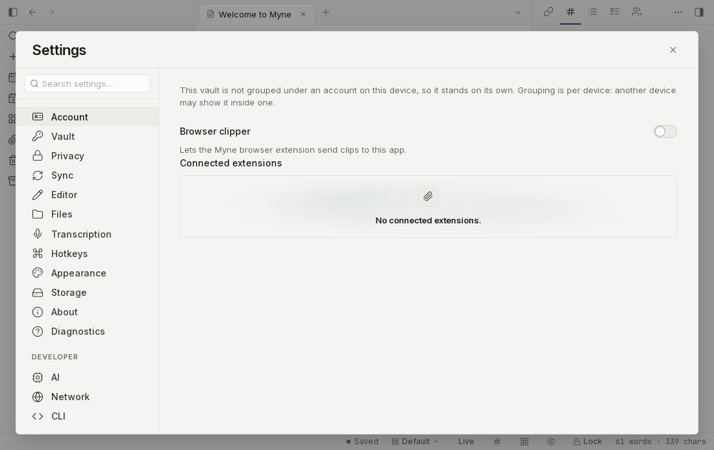

The Myne Clipper is a browser extension that saves a web page into your vault as a note. It talks to the desktop app over a local bridge rather than a network service, and it holds no keys: it can only create clip notes, and only while your vault is unlocked. This page covers installing the extension, pairing it to your open vault, what gets saved, and managing the browsers you have paired.

## Prerequisites

- A vault, created and unlocked. Pairing and clipping both require the desktop app running with the vault unlocked.
- One of the supported browsers: Firefox, Chrome, or Edge.
- The **Browser clipper** setting turned on. It is off until you turn it on, and turning it on is what puts the local bridge in place.

## Turn on the browser clipper first

The desktop side does not register the native-messaging host — the local bridge the extension uses to reach the app — until you ask it to. The setting ships off, so turn it on before you install or pair the extension; an extension installed while the host is unregistered has nothing to talk to, and pairing will not start.

1. Open Settings from the gear in the bottom bar or with `⌘,`.
2. Open **Settings → Browser extensions** and switch **Browser clipper** on. Turning it on registers the native-messaging host; turning it off removes it again.

Then install the Myne Clipper extension in your browser from its extension listing. The extension and the desktop app find each other through the registered host.

## Pairing the extension to your vault

Pairing binds a scoped token to the exact extension, so only that extension can hand clips to your app. You start pairing from the extension; the desktop app then shows a confirmation.

1. With Myne open and your vault unlocked, start pairing from the extension.
2. Myne shows a pairing dialog titled **A browser extension wants to connect**, with a short numeric code.
3. Confirm that the code matches the one the extension shows, then choose **Accept**. Myne mints a scoped, revocable token for that extension and the extension stores it.

If the codes do not match, or you did not start this, choose **Reject**. Rejecting mints no token and leaves the extension unpaired. The dialog does not dismiss on `Esc` or a background click on purpose — declining is the explicit **Reject** action, so a pairing request is never left silently unresolved.

## What gets saved

A clip lands as an ordinary note at your vault root. It is a normal `.myn` note from that point on — you can move it into a folder, edit it, tag it, or delete it like any other.

- **A page or a selection** is saved as markdown. Select text first to clip just that selection; otherwise the readable article is captured. Images in the captured content are imported as [attachments](/user-guide/attachments-and-import/attachments/) and embedded in the note. When an image cannot be brought in, the note records how many were omitted, by type, so nothing is dropped silently.
- **A bookmark** is a content-light note pointing at the page.

The note takes its name from the page's title, the same way whether you clipped the page or a selection. A page that has no title lands untitled, and you rename the note like any other.

A clip records where it came from as ordinary frontmatter. A page or selection clip carries a `source:` and `url:` for the page address plus a `clipped:` timestamp; a bookmark carries `source:` and `clipped:` (no `url:` field). These are plain fields you can read or edit, and editing and re-saving a clip keeps them. When a clip is saved, Myne shows a "Clipped to your vault root." notice with a **View** action that opens the new note.

Clips always save to the vault root. The extension cannot choose a folder or apply tags, so no information about how your vault is organized ever crosses into the browser.

## Managing paired browsers

The same **Browser extensions** panel lists the browsers you have paired, under **Connected extensions**. Each row shows the browser it runs in — for example **Chrome / Edge** or **Firefox** — and when it was connected. Chrome and Edge share a row because they cannot be told apart from the extension identifier alone.

To disconnect a browser, choose **Revoke** on its row. Revoking is immediate and durable on the desktop side: the token is dropped, and that extension must pair again before it can clip. When nothing is paired, the section reads "No connected extensions."

## Limits

The clipper is a keyless producer. This section maps that to what it does and does not protect against; it does not exceed the [threat model](/user-guide/settings-and-privacy/privacy-model/) (TB10, A14).

- **Pairing binds the token to one extension.** The token authorizes creating clips only, never reading, decrypting, modifying, or deleting notes, and it works only while your vault is unlocked. A compromised extension build cannot read or exfiltrate your vault; the worst it can do is write visible clip notes you can see and delete.
- **Captured page content arrives as plaintext from the browser.** The page you clip was already open in your browser, which is outside the encrypted boundary. Once saved, the clip note is encrypted at rest inside your vault like every other note — but the capture itself happened in the browser, which Myne does not protect.
- **There is no plaintext queue.** If your vault is locked, a clip is dropped, not buffered: nothing is written to disk while locked. Capture requires an unlocked vault.
- **Revoke is the desktop's decision.** Revoking drops the token here immediately; the extension learns it must re-pair on its next attempt. There is no separate remote kill for the extension's own copy beyond that.
