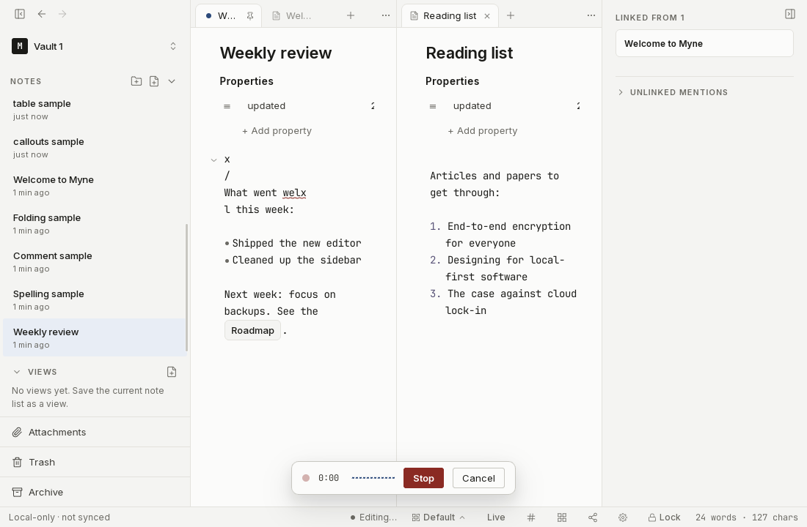

You can record a voice note inline from the editor with the `/record` command. The clip saves as an encrypted audio attachment and embeds at the cursor as an inline player you can play back in place. Recording runs locally on your device, and it stops if the vault locks or auto-locks.

## Recording a voice note

In the editor, type `/` and choose **Voice note** (the slash command, icon ◉). This arms microphone capture and mounts a floating recording bar. The bar shows a pulsing dot, an elapsed-time clock that starts at 0:00, a live waveform that moves with your input level, and **Stop** and **Cancel** buttons. There is no default keyboard shortcut; you reach it through the slash menu.

Choose **Stop** to keep the clip. Myne saves it as an `audio/wav` attachment and inserts an embed at the cursor, auto-named `Voice note YYYY-MM-DD HH-MM-SS.wav` from the time you stopped. Choose **Cancel** to discard it instead; nothing is saved when you cancel.

## The inline player

The embed renders as an inline player with a play/pause control, a seekable waveform track, a `0:00 / 0:00` time readout, and a **⋯** overflow menu. The menu carries **Export**, **Rename**, **Remove**, and **Reveal in library**, the same actions used elsewhere for attachments. An audio file you bring in yourself (an imported `audio/wav` file) renders with this same player; a recorded voice note and an imported clip behave identically once they are in a note.

## Microphone and silence handling

The moving waveform is also your "is it working" signal. On some systems a denied microphone shows up as silence rather than an error. If the bar stays near-silent for a short grace period, it warns **No audio detected — check your microphone.** If you stop a recording that captured no sound, Myne discards the silent clip rather than saving an empty one. If you see this warning, check that Myne has microphone access in your operating system's settings, then try again.

A long recording does not fail at the attachment size limit. When a clip reaches the 64 MiB cap, Myne finalizes it and continues into the next one with no dropped samples, so the recording becomes a sequence of ordinary embeds in order.

## Limits

Microphone capture runs natively in the Myne core, not in the WebView that draws the editor. The recorded audio stays on the Rust side, where it can be wiped from memory, and it never enters the editor's JavaScript heap. The in-progress recording is held in memory only — Myne never writes a plaintext temporary `.wav` to disk while you record. The saved clip is an ordinary encrypted attachment, the same on-disk format as any other attachment; there is no new file format for audio.

Recording requires an unlocked vault and only runs in the main window. It is aborted when the vault locks, when [auto-lock on idle](/user-guide/settings-and-privacy/quick-unlock/) triggers, and when a vault is deleted, so the microphone never stays active past your unlocked session.

What Myne does not protect against is forensic capture of device memory. The in-memory recording buffer and the decrypted audio that playback hands to the editor are plaintext in RAM, and anything that can read your machine's memory, swap, or hibernation image while the vault is unlocked is outside what Myne defends against — the same inherited limitation that applies to your decrypted notes.

Voice notes are attachments, so the attachment limits apply: see [Attachments](/user-guide/attachments-and-import/attachments/) for how they are stored, and [The attachments library](/user-guide/attachments-and-import/attachments-library/) for managing them. Attachment contents are not searched, so a voice note's audio is not part of [Search](/user-guide/find-and-connect/search/).
