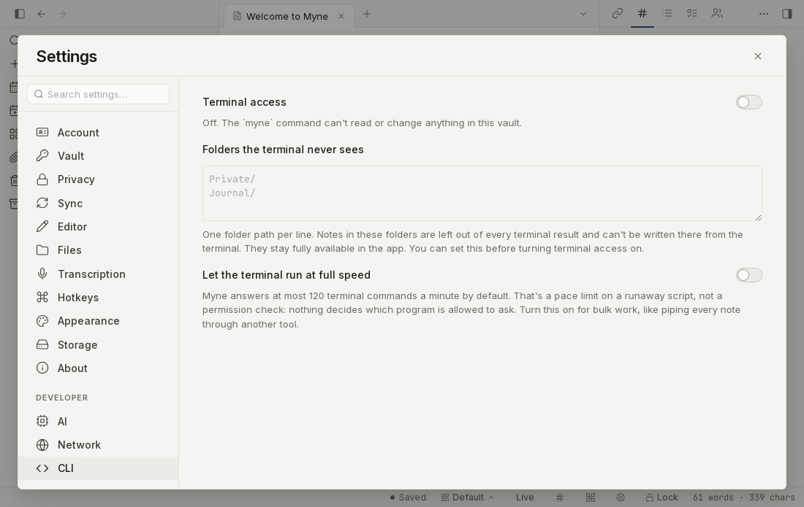

The `myne` command reads, searches, and creates notes from a terminal by talking to the running, unlocked app over a local socket on your device. This article covers turning on terminal access, the commands it offers, the stable `--json` output for scripts, and what each refusal means.



## Prerequisites

- The Myne app open and unlocked. The command line drives the running app; it cannot open a locked vault.
- Developer mode on, and **Terminal access** on in Settings → CLI (below). Both are off until you turn them on.
- macOS or Linux. There is no Windows version of the command line.

## Turning on terminal access

Terminal access is off by default, and its control stays hidden until you turn on Developer mode.

1. Open **Settings → About** and turn on **Developer mode**. The terminal-access controls live in the **CLI** panel, which joins the rail's Developer section only once you do this. See [Developer mode](/user-guide/settings-and-privacy/developer-mode/).
2. Open the **CLI** panel and turn on **Terminal access**.

While terminal access is on, the same row shows when the door was last used: **Last used just now.**, a count in minutes, hours or days, or **Not used since this vault was unlocked.** Every command that reached the door counts, including ones it refused, so a script running quietly in the background shows up here. The figure is held in memory for the session only. Locking the vault clears it, and it is never written into your vault.

Until you turn it on, every command refuses with `CLI access is off. Enable it in Myne's Settings.` and exits with code 5.

It is opt-in because an open socket lets any program running under your account read what the app has already decrypted. See [Limits](#limits) below.

Turning Developer mode back off only hides these controls. An enabled socket keeps serving until you turn **Terminal access** itself off, so switch the door off first if that is what you meant to do.

Terminal access is set per device. Turning it on here opens the door on this machine only, and turning it off closes it here only: each device you want to use the command from has its own switch. **Let the terminal run at full speed** is per device in the same way.

## Making your shell find the command

The `myne` command ships inside the Myne app. When the app starts it writes a small launcher to `~/.local/bin/myne` pointing at the copy inside the bundle. It never edits your shell profile, and it never replaces a `myne` command you installed yourself.

On most Linux desktops `~/.local/bin` is already on your `PATH` and nothing more is needed. On macOS it usually is not, so the **CLI** panel shows the one line to add to your shell profile:

```
export PATH="$HOME/.local/bin:$PATH"
```

Add it, open a new terminal, and `myne --help` resolves.

## The commands

Run `myne --help` at any time to see the commands:

<div class="ug-cast" data-cast="/casts/cli-help.cast" data-title="myne --help" aria-label="Terminal session: running myne --help lists the available commands"></div>

| Command | What it does |
|---|---|
| `myne list` | Print every live note's id, one per line |
| `myne show <id>` | Print one note's Markdown to standard output |
| `myne search <query>` | Full-text search over live notes |
| `myne new [--folder <path>]` | Create a note from standard input |
| `myne daily` | Print today's daily note, creating it if needed |
| `myne daily:append <text>` | Append a line to today's daily note |
| `myne weekly` | Print this week's note, creating it if needed |
| `myne weekly:append <text>` | Append a line to this week's note |
| `myne monthly` | Print this month's note, creating it if needed |
| `myne monthly:append <text>` | Append a line to this month's note |

Note ids are long, stable identifiers, so `list` and `search` are meant to be piped rather than read by eye — for example `myne list` into another command, or `myne search` to find the id you then pass to `myne show`.

A note you create or append to from the terminal appears in the open app straight away — Myne treats the terminal as another writer to the same vault. A note you are in the middle of typing is the exception: the app leaves your unsaved text alone rather than reloading over it.

## Folders the terminal never sees

Settings → CLI carries a list of folders the terminal is never given, under **Folders the terminal never sees** — one folder path per line. Notes in those folders are left out of `list`, `search`, and `show`, and `new --folder` refuses to write into one. They stay fully available in the app.

You can fill the list before you turn terminal access on, which is the safer order. Myne decrypts a note to read the folder it is in and then declines to hand it over, so the filtering happens on the way out rather than by keeping a separate, narrower index.

If the folder a periodic note is configured to live in is on the exclusion list, that period's two commands both fail with an error rather than quietly doing nothing. Each period has its own folder, so excluding `Weekly/` stops `weekly` and leaves `daily` working.

The exclusion list is the exception to the per-device rule above: it is part of your vault rather than of this device, so with sync on it travels to your other devices. Devices merge it by keeping every entry any of them holds, so an exclusion added anywhere is never lost, and a folder you take off the list on one device comes back if another device still lists it. To stop excluding a folder, remove it on every device.

## Periodic notes and the clock

`daily`, `weekly` and `monthly` open or create the same notes the app's own
commands do, matched the same way: by the folder and the title your
[periodic-notes settings](/user-guide/notes-and-organization/periodic-notes/) produce. So
`myne weekly:append "shipped the thing"` lands in the note the app opens for
this week.

One difference, and it is deliberate. If you have set a display timezone in
Settings, the app honours it and the terminal does not: these commands use the
clock of the machine they run on. On most days that is the same answer. On an
evening where your override has already crossed midnight, or has not yet, it is
not, and the terminal writes a line to standard error saying so. Standard output
still carries only the note, so a redirect to a file is unaffected.

## Searching

`myne search` prints one `id`-and-title line per match. It also prints a fixed line to standard error: `Some notes may be excluded from search results (see Settings).` That line is identical on every search, so it can never be read as a count of what was hidden.

<div class="ug-cast" data-cast="/casts/cli-search.cast" data-title="myne search" aria-label="Terminal session: myne search prints matching note ids and titles"></div>

An excluded note's id looks exactly like an unknown one, and an excluded search hit is simply absent. Writing into an excluded folder with `new --folder` is refused rather than silently redirected.

## Output for scripts

Add the global `--json` flag before any command for a stable, single-line envelope instead of the human text — `{"ok":true,"notes":[…]}` for `list`, `{"ok":true,"body":"…"}` for `show`, `{"ok":true,"results":[{"id":"…","title":"…"}]}` for `search`, `{"ok":true,"id":"…"}` for `new`, a bare `{"ok":true}` for the three `:append` commands, and `{"ok":false,"error":{"kind":"…","message":"…"}}` on failure. Everything a command has to say that is not the envelope — including the search advisory above — goes to standard error, so a script reading standard output gets the envelope and nothing else. The shape is a promise to scripts and does not change with the wire protocol underneath.

## Pace

Myne answers at most 120 terminal commands a minute. Past that, commands are refused with exit code 8 and the message `Too many requests in a short time. Wait a moment and try again, or turn the CLI rate limit off in Myne's Settings.`, and the next minute lets them through again. The limit paces a runaway script; it decides nothing about which program is allowed to ask, and it is not a permission check. For bulk work, such as piping every note through another tool, turn on **Let the terminal run at full speed** in Settings → CLI.

## When a command is refused

Every command checks its preconditions before doing anything and fails with a specific message and exit code — it never prompts. Running a command while the vault is locked, for instance, refuses at once:

<div class="ug-cast" data-cast="/casts/cli-locked.cast" data-title="myne list (locked)" aria-label="Terminal session: myne list is refused because the vault is locked"></div>

| Exit code | Meaning |
|---|---|
| 0 | Success |
| 1 | Could not reach the app, or could not read its reply |
| 2 | Usage error (unknown command or wrong arguments) |
| 3 | Myne is not running |
| 4 | The vault is locked |
| 5 | Terminal access is off |
| 6 | No matching note |
| 7 | The folder is excluded from terminal access; nothing was written |
| 8 | Too many requests in a short time |

## Limits

The command line is not a second way into your vault. It reaches your notes only by asking the running, unlocked app over a device-local socket; it never opens the vault, holds a key, or reads anything from disk itself. It cannot unlock a locked vault and cannot run while the app is closed, so closing or locking Myne closes this door too. Trashed notes and templates are absent from `list`, `search`, and `show`, matching the app's own lists, and folders you exclude stay invisible to it.

While terminal access is on and your vault is unlocked, any program running under your user account can drive the `myne` command and read, search, create and APPEND to notes through it. Myne cannot tell your terminal apart from a script: nothing on the socket checks who is asking — no token, no signature, no process check — because a program already running as you defeats each of those. Deleting notes is refused outright over the socket, and folders you exclude are left out of everything it returns, but reads inside scope are the trade-off for having the door open at all. Locking the vault or quitting Myne closes the socket; turning Developer mode off does not.
