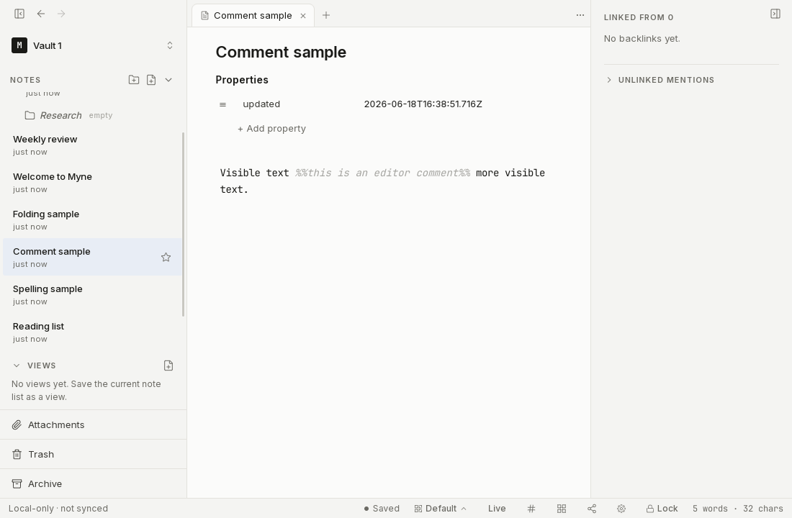

A comment is a note-to-self you write inside a note. Wrap text in `%%` and Myne treats it as a comment: it stays on screen, dimmed, so you can still read it while you write, but it is dropped from the HTML, PDF, and plain-text exports and is left out of the [document statistics](/user-guide/editor-and-writing/document-statistics/). A byte-for-byte [Markdown export](/user-guide/editor-and-writing/export-notes/) keeps the comment exactly as you typed it, because the `%%` you wrote is never rewritten.

## Writing a comment

Type the `%%` delimiters yourself; there is no toolbar button and no [slash command](/user-guide/editor-and-writing/slash-commands/) that inserts a comment. Two forms work:

- **Inline** — wrap a span on one line, like `Ship the draft %%still missing the intro%% by Friday`. Only the text between the two `%%` pairs is the comment; the rest of the line stays ordinary text.
- **Block** — open a line with `%%` and close it later with another `%%`. The closing `%%` can sit on the same line or on a following line, so a block comment can run across several lines.

## Where comments show and where they don't

In the editor the comment is always visible. Myne renders it dimmed, so it reads clearly as a comment set apart from the surrounding text, but it never disappears, even when your cursor is elsewhere. You can always see and edit your own notes-to-self.

The comment is removed from every rendered or lossy output:

- the **HTML** export,
- the **PDF** export,
- the **plain-text** export, and
- the **document statistics** (word, character, sentence, and reading-time counts).

The one place the comment survives in full is the byte-verbatim **Markdown** export. That export copies your note's exact bytes, and the `%%` source you typed is never rewritten, so the comment text comes through unchanged.

## Termination is required

A comment must be closed. A `%%` with no matching closing `%%` is inert: it stays as the literal characters you typed, hides nothing, and is not stripped from any export. This is a deliberate divergence from Obsidian, where an unterminated `%%` swallows everything to the end of the file. Myne chooses the safer behavior so that a stray, unclosed `%%` never makes the rest of your note vanish from an export. If a comment is not doing what you expect, check that it has a closing `%%`.

## Limits

A comment is author content. It is stored verbatim inside the encrypted `.myn` note, the same as the rest of the note body, and it is hidden only from exports, rendered output, and document statistics — never from the editor. Anyone who can read the decrypted note can read the comment, and a byte-verbatim Markdown export carries the comment text in the clear. A comment is a writing convenience, not a way to redact or hide text, and it carries no security or privacy guarantee of its own. How the note itself is protected is covered in [How Myne protects your notes](/user-guide/settings-and-privacy/privacy-model/).
