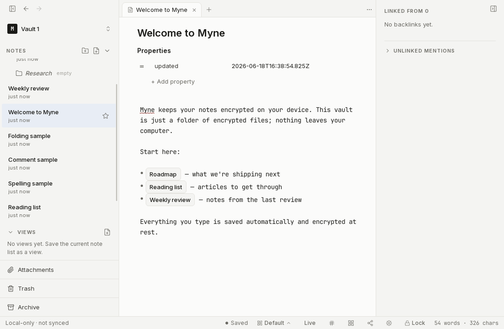

The bottom bar carries a live readout of the open note's word and character count. Hover it and a tooltip breaks the count down further — characters, words, spaces, and paragraphs. It measures the prose body of the note, and the moment you select some text it switches to counting just the selection.

## The readout

At the right end of the editor's bottom bar, a small readout shows the open note's word and character count — for example, `123 words · 456 chars`. It is drawn in a monospace font so the digits stay aligned as the numbers change.

The whole-note count updates on a short debounce as you type, so it settles a moment after you stop rather than flickering on every keystroke.

If you would rather not see it, you can hide it. Right-click the bottom bar and toggle the **Word count** item off; toggle it back on the same way. The setting is part of which bottom-bar items you show.

## The full breakdown

Hover the readout and a tooltip shows the full four-stat breakdown: characters, words, spaces, and paragraphs. The bar itself stays compact with just words and characters; the tooltip is where you reach for the rest.

## Counting a selection

Select any text in the note and the readout switches to the figures for that selection, appending ` (sel)` so you can tell which scope you are looking at — for example, `12 words · 47 chars (sel)`. The hover tooltip follows the same switch and ends with ` (selection)`. Clear the selection and the readout returns to counting the whole note.

## What is and isn't counted

The counts cover the prose body of the note only. Three things are left out of every figure:

- **YAML frontmatter** — the metadata block at the top of the note.
- **Dialect markup** — the formatting marks of Myne's [markdown dialect](/user-guide/editor-and-writing/overview/), not the words they wrap.
- **`%%` comments** — your private editor-only notes never reach the count.

So the numbers track the words a reader would actually read, not the scaffolding around them.

There is no reading-time estimate. The readout reports four things and only those four: words, characters, spaces, and paragraphs.

## Limits

The counts are computed inside the editor over content that is already decrypted and on screen. Nothing about the figures is persisted to your vault or transmitted anywhere — they are recalculated each time, on your device, from the note you have open. Myne today runs entirely on your device; nothing leaves it.
