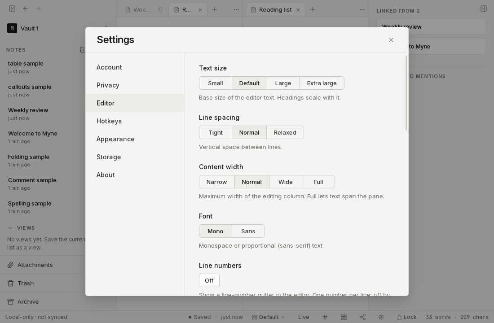

The editor's reading surface is yours to tune. You can set the text size, the line spacing, the width of the editing column, and the font, and you can turn on a line-number gutter. Every control lives in Settings, applies to the open editor right away, and is saved in your vault's encrypted preferences.

## Text size, line spacing, content width, and font

Open **Settings → Editor**. Four segmented controls sit at the top, each a row of presets you click between:

- **Text size** — **Small**, **Default**, **Large**, or **Extra large** (13, 14, 16, or 18 px). The default is **Default**. Helper text: "Base size of the editor text. Headings scale with it." Headings are sized relative to the base, so raising the text size scales the whole document, not just body text.
- **Line spacing** — **Tight**, **Normal**, or **Relaxed** (1.45, 1.7, or 1.95). The default is **Normal**. Helper text: "Vertical space between lines."
- **Content width** — **Narrow**, **Normal**, **Wide**, or **Full** (560, 680, or 820 px, or no maximum). The default is **Normal**. Helper text: "Maximum width of the editing column. Full lets text span the pane." **Full** lets text run to the edges of the editing pane instead of capping the line length.
- **Font** — **Mono** or **Sans**. The default is **Mono**. Helper text: "Monospace or proportional (sans-serif) text."

Each change applies to the open editor immediately, with no reload of the note — your cursor, scroll position, and undo history stay put. Picking a field's default value clears that field rather than storing it, so a vault left at the defaults is byte-for-byte identical to one that never touched the controls.

## Line numbers

To show line numbers down the left side of the editor, open **Settings → Editor → Line numbers** and switch it **On**. It is **Off** by default. Helper text: "Show a line-number gutter in the editor. One number per line; off by default."

The gutter numbers one logical line per row. When a long line soft-wraps onto more than one row, the continuation rows stay blank — only the start of each logical line gets a number. Like the typography controls, the toggle applies to the open editor live, with no reload; your cursor, scroll position, and undo history are preserved.

## Where these settings live

All five preferences — text size, line spacing, content width, font, and the line-number toggle — are stored per vault in your encrypted vault prefs. They stay on your device and are never sent anywhere. Because Myne only writes a value when it differs from the default, a vault you have left untouched stays identical on disk to one where you explicitly chose every default.

To reach Settings, click the gear in the bottom bar or press ⌘, (Ctrl , on Windows and Linux).

## Limits

These are cosmetic display preferences. They change how your notes are drawn on screen — text size, spacing, column width, font, and whether the gutter shows — and nothing else. They never change the content of a note, what is encrypted, or where it is stored.

The five values are stored in the encrypted vault prefs, but they are not load-bearing: a tampered or replayed value can at worst change how text renders or show or hide the line-number gutter. There is no security claim attached to them. How your notes themselves are protected is covered in [How Myne protects your notes](/user-guide/settings-and-privacy/privacy-model/).

## Shortcuts

| Action | macOS | Windows / Linux |
|---|---|---|
| Open Settings | ⌘, | Ctrl , |
