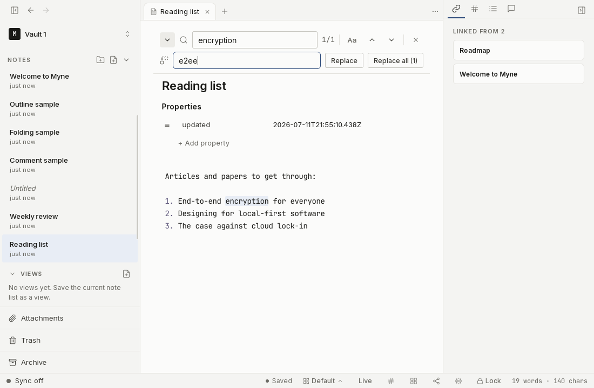

The in-note find bar searches the note you are reading. Press `⌘F` (or `Ctrl F`) to dock it at the top of the editor pane, type into the **Find in note** box, and Myne highlights every match and shows a live count. Step through matches with Enter and Shift+Enter, toggle case sensitivity with the **Aa** button, and open a second row to replace the current match or rewrite every occurrence in one undoable step.

## Opening the find bar

Press `⌘F` (or `Ctrl F`) while a note is open. A bar docks at the top of the editor pane with a **Find in note** input, and the cursor lands in it ready to type. The search is literal: it matches the exact substring you type, with no regular expressions, and it covers only the one open note. As you type, every match in the note is highlighted and a live `k/N` count appears, where `k` is the match you are on and `N` is the total. If nothing matches, the bar reads **No matches**.

Press `⌘F` again while the bar is open and it refocuses the input and selects its contents, rather than closing. Press Esc to close the bar. The command palette can open it too — **Find in note** and **Find and replace in note** both live in the palette's **Editor** category. `⌘F` is the default chord and can be changed in [Customizing keyboard shortcuts](/user-guide/settings-and-privacy/custom-hotkeys/), where the command is listed under **General** as **Find in note**.

## Stepping through matches

With matches found, press Enter to jump to the next one and Shift+Enter to jump to the previous one. Both wrap around: stepping past the last match returns to the first, and stepping back past the first goes to the last. The **Previous match** and **Next match** chevrons in the bar do the same thing by click. As you move, the count updates to show which match you are on.

## Case sensitivity

By default find ignores case, so `note` also matches `Note` and `NOTE`. The **Aa** button (**Match case**) turns case sensitivity on, narrowing the matches to the exact casing you typed. The setting is remembered for the rest of your unlocked session, so it carries across notes until you turn it off or lock the vault; it starts off again on the next unlock.

## Replacing text

The chevron at the lead edge of the bar (**Toggle replace**) expands a second row with a **Replace with** input and two buttons.

- **Replace** swaps the current match for the replacement text and advances to the next match. Pressing Enter in the **Replace with** field does the same thing.
- **Replace all** shows the live match count in its label, for example **Replace all (12)**, and rewrites every occurrence at once. This happens as a single undoable step, so one `⌘Z` (or `Ctrl Z`) reverts the whole bulk replace, not just the last match.

Replace works on the note's underlying text, which includes matches inside [folded](/user-guide/editor-and-writing/folding/) sections. Stepping onto a match inside a folded section unfolds it so you can see the change in context.

## Find and replace versus search

This bar is for locating and editing an exact string inside the note in front of you. It is deliberately different from the cross-note [search](/user-guide/find-and-connect/search/) in the command palette, which ranks whole notes across your vault by relevance and understands word stems. Use find and replace to fix a phrase in the current note; use search to find which note a topic lives in.

## Limits

The find query and the cached positions of its matches live only in your device's memory while you work; they are never written to disk, saved to your preferences, or sent across the app's internal boundary. They are released when the vault locks and the editor reloads. Like the open note itself, this is best-effort in-memory handling rather than a stronger guarantee: it is no more exposed than the decrypted note you are already reading. How that fits the wider model is covered in [How Myne protects your notes](/user-guide/settings-and-privacy/privacy-model/).

A match inside a note's [properties](/user-guide/markdown/frontmatter-properties/) is counted in the `k/N` total but is not highlighted, and stepping onto it does not move the cursor there. Properties render as their own block rather than as raw text, and the cursor is kept out of that block, so there is nothing in the note body to paint the match on and nowhere for the cursor to land — it comes to rest on the first line of the note body instead. The count still tells you the value is there; edit it in the Properties block itself.

## Shortcuts

| Action | macOS | Windows / Linux |
|---|---|---|
| Open the in-note find bar | ⌘F | Ctrl F |
| Next match | Enter | Enter |
| Previous match | Shift+Enter | Shift+Enter |
| Replace current match and advance | Enter (in **Replace with**) | Enter (in **Replace with**) |
| Undo a bulk replace all | ⌘Z | Ctrl Z |
| Close the find bar | Esc | Esc |

`⌘F` and `⌘Z` are defaults you can change in **Settings → Hotkeys** (listed as **Find in note** and **Undo**). The Enter, Shift+Enter, and Esc keys belong to the find bar itself and are not listed there, so they cannot be rebound.
