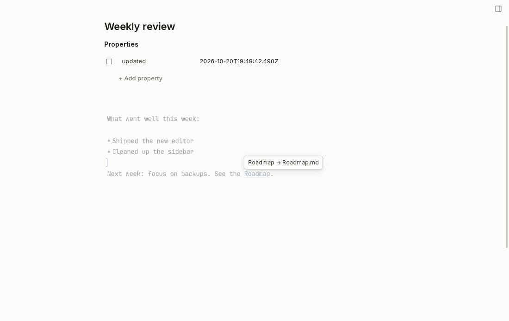

Focus mode fades the chrome around the editor and centers the writing column, so only the words are left. Two optional reading aids ride along with it: typewriter scroll keeps the line you are editing centered, and dimming fades every line except the one your cursor is on. The fade is an in-app effect — the operating-system window frame stays exactly where it was; focus mode is never OS fullscreen.

## Entering and leaving focus mode

Focus mode is something you opt into for the current session. It is never on by default, and Myne never enters it for you — when you reopen a vault, the editor starts in its normal layout every time.

To enter it:

1. Open the command palette and run **Toggle focus mode** (it lives in the View category), or press the shortcut: ⇧⌘F on macOS, Ctrl Shift F on Windows and Linux.
2. The sidebars, tab strip, bottom bar, and the floated title-bar cluster fade out, and the writing column moves to the center of the window.

To leave it, run **Toggle focus mode** again, or press Esc. Esc is a low-precedence exit: the editor's autocomplete and multiple-cursor handling consume Esc first, so a single press dismisses an open autocomplete or clears extra cursors before it falls through to exit focus mode.

The command palette and Settings open over focus mode and return to it when you close them. Because the workspace chip and the rest of the chrome are faded while focus mode is active, reach for the command palette (⌘K / Ctrl K) rather than the bottom-bar controls when you want to do something without leaving focus.

## Typewriter scroll

Typewriter scroll keeps the line you are editing vertically centered in the window as you type, so your eyes stay in one place instead of drifting toward the bottom of the screen. It is active only while focus mode is on, and it follows the keyboard caret: typing or moving the cursor with the arrow keys re-centers the view, while a mouse click places the cursor where you aimed without moving the viewport.

Typewriter scroll is on by default. To change it, open **Settings → Editor** and toggle **Focus mode · typewriter scroll**. The setting's helper line reads: "In focus mode (⇧⌘F), keep the active line vertically centered as you type." If your system is set to reduce motion, Myne honors that.

## Dimming inactive lines

Dimming fades every line except the one your cursor is on, so the line you are working on stands out. Like typewriter scroll, it applies only while focus mode is active. It is a single static change in how dim the other lines look — never an animated pulse — and it respects a reduce-motion system setting.

Dimming inactive lines is on by default. To change it, open **Settings → Editor** and toggle **Focus mode · dim inactive lines**. The setting's helper line reads: "In focus mode (⇧⌘F), dim every line except the one you're editing." Either aid can also be flipped from the command palette without leaving focus mode: **Toggle typewriter scrolling** and **Toggle dim inactive lines**, both in the **Editor** category.

## Limits

Whether focus mode is on right now is ephemeral interface state. It lives only in memory while the editor is open and is never written to disk, which is why the editor always starts in its normal layout when you reopen a vault.

The two behavior settings — typewriter scroll and dimming inactive lines — are cosmetic preferences. They are stored as fields in your vault preferences, which are encrypted along with the rest of the vault, and they only ever change how the editor looks while focus mode is active. They have no effect on the contents of your notes.

## Shortcuts

| Action | macOS | Windows / Linux |
|---|---|---|
| Toggle focus mode | ⇧⌘F | Ctrl Shift F |
| Leave focus mode | Esc | Esc |
| Open command palette | ⌘K (alias ⌘P) | Ctrl K |
