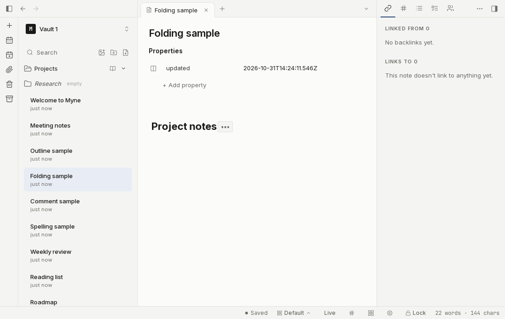

Folding lets you collapse a heading's whole section or a list item's nested children so a long note stays readable. You fold one region at a time from the arrow in the editor's left gutter, or collapse and expand everything at once with Fold all and Unfold all. Folds are ephemeral: they live only while the note is open and clear the moment you switch notes, lock, or quit.

## Folding a section or list

Hover the editor and a small fold arrow appears in the left gutter, next to any line that can be folded. Two kinds of line are foldable:

- A **heading** — folding it collapses its whole section, down to the next heading of the same or higher level.
- A **list item that has a nested sub-list** — folding it collapses only that item's children, leaving the item itself and any following siblings in place.

A flat, one-line bullet has nothing underneath it, so it shows no arrow; the gutter stays quiet on lines you can't fold.

Click the arrow to collapse the region. The folded text is replaced by a small inline `⋯` placeholder on the line. Click that placeholder to expand the region again. A line that is folded keeps its gutter marker visible even when you are not hovering, so you can always find a fold and open it back up.

## Fold all and unfold all

To collapse or expand every region in the note in one move, use **Fold all** and **Unfold all**. Both are in the command palette under the **Editor** category, and both have a keyboard shortcut (see Shortcuts below). Fold all collapses every heading section and nested list in the note; Unfold all opens them all back up.

[Find and replace](/user-guide/editor-and-writing/find-and-replace/) still works on folded text. When a match sits inside a collapsed region, navigating to it un-folds that region so you can see the result in context.

## Folds are not saved

Folding only changes how the open note is displayed; it never touches the note's content. Fold state is also not remembered. Switching to another note, locking the vault, or quitting Myne clears every fold, and the note opens fully expanded the next time you return to it.

This is deliberate, not a gap — there is no fold setting to configure and nothing about which sections you collapsed is written to disk.

## Limits

Fold state is intentionally never persisted. Myne keeps no field for it in your vault preferences or saved workspace, so collapsing a section is a view-only convenience that resets on the next note switch, lock, or quit. This is a durability bound on a display preference, not a privacy concern: there is simply nothing about your folds to save or to leak. Your note content is unaffected and continues to autosave as usual.

## Shortcuts

| Action | macOS | Windows / Linux |
|---|---|---|
| Fold all | ⌘⌥[ | Ctrl Alt [ |
| Unfold all | ⌘⌥] | Ctrl Alt ] |

Both shortcuts can be changed. They are listed in the Hotkeys catalog under **Editor formatting**, and a new chord applies to the open editor straight away — your cursor, scroll position, and undo history stay put. See [Customizing keyboard shortcuts](/user-guide/settings-and-privacy/custom-hotkeys/). Folding a single region has no keyboard shortcut — use the gutter arrow for that.
