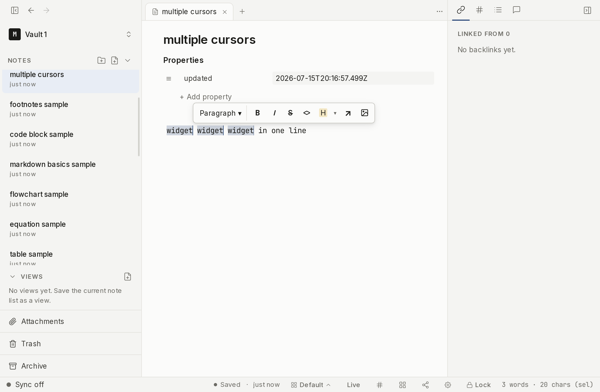

Sometimes the same edit belongs in several places at once. Myne lets you stack cursors on the lines above and below where you are, Alt-click to drop a cursor anywhere you point, or grow a selection to the next occurrence of a word so you can change every match together. When you are done, Escape collapses everything back to a single cursor. All of it lives in the editor body, on the keyboard and the mouse.

## Adding cursors

To stack cursors vertically, hold the add-cursor chord and press the down or up arrow: each press drops another cursor on the next line in that direction (see Shortcuts below). Once you have more than one cursor, typing lands the same edit at every cursor in lockstep, so the keystrokes you make go into each place at the same time.

To place a cursor somewhere that is not directly above or below, Alt-click where you want it. Each Alt-click adds one more cursor at the point you click, so you can build up a set of edit points anywhere in the note.

## Selecting the next occurrence

When you want to change the same word in more than one spot, first select the word, then press the select-next-occurrence shortcut. Myne extends the selection to the next occurrence of that word, leaving a cursor on each match. Press it again to add the occurrence after that, and so on; with several matches selected, what you type replaces all of them at once.

## Collapsing back to one cursor

Press Escape to collapse every cursor back to a single one. Myne shows no on-screen count of how many cursors are active, so when an edit starts landing in places you did not expect, Escape is the quick way back to one cursor.

## Shortcuts

| Action | macOS | Windows / Linux |
|---|---|---|
| Add cursor below | ⌘⌥↓ | Ctrl Alt ↓ |
| Add cursor above | ⌘⌥↑ | Ctrl Alt ↑ |
| Add cursor at click | Alt+Click | Alt+Click |
| Select next occurrence | ⌘D | Ctrl D |
| Collapse to a single cursor | Esc | Esc |
