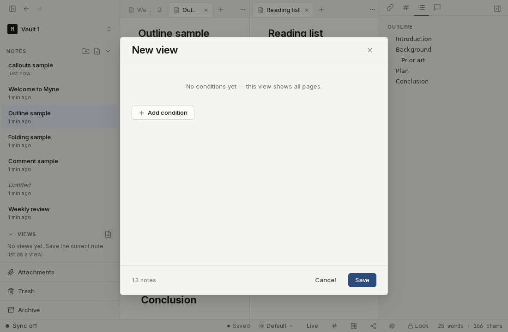

A saved view is a filtered, projected slice of your notes that you can return to from the left sidebar. The feature is off by default and you turn it on in Settings. You build a view from condition filters (tag, folder, or free-text search) and Myne renders the matching notes as cards, as a table, as a list, or as a board with one lane per value of a property you pick. You can also import view definitions from an Obsidian Bases `.base` file, and export or import one of your own as a `.myneview` file. A view is a projection over your notes, not a database: there is no formula language behind it. It is not quite read-only either, and the two places that matters are the board, where adding and moving a card write to notes, and the short list under **Fields this view can change**. Both are covered below.

## Turning views on

Views are off by default. Open **Settings → Editor → Features** and turn on **Views**. The helper line reads "Show the Views entry in the sidebar for saving filtered note lists. Off by default; on if you already have views." If your vault already has saved views, the entry shows without you turning anything on. The setting is stored on this device only, so each device decides for itself.

## The Views entry and its flyout

With views on, the left sidebar carries a compact **Views** row, a peer of the Attachments, Trash, and Archive entries at the foot of the sidebar. Two controls appear on the row when you hover it: a **+** button (**New view**) and a caret.

Click the row or the caret and a flyout opens to the right, listing every saved view in display order. It has a search box (**Search views…**) so a long list stays reachable; when nothing matches, it reads **No views match your search.** The view you currently have open carries a checkmark. Clicking a view row opens that view as a workspace tab. When you have no views yet, the list reads **No views yet. Save the current note list as a view.**

Right-clicking a view row in the flyout opens a menu:

- **Edit filter…**: reopen the filter builder for this view.
- **View settings…**: how the view renders, meaning its type, grouping, sorting, columns, and for a cards view its cover settings. It appears for every view type.
- **Rename**: edit the view's name in place.
- **Move up** / **Move down**: reorder the view within the list.
- **Delete view**: remove the view definition.

You can also reach the views from the **Views** button in the bottom bar, or with the **Browse views…** action in the command palette. Both expand the sidebar, scroll the row into view, open the flyout, and briefly highlight the row so the click always lands somewhere visible.

## Building a view's filter

A view's filter is composed in a filter builder modal — opened from the **+** button for a new view, or **Edit filter…** for an existing one. It works like a Notion- or Airtable-style set of condition groups.

- Each **condition** is a **Tag**, a **Folder**, or a free-text **Search**, with an **is** / **is not** toggle.
- Each **group** combines its conditions with **all** (every condition must match) or **any** (at least one must match).
- When you have more than one group, a top-level **all** / **any** combines the groups. That is the one level of nesting the builder offers.

As you compose, a live **N notes** count previews how many notes currently match. Saving with no conditions creates an all-pages view — every note, in recency order.

If a condition points at a tag or folder that no longer exists, it shows a quiet **unresolved** badge. The stored value stays visible and removable; a missing target simply matches nothing. A filter that was made with a more advanced editor than the builder can represent opens read-only, with a **Replace filter** button so you can deliberately start a fresh filter rather than have Myne silently reinterpret the old one.

Under the hood, the query layer is type-aware and follows a few fixed rules. Folder conditions are subtree-inclusive, so a folder also matches its sub-folders. There is no file-metadata or modified-time source to query against — only your notes' tags, folders, text, and typed properties.

## The cards view

A cards view renders the matching notes as a calm card gallery — not a kanban board. Each card shows an optional cover image, the note's title, and any display-column values formatted by their type. Cards are grouped under section headings, each heading carrying a per-group count, and the gallery is virtualized so a large result stays smooth. A note with no value for the grouping property lands under a **No value** group; a note whose grouping property holds a list of values appears under each matching group.

A card opens a note rather than editing it, apart from the cover control described further down:

- **Single-click** opens the note in the focused tab.
- **⌘-click** or **Ctrl-click**, or a **middle-click**, opens it in a new tab.
- **Alt-click** opens it to the side.

Right-clicking a card offers exactly four non-destructive actions: **Open**, **Open in new tab**, **Reveal in folder**, and **Copy link**. **Copy link** writes a wikilink to the clipboard and reports nothing either way, so check the clipboard rather than the screen. When no notes match the filter, the gallery reads **No notes match this view**.

## The table and list views

A view can also render as a table or as a list. You pick which in **View settings…**, and the choice is per view.

A **table** draws one row per note: a **Name** column with the note's title, then one column for each frontmatter property you added under **Columns**. A **list** draws one line per note, with those same properties as a quiet detail line under the title.

Both behave like the cards gallery in every other respect. They group under the same section headings with a per-group count, they sort the same way, they open notes with the same clicks (single-click in the focused tab, ⌘-click or Ctrl-click or middle-click in a new tab, Alt-click to the side), and they offer the same four-item right-click menu. Both open notes the way cards do. When nothing matches the filter, all three read **No notes match this view**.

## The board view

A board arranges the same matching notes as lanes instead of sections: one lane per value of the **Group by** property, and a card in each lane is the note whose property holds that value. It is the one view type that writes to your notes, and the writing is deliberately narrow.

- **A board with no lane property writes nothing.** A **Group by** of **None** renders the board's message instead: **This board has no lane property. Choose a property to group by in view settings.**
- **Adding a card.** Each lane header carries **Add a card to <lane>** while the grouped property is on the view's **Fields this view can change** list, because placing a card means writing that field. Where the field is not declared the control is not shown at all, which is the honest version: an action the app would refuse is not an offer. Adding creates an ordinary note, then writes the lane's value into it; if the view declares a **Template**, the new note's body starts from that template's body, and the template's own frontmatter is not copied. If the note was created but could not be placed, the board says so and names the reason rather than leaving a stray note you cannot see.
- **Moving a card.** Drag it to another lane and the grouped property is rewritten. A drop that is refused puts the card back and says why: **<reason>. The card is back in <lane>.** Selecting several cards with **Select <title>** and **Move <count>** moves them together.
- **Renaming a lane** rewrites that property on every card in the lane, in one action you can undo as one action, and it reports any card that refused instead of pretending the lane is uniform.
- **Lane order** is part of the view's definition, so reordering lanes is a view edit, not a note edit. A board whose lane order could not be saved says exactly that.

A card that is not being dragged shows nothing extra: the lane is the shape, and the note is still an ordinary note you can open, archive, or put in the trash from the card's own menu.

## Fields this view can change

**View settings… → Fields this view can change** is the whole write authority a view carries. Leave it empty and the view can change nothing; add a property and the board may write that property, and only that one.

There are three hard edges, and each of them is a refusal you will see rather than a silent failure.

- **Archived, deleted, and trashed are never offered.** Those are how the app takes a note out of the way, so a view that could set them could hide its own notes from the vault.
- **Every change is checked against the list before it is written**, and a change to a field that was edited somewhere else since the view last read it is refused rather than overwriting the newer value.
- **A field that is not a property in this vault is not offered.**

A view that arrived from another device or from a file starts out approved on the device that made it and not on this one. Until you approve it here, its definition is stored and it reads nothing.

## View settings and covers

**View settings…** decides how a view renders. The first four controls apply to every view type:

- **View type**: **Cards**, **Table**, or **List**.
- **Group by**: the frontmatter property whose value groups the results under section headings, or **None** for one flat run.
- **Sort by**: the property to sort on, or **None**. Pick one and an **Ascending** / **Descending** control appears beside it.
- **Columns**: "Frontmatter properties shown as columns (table) or as a detail line (list / cards)."

The last three appear for a cards view only:

- **Cover image property**: the frontmatter property whose value is an image, shown as each card's cover. Leave it empty for no cover. To show the covers you set on notes themselves, point this at `cover`, which is the property [Note covers](/user-guide/editor-and-writing/note-covers/) writes. Properties already in your vault are offered as one-click chips under the field.
- **Image aspect ratio**: **Default (16:9)**, **16:9 (wide)**, **3:2**, **4:3**, or **1:1 (square)**.
- **Card size**: a slider from 120 to 600 pixels (default 220), with a **Reset** button.

You can also set a cover on an individual note from its card. Hover the card and click **Set cover** (or **Change cover** if it already has one) to open the **Choose a cover image** modal. There you pick from a grid of images already in your vault, use **Upload** to add a new one, or drag and drop a file in. **Remove cover** clears the note's cover.

That writes the note's own `cover` property, the same one the note's banner uses, so a cover set from a card also appears above the note when you open it. [Note covers](/user-guide/editor-and-writing/note-covers/) covers it from the note's side.

## Importing an Obsidian .base view

If you have view definitions in an Obsidian Bases `.base` file, the command palette has an **Import .base view…** action (under the Vault category) that reads a single `.base` YAML file and turns its views into Myne saved views. This is import-only — Myne does not export back to `.base`.

The import is deliberately lossy, and it tells you exactly what it left behind rather than guessing. A filter clause Myne's query layer cannot represent is dropped, and the rest of that view is kept. A view whose entire filter drops is skipped rather than silently widened to "all notes". Top-level formulas, summaries, and property-display blocks are dropped — Myne has no formula language to honor them. When it finishes, a summary toast reports the tally, for example **Imported 3 view(s) · 1 skipped · 2 filters dropped**.

You can also turn a tag selection into a view without the builder. In the Tag browser, the active tag selection plus its AND/OR mode becomes a saved view through **Save as view**: each selected tag becomes a tag condition. A blank name falls back to a label derived from the tags, or **Filtered view** when there is nothing to derive from. A view made this way defaults to the cards type.

## Exporting a view, and importing one

**View settings… → Export saved view…** writes the view's definition as one `.myneview` file where you choose. The helper line is literal about what it leaves out: **Write the saved definition as a .myneview file somebody else can import. Changes you have not saved yet are not included.** View settings also shows the version the definition is at, and says there is nothing to edit there: the version moves forward on its own when you change the view.

To bring one in, open the command palette, run **Manage views…**, and press **Import view**. The dialog reads the file first and shows you what it selects and reads before anything is stored. What happens next depends on the file:

- **A view this vault does not have** is added, and it is kept at the version it arrived at.
- **A newer version of a view you already have** replaces the definition, and the replacement does not approve itself: it arrives needing your approval on this device, because what you approved was the version you were shown.
- **The same version, the same bytes** is a no-op that says nothing needs doing, so a file you download twice is not an error.
- **The same version with different contents** is refused. Either a different author reused the id, or the file changed after it was signed off, and neither is something to overwrite with.
- **An older version** is refused, with both versions named.

A file that is not a view this build can represent is refused with the reason stated, and nothing in the vault changes: it is not well-formed JSON, a required field is missing, it carries no version to compare, a field holds the wrong kind of value, it is larger than a view definition may be, it names a key this version of Myne does not know, or it would let the view change `archived`, `deleted`, or `trashed`.

The dialog also states the two things a view is allowed to be. A view describes what to show and **cannot run code**. A view's **Fields this view can change** list is the only thing it may write, and it is checked on every change. Read the list before you approve a file somebody sent you, exactly as you would read a filter.

## Limits

A saved view writes only inside two narrow permissions, and both are visible before they are exercised: it may change the properties listed under **Fields this view can change**, and a board may create an ordinary note and set its lane property. It never writes anything else. Its own definition lives inside the vault's encrypted preferences, and a view's name and filter are treated as sensitive: Myne never logs the name or the query itself, only operation counts.

Whether the sidebar shows the **Views** entry at all is a separate, device-local display setting stored outside the vault. It holds no view content — only a yes or no — which is why it does not travel to your other devices.

The query layer is a closed allow-list — tag, folder, search, and typed-property comparison, joined with and / or / not. There is no evaluatable expression, no arithmetic, and no code evaluation: Myne is not a database and has no formula language. This is why an unsupported `.base` clause is dropped rather than approximated, and why there is no modified-time query source.

When the vault is locked, a view has nothing to read, so it resolves to an empty result and its count shows 0 — never an error. How that fits the wider model is covered in [How Myne protects your notes](/user-guide/settings-and-privacy/privacy-model/). Until you turn on sync or name a remote AI provider, Myne runs entirely on your device; nothing leaves it.

## Shortcuts

| Action | macOS | Windows / Linux |
|---|---|---|
| Open command palette (then **Browse views…**, **Import .base view…**, or **Manage views…**) | ⌘K (alias ⌘P) | Ctrl K |
| Open a card's note in a new tab | ⌘-click / middle-click | Ctrl-click / middle-click |
| Open a card's note to the side | Alt-click | Alt-click |
