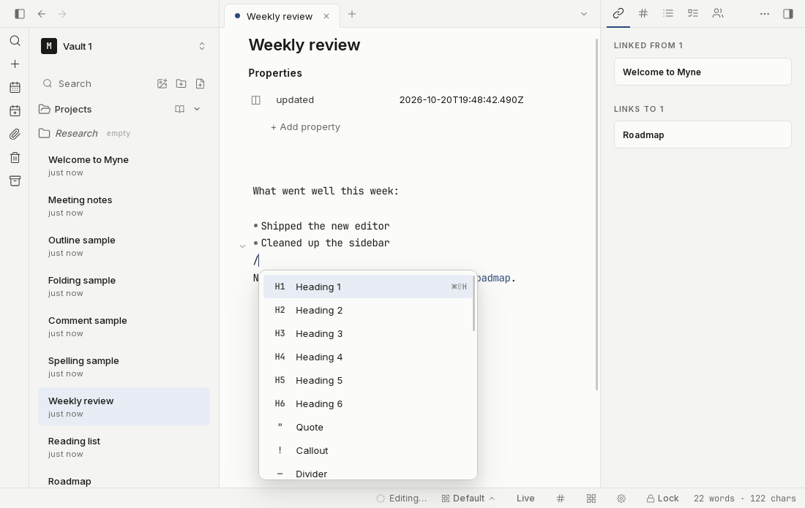

Typing `/` in the editor opens a menu of inserts and actions you can run without leaving the keyboard. You fuzzy-match a command by name, then press Enter to drop its result at the cursor. The menu covers structural inserts like tables and callouts, the wiki-link picker, file attachments and voice notes, and four date and time inserts. The date and time inserts write frozen plain text into the note — a stamp of the moment you ran the command, not a live token that updates itself later.

## Opening the slash menu

Type `/` at the start of a line or right after a space, tab, or line break. The menu opens below the cursor (or above it when there is no room below). Then type part of a command name to filter the list. The match is a substring match, ranked by the same scorer as the command palette (an exact name first, then a name that starts with what you typed, then a word inside the name), so `/cal` finds **Callout** and `/quo` finds **Quote**. Letters you skip do not count: `/td` matches nothing, and a query that matches nothing closes the menu.

- Press Enter to accept the top match. The list always re-highlights the best match as you type, so `/todo` then Enter inserts a to-do item with no arrow press.
- Use the up and down arrows to pick a different match, then Enter.
- Press Esc to dismiss the menu without inserting anything.

The menu does not open everywhere. Inside a code block, fenced or indented, inside an inline code span, inside an inline link's URL, or inside a wiki link, a `/` is treated as ordinary text and the menu stays closed.

## Inserting the date or time

Four commands stamp the current local date or time into the note as plain text:

- `/date` inserts the date as `YYYY-MM-DD` (for example, `2026-06-18`). Menu icon: a calendar.
- `/time` inserts the time as `HH:mm` on a 24-hour clock (for example, `09:30`). Menu icon: a clock.
- `/now` inserts both together as `YYYY-MM-DD HH:mm`. Menu icon: an alarm clock.
- `/day` inserts the long weekday name for today, localized to your system (for example, `Monday`). Menu icon: a sun.

All four read your device's local time, never UTC: a note stamped just after midnight in a positive time-zone offset reads today's local date, not yesterday's. There is no configurable format and no format mini-language — the layouts above are the only ones, by design.

What lands in the note is frozen plain text. It records the instant you ran the command and never changes afterward; reopening the note tomorrow leaves `2026-06-18` reading `2026-06-18`. This is different from a template token like `{{date}}`, which is evaluated once when a note is created from a template — the slash inserts share the same local-time formatting but produce ordinary text wherever your cursor is.

## Other slash commands

The menu also runs inserts and actions documented in their own articles:

- `/table` inserts an empty table and lands the cursor in the first cell.
- `/callout` starts a callout block you can title and re-type.
- `/wiki` opens the [wiki-link](/user-guide/find-and-connect/wikilinks/) picker to link to another note.
- `/attach` (**Attach file**) opens the file picker to bring in an [attachment](/user-guide/attachments-and-import/attachments/). The command palette carries the same action as **Attach file…**, under **Editor**.
- `/record` (**Voice note**) arms the microphone to record a [voice note](/user-guide/attachments-and-import/voice-notes/) inline.
- `/drawing` (**Drawing**) creates a [drawing](/user-guide/notes-and-organization/drawings/) beside this note and embeds it inline, where it opens into a canvas you can edit in place.
- `/due`, `/remind`, `/repeat`, and `/priority` add a field to the task on the current line. Each opens the same picker the task chip opens, and a line that is not yet a task is turned into one first. On a phone these four open the field editor as a bottom sheet, entered on the field the command named, with the list of the four fields one step back; on desktop and in the browser they open the panel beside the line.
- `/task` (**Task list**) opens the task-query builder, which composes the query block for you rather than leaving you an empty fence to fill in.

The same menu also carries the everyday formatting inserts — the six heading levels, quotes, dividers, links, bullet, numbered, and to-do lists — so you can apply them by name instead of typing the Markdown by hand. Two more commands, **Continue writing (AI)** and **Suggest title (AI)**, appear only once you have turned AI on; see [AI](/user-guide/ai/overview/).

## Limits

The date, time, and weekday inserts are plain text written into the note body. They are encrypted at rest exactly like the rest of your note — Myne stores no separate, unprotected timestamp for them. The clock value comes from your host machine's local time, and the weekday name follows your host machine's locale; there is no in-app format or locale setting to change either, which keeps these inserts inside Myne's closed-registry, no-scripting handling of note content. Because the result is frozen text, it does not track the real date and will not be corrected if your machine's clock was wrong when you ran the command.
