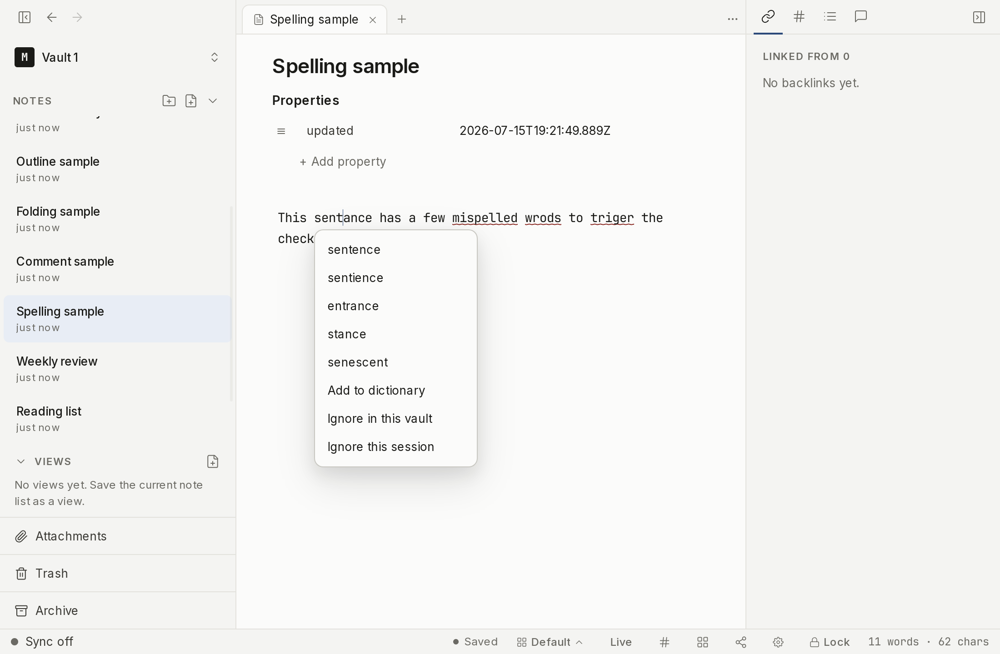

As you type, Myne underlines words it does not recognise with a wavy red line. The check runs entirely offline against dictionaries bundled with the app, so your note text never leaves your device — no operating-system speller and no cloud service is involved. Right-click a flagged word for up to five spelling suggestions, add a word to a personal dictionary so it stops being flagged, or ignore it. The picker in settings lets you choose from 22 bundled languages, and a word counts as correct if it is valid in any of the languages you have turned on.

## How spell check works

While you write, the checker flags each word it cannot find in your active dictionaries with a wavy red squiggle under it. The work happens in Myne's Rust core, against dictionaries that ship inside the app — nothing is sent over the network, and the editor does not fall back to your operating system's built-in speller. Spell check is on by default.

The squiggle is aware of Markdown, so it only checks the parts of a note where spelling matters. It skips code, frontmatter, the target of a [wikilink](/user-guide/find-and-connect/wikilinks/), plain URLs, and `#tags`, and it checks ordinary prose, including a wikilink's display text and alias. While your cursor is inside a word, the squiggle on that word is hidden, so a word you are still typing is not underlined mid-keystroke; the mark reappears once you move on.

A word is treated as correct if it is valid in **any** of the languages you have turned on, or if it is in your personal dictionary. There is no per-note language detection — the active languages are pooled together. That is what lets you drop English technical terms into a note written in another language without every English word being flagged.

## The correction menu

To act on a flagged word, right-click it, or place your cursor inside it and press `⌘.` (or `Ctrl .`). A small menu opens next to the word with up to five ranked suggestions at the top, followed by three actions that are always present:

- **Add to dictionary** adds the word to your personal dictionary so it is never flagged again in this vault. The personal dictionary is stored encrypted inside the vault, and it follows the vault: with sync on, a word you add here is added on your other devices too (see [Where the dictionary lives](#where-the-dictionary-lives)).
- **Ignore in this vault** silences the squiggle on that word and remembers the choice, without asserting that the word is spelled correctly. Use it for a name or term you do not want in your dictionary but do not want underlined either.
- **Ignore this session** silences the word only until you close the app. It is held in memory and never written anywhere.

Choosing a suggestion replaces exactly the flagged word with a precise edit and leaves the rest of the line untouched. Nothing changes until you pick something — the menu is never an auto-correct. If the checker has no suggestions for the word, the menu shows **No suggestions** above the three actions. Right-clicking anywhere that is not over a squiggle gives you the normal operating-system menu instead.

## Turning it on or off and choosing languages

Spell check lives in **Settings → Editor**. A **Spell check** toggle (**On** by default) turns the underlines on or off, with the helper line "Underline misspelled words as you type. Fully offline: your notes never leave the device." The command palette carries the same switch as **Toggle spell check**, under **Editor**, if you would rather not open Settings for it.

Below it, a searchable **Languages** picker lets you select one or more of the 22 bundled languages. Its helper line reads "A word is correct if it’s valid in any selected language. Handy for mixing English terms into other-language notes." Each language is listed under its own name rather than an English one, and the list is sorted by that name, so you search for `Deutsch`, not German, and `Русский`, not Russian. The bundled set is English (US), English (UK), Български, Català, Deutsch, Español, فارسی, Français, עברית, Magyar, Italiano, 한국어, Lietuvių, Latviešu, Nederlands, Polski, Português, Română, Русский, Slovenčina, Slovenščina, and Svenska. Turkish is not yet available.

Dictionaries are loaded only when a language is active, and they are bundled with the app — there is no language pack to download at any point. Adding more languages widens what counts as correct rather than narrowing it, because the languages are pooled.

## Where the dictionary lives

The personal dictionary and the vault-wide ignore set are stored inside the vault, encrypted, in `vault.dictionary`. That means they travel with it: with sync turned on, a word you add on one device arrives on the others, and a removal propagates the same way, usually within one sync round. A word you removed is remembered as removed even when no device still holds it, so it cannot creep back from a device that was offline when you deleted it.

On a **shared vault** there is one dictionary for everyone: a word you add or ignore applies to every member, and a word another member adds is correct on your device too. The words stay inside the encrypted vault, so the sync server only ever holds ciphertext, but the other members can read them, the same as they can read the notes.

If you reinstall an older build that predates dictionary sync, it will not read the newer dictionary: it leaves the file alone and treats the dictionary as unavailable until you update again. Nothing is deleted.

## Limits

The checker is fully local. There is no network call, and the operating system's own speller and any cloud speller are never used — the decrypted text of your note stays inside the Rust core, which is the same posture as full-text search. Until you turn on sync or name a remote AI provider, Myne runs entirely on your device; nothing leaves it. With sync on, the encrypted dictionary is part of what syncs.

Words you add to your personal dictionary and words you ignore for the whole vault are stored encrypted at rest, inside the vault, and are held in memory only while the vault is unlocked; they are cleared from memory when you lock. A word you ignore for the session only is kept in memory and is never written to disk. Because dictionaries ship inside the app and are never fetched at runtime, the language you write in is not revealed by a download. None of this is a security feature of the note itself — it is about keeping the speller from leaking your text. How the note is protected is covered in [How Myne protects your notes](/user-guide/settings-and-privacy/privacy-model/).

## Shortcuts

| Action | macOS | Windows / Linux |
|---|---|---|
| Open the correction menu for the flagged word under the cursor | ⌘. | Ctrl . |
