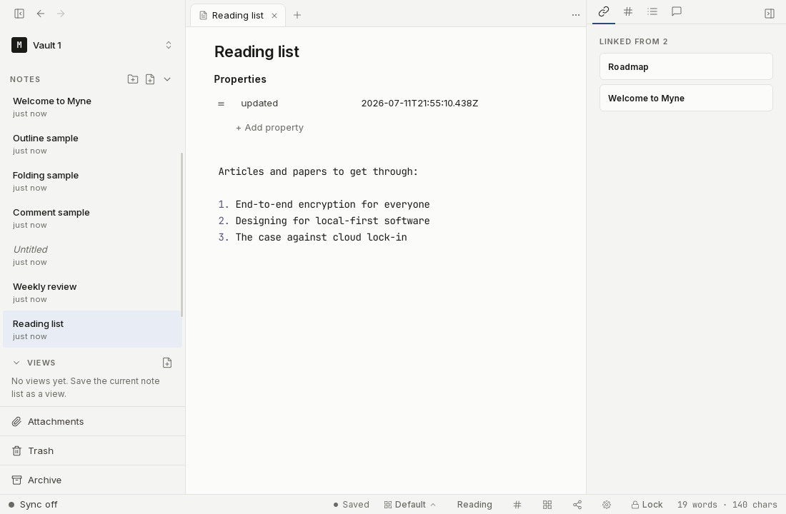

Every note tab can render in one of three view modes — Live preview, Reading, or Source — over the very same content. You can switch a tab's mode at any time, set which mode new tabs open in, and while a tab is in Source mode you can open a read-only preview of the rendered note beside it. Switching modes only changes how the note is shown; it never rewrites what is stored.

## Live preview, Reading, and Source

A note tab is always in one of three modes:

- **Live preview** is the default. It is the cursor-aware editor you write in: markdown renders as you go, and the raw syntax lifts back into view where your cursor is, so you edit the markup in place. How much lifts depends on the mark. A bullet's disc and a heading's `#` come back only when the cursor is on the marker itself, so editing the text of a list item leaves the disc alone; a numbered list's `1.` and most inline marks come back for the whole line your cursor is on. A colored highlight always lifts as `==text==`, never as the underlying HTML it is stored as.
- **Reading** is the fully rendered, read-only view. Markdown never lifts — everything stays rendered — and keystrokes are no-ops, so it is a clean way to read a note without touching it.
- **Source** shows the raw markdown verbatim, with the live-preview rendering decorations turned off. It is still fully editable, and syntax colouring stays on, so you are editing coloured plain markdown.

All three are views over the same buffer. Switching a tab between them never changes the note's stored `.myn` bytes — it changes only what you see.

## Switching a tab's mode

Each tab remembers its own mode, so two tabs of different notes can sit in different modes at the same time.

- The **view-mode button** in the bottom bar shows the current mode (Live, Reading, or Source). Click it to cycle Live preview → Reading → Source → Live preview. You can hide this button through bottom-bar customization (the **View mode** item).
- The command palette has **Toggle reading view** (switches the focused tab between editing and Reading) and **Toggle source mode** (switches the focused tab between Live preview and Source).
- **Toggle reading view** also has a keyboard shortcut — see [Shortcuts](#shortcuts) below. Toggle source mode has no default shortcut; reach it from the palette or the bottom-bar button.

## Setting the default view mode

To choose which mode new tabs open in, go to **Settings → Editor → Default view mode** and pick one of the segmented options: **Live preview**, **Reading**, or **Source**. The helper text reads: "How a note opens: Live preview (default), read-only Reading, or raw Source. Toggle a note with ⇧⌘E."

This sets the starting mode for tabs you open from now on. Tabs that are already open keep whatever mode they are in — changing the default does not reach back and re-mode them.

## Side-by-side preview while editing source

While a tab is in **Source** mode, a **Toggle side-by-side preview** button appears in the bottom bar. It opens a read-only Reading view of the same note beside your source, so you can see the rendered result as you edit the markdown.

The preview is a linked mirror of the same buffer, not a second editable copy — you still edit in the Source pane, and there is only ever one editable instance of the note. The preview only makes sense in Source mode, so it auto-hides when you leave Source (in Live preview the rendering is already inline, and Reading is itself the rendered view).

## Limits

View modes are a presentation choice. Switching a tab between Live preview, Reading, and Source — and the side-by-side preview — never mutate the note's stored bytes.

Your **Default view mode** preference lives inside the vault's encrypted preferences, and each tab's own mode rides inside the encrypted workspace state that Myne restores when you unlock. Neither is written in plaintext, and neither leaves your device. Until you turn on sync or name a remote AI provider, Myne runs entirely on your device; nothing leaves it.

## Shortcuts

| Action | macOS | Windows / Linux |
|---|---|---|
| Toggle reading view | ⇧⌘E | Ctrl Shift E |
