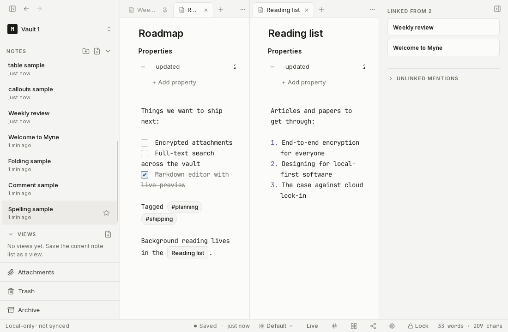

Backlinks answer the question "what links here?". While you read a note, the backlinks pane in the right sidebar lists every other note that links to it. It is the reverse of the wikilinks you write.

## The backlinks pane

The pane is headed **Linked from N**, where N is the number of notes that link to the one you're reading. Each row is a linking note, with a count of how many times it links here. Click a row to jump to that note. When nothing links to the current note, the pane reads **No backlinks yet.**

The list refreshes as you work: add a link in another note and this note's backlinks update to match.

## What it shows

Each row names the source note; it does not show a snippet of where the link sits. As in search, results never decrypt your notes just to preview them. A note linking to itself is not listed, since a backlink is always from another note. Links from notes in the Trash don't count, because trashed notes are set aside.

## Limits

Backlinks follow **resolved** wikilinks only: a link to a note that doesn't exist yet creates no backlink (see [Wikilinks](/user-guide/find-and-connect/wikilinks/)). Backlinks are within the current vault.
