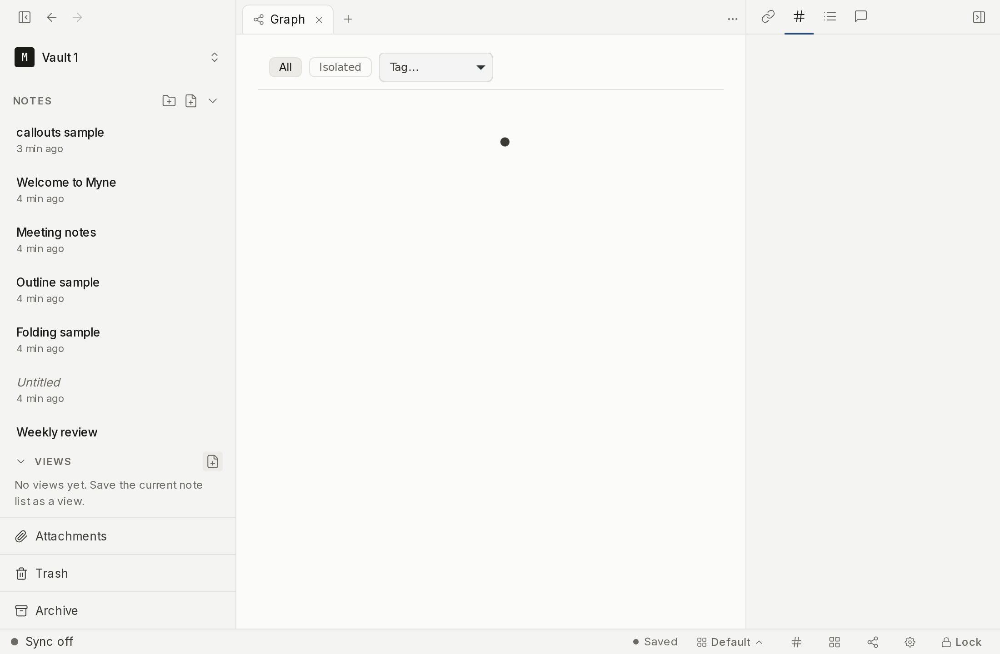

The graph view draws your vault as a map: each note is a dot, and each link between notes is a line. It is a way to see structure: clusters, hubs, and the notes nothing points to.

The graph opens as its own workspace tab, a peer alongside your note tabs and [saved-view](/user-guide/editor-and-writing/saved-views/) tabs. There is exactly one graph tab: opening the graph again reveals the existing one rather than stacking up duplicates. It stays open as a tab while you navigate elsewhere, and is part of your saved workspace, so it comes back when you reopen the vault or switch [named workspaces](/user-guide/notes-and-organization/named-workspaces/).

## Opening the graph

Open it from the left ribbon, from the command palette (**Show graph view**), or with `⌘⇧G`. Any of these opens or reveals the single graph tab.

## What's on it

- **Nodes are notes, plus tags.** In the whole-vault view a tag that a colour group claims becomes a node of its own: a coloured hub in the middle of the notes carrying it. Folders and attachments are not nodes. The tag-filter, local and isolated views stay notes-only.
- **Edges are resolved links.** A line is drawn for each resolved wikilink, pointing from the note that links to the note it links to. An unresolved link (to a note that doesn't exist yet) draws no edge.

## Focusing the view

Filter chips narrow what's shown:

- **All**: the whole vault.
- **Isolated**: only notes that neither link out to anything nor are named by another note, so you can find what's disconnected and wire it in.
- **Around this note**: just the neighborhood of the note you have open, out to one or two hops (toggle the depth between 1 and 2). This chip appears once you have a note selected.
- **Tag**: a dropdown that narrows the graph to notes carrying a tag, counting nested tags under their parent. It appears once the vault has at least one tag.

A large vault is drawn in full: there is no note limit on the graph. What keeps it usable is that the layout is computed off the main thread and does not block the window, the renderer draws only what is on screen, and labels appear once you zoom in far enough to read them.

Whatever the filter, the count of notes now showing is announced, so a screen reader hears what a filter did rather than discovering it by counting.

## Moving around

How a click behaves depends on the mode. In most modes, clicking a node opens that note in a new tab, so the graph tab stays put and you can keep coming back to it. In "Around this note", clicking a node instead re-centers the view on it; double-clicking a node opens that note in a new tab.

The graph is **live** rather than a picture that is drawn once. It settles when you open it, and it keeps responding after that:

- **Dragging a node moves its neighbours with it.** The note you are holding stays under the pointer, and the notes it is linked to are pulled along, because the links are springs rather than decoration.
- **Letting go sets the node free.** It does not stay pinned where you dropped it; its links pull it back toward them. That makes what you see an honest picture of what is connected to what, rather than a picture you have rearranged by hand.
- **Hovering a node highlights it, its neighbours, and the links between them**, and fades everything else. That is how you read one note's local structure without leaving the graph or opening anything.
- **The view animates when it frames itself**, so the graph does not jump under you.

If you have asked your system for reduced motion, none of that animates: the graph settles, frames and repaints without moving, and the hover highlight appears immediately rather than fading in.

The layout settles and then stops, so an idle graph costs nothing.

The arrangement is saved, so reopening the graph (including after a restart) brings back the picture you left rather than laying it out afresh. When you've changed your vault and want the graph to catch up, use **Refresh** to rebuild it.

## Reading the graph without a mouse

A canvas of dots cannot be read by a keyboard or by a screen reader, so the same view is available as text. The **List** button in the graph's header swaps the picture for a list of the notes that are showing:

- one row per note, ordered with the most connected first;
- each row states the note's title, how many links it has, and which notes it links to and which link back to it;
- activating a row opens that note, exactly as clicking its dot would.

Rows are ordinary buttons, so `Tab` reaches them and `Enter` opens the note. The arrow keys move between rows when you are in the list. A note with no title shows as "Untitled note" rather than as a blank row.

Because it is generated from the same view the picture draws, switching filters updates both. And because the list is text rather than a canvas, choosing it means the graph's drawing code is never even loaded.

## Coloring notes by rule

Colour groups let you tint nodes by rule, so clusters are separable at a glance: work notes in one color, reading notes in another. Until you author any, the graph is coloured for you by tag, and a tag with a colour group becomes a **tag node**: a coloured hub with its notes around it. That default is not saved. Press **Make these editable** in the panel to turn it into rules you can change.

Open the **Graph settings** panel from the gear in the graph's floating control cluster at the top of the pane, then find the **Color groups** section. Each rule pairs a filter with a color:

- **Add rule** creates one; name it and pick a color from the fixed palette (Olive, Fern, Teal, Denim, Indigo, Violet, Orchid, Rose). The palette is theme-aware, so the colors stay legible in light, dark, and AMOLED themes and follow a custom theme's overrides.
- **Edit filter…** opens the same filter builder that [saved views](/user-guide/editor-and-writing/saved-views/) use. For now a rule matches on **tag** or **folder**; a [tag](/user-guide/find-and-connect/tags/) condition counts nested tags under its parent, the way the graph's tag filter does.
- A note takes the color of the **first rule it matches**, read from the top down. Drag a rule by its handle to reorder it: order is precedence, so a rule higher in the list wins a note that more than one rule matches.
- The switch on each rule turns it off without deleting it, so you can check the graph without that grouping. A note that matches no enabled rule keeps the neutral color.

Color groups apply the same way in every view: the whole vault, a tag filter, and **Around this note**. Changing a rule's COLOR recolors the graph in place and does not re-run the layout, so you keep the arrangement you were looking at. Adding, removing or disabling a rule that groups by a tag is the one exception: it adds or removes a tag node, so the graph settles once into the new shape (keeping every note where it was).

Color-group rules are stored as encrypted content in your vault, alongside your other preferences. Until you turn on sync or name a remote AI provider, Myne runs entirely on your device; nothing leaves it. With sync on, your rules travel to your other devices with the rest of your vault, and the server sees only that a preferences blob changed, never the rule names or the tags and folders they reference. The default by-tag coloring is NOT stored: it is derived as you look at it, and it becomes stored rules only when you press **Make these editable**.

## Tuning the layout and appearance

The same **Graph settings** panel holds controls for how the graph is drawn. It floats over the canvas instead of splitting the pane, so opening it never re-arranges the graph beneath it, and every control previews as you change it.

- **Direction arrows on hover** draws an arrowhead on the hovered note's own edges, pointing from the note that links out to the note it links to, so you can read which way a link runs rather than only that one exists. Arrows are hidden until you hover, and appear only once you have zoomed in far enough to read them.
- **Appearance** groups **Label fade** (how far you zoom before labels appear), **Node size** (the base dot size), **Size by connections** (how much a note's dot grows with the number of links it has, so hubs stand out), and **Line thickness** (edge width).
- **Forces** groups **Center pull**, **Repel**, **Link strength**, and **Link distance**: the force-layout constants, for loosening a cramped graph or drawing a scattered one together. Moving one settles the graph into the new shape; it does not rebuild it from scratch.
- **Reset to defaults**, in the panel's header beside the close control, returns every appearance and force control to its starting value.

These settings stay on this device. They are not part of what syncs, so a phone-appropriate layout never overwrites your desktop one. They are written when you close the vault or quit normally; a change made and then lost to a force-quit may not be kept.

## Private by design

The shape of the graph (which notes exist and which links join them) is derived in memory from your notes each time it is built; there is no second copy of your links on disk. What is saved is the arrangement: where the layout settled, and where you dragged nodes, goes into an encrypted file inside your vault (a tag node's position included), so reopening the graph brings back the picture you left. That file stays on this device, is not synced and is not part of a backup, and Myne rebuilds it from your notes if it is missing. (The search index is a separate stored, encrypted cache; see [Search](/user-guide/find-and-connect/search/).)

The list view is a way of reading the same graph, not a second copy of it: it is generated as you look at it and nothing about it is stored. It is available on the desktop clients; the mobile graph is the picture alone.

## Limits

The graph draws **resolved** wikilinks only, but **Isolated** counts links as you wrote them. A note whose only links point at notes that don't exist yet therefore draws no lines in **All** and is still not listed under **Isolated**: it has links, they just don't land anywhere. Use it to find notes you never wired in, not to find broken links.

Folders and attachments are not nodes, so a set of notes grouped only by folder looks unconnected here even though the sidebar groups them. A tag does become a node in the whole-vault view, so a set of notes grouped only by tag reads as one hub with its notes around it.

The saved arrangement is a convenience, not a stored document. Losing it costs a fresh layout and none of your content: the notes and their links are the source of truth, and the positions are rebuilt from them.

A dragged node springs back when you let go, so the graph is not a place to assemble a permanent diagram by hand. What it is for is reading the shape your links already have.

## Shortcuts

| Action | macOS | Windows / Linux |
|---|---|---|
| Show graph view | ⌘⇧G | Ctrl Shift G |
