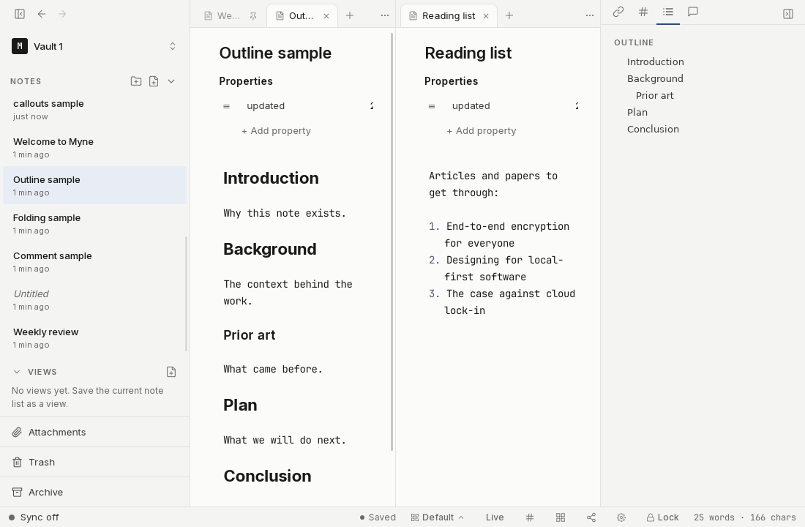

The outline tab shows the heading structure of the note you're reading, as a table of contents. Click any heading to jump to it in the editor. For a long note, it is the fastest way to see the shape of the note and move around inside it.

## Opening the outline

Outline is one tab in the editor's multi-tab right panel, alongside [Links](/user-guide/find-and-connect/backlinks/), [Unlinked mentions](/user-guide/find-and-connect/unlinked-mentions/) and Tasks.

1. If the right panel is hidden, show it with the sidebar toggle in the title bar — it appears there while a note is open — or run **Toggle backlinks sidebar** from the command palette.
2. In the tab strip along the top of the panel, click the Outline tab. Each tab is an icon; hover to read its label.

## Reading and using the outline

Every Markdown heading in the note becomes a row, indented by its level so the nesting is visible: a `#` top-level heading sits at the left edge in bold, and deeper `##` and `###` headings step inward. Click a row and the editor scrolls to that heading. The same headings are the targets a `[[note#heading]]` link points at, so the outline and heading links describe the same structure.

A heading that has subheadings under it carries a small chevron: click it to fold that part of the outline away, and again to bring it back. Folding changes the outline only — it never touches the note — and it resets when you open a different note.

As you move through the note, the heading you are currently under is highlighted, and the list scrolls to keep it in sight. If that heading is folded away, the highlight moves up to the collapsed heading containing it, so you can still see where you are.

If the note has no headings, the tab reads **No headings**.

The outline is built from Markdown headings only — lines that start with one or more `#` characters. Text you have merely made large or bold is not a heading and does not appear.

## Limits

The outline refreshes from the saved note rather than from each keystroke, so a heading you just typed appears once autosave has flushed — a sub-second lag, not an instant redraw. It reflects the current note only, and only its heading lines; it is a navigation aid, not a separate stored document.
