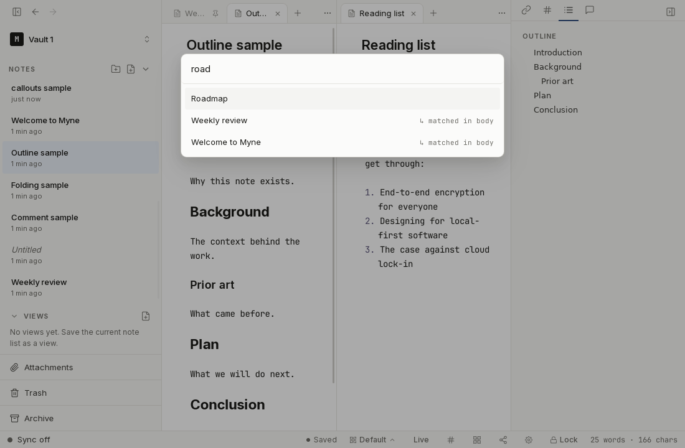

Search lives in the command palette. Press `⌘K` (or its alias `⌘P`) to open it: it shows commands first, and as you type it searches the full text of every note in your vault.

## What it searches and how it ranks

Search covers each note's title and body, and ranks results by relevance (using BM25). A few specifics worth knowing:

- **All your terms must match**: typing two words finds notes containing both.
- **The last word matches as a prefix**, so results narrow as you type `rus` → `rust`.
- **Title matches rank higher** than body-only matches.
- Results are capped at the top matches, so the list stays focused.
- Search understands word stems in **English, Turkish, and German**: searching "running" also finds "run". Other languages match on the exact words.

Results update live as your notes change, because the index keeps up with your edits.

## Search operators

A plain query — one or more words with no special syntax — uses the ranked search described above. Adding an operator, a boolean, or a quoted phrase switches search into a filter: it keeps every note that matches and drops the rest, rather than ordering the whole vault by relevance.

### Field operators

Prefix a term with one of these to match a specific part of a note:

| Operator | Matches |
|---|---|
| `file:` | the note's **title** (`file:roadmap`) |
| `content:` | a word anywhere in the note's **text** (`content:invoice`) |
| `tag:` | notes carrying a **tag** (`tag:rust`) |
| `path:` | notes in a **folder** (`path:Projects/Rust`) |
| `task:` | notes with a **task** item; `task:` alone matches any note that has one, `task:review` narrows to tasks containing a word |

Put quotes around a value that contains a space: `tag:"reading list"`. A prefix Myne doesn't recognize (`note:`, `http:`) is treated as ordinary search text, so pasting a link never breaks the query.

### Combining terms

- **Several terms match together.** `rust async` finds notes containing both — the same implicit "and" as plain search.
- **`OR`** (uppercase only) matches either side: `rust OR zig`. Lowercase `or` is just a word to search for.
- **`-`** excludes: `rust -async` finds notes with "rust" but not "async", and it works on operators too, as in `-tag:archive`.
- **Parentheses** group: `(rust OR zig) -tag:draft`.
- **"Quoted phrases"** keep words together: `"quarterly review"`.

These compose, so `tag:reading -tag:done "to read"` is one query. A malformed query — an unclosed quote or bracket — falls back to plain text, so a stray character never breaks the search box.

## Attachment text

Where Myne can read text out of a file you have attached, that text is folded into the owning note's searchable content. A note can then turn up in search on words that appear inside its attachment, not only its own prose, and it surfaces the same way a body match does.

Text extraction happens entirely on your device — no file is ever sent anywhere to be read. It covers the text layer of PDFs, Word `.docx` files, and plain-text files such as `.txt`, `.md`, and `.csv`. Scanned PDFs and images have no text layer, so Myne reads them with on-device optical character recognition instead: a background worker — separate from the unlock path, so it never slows opening your vault — recognizes text in image attachments and scanned PDFs and folds it into search the same way. No file is sent anywhere to be read, and there is no cloud recognition step. Recognition is on by default; you can turn it off for a device under Settings → Files, with the "Search inside images and scanned documents" switch, which stops the extraction while keeping any text already found. Audio has no text layer either, but if you turn on [on-device AI](/user-guide/ai/overview/) you can transcribe a voice note on demand, and that transcript is folded into search the same way — see [Voice notes](/user-guide/attachments-and-import/voice-notes/#transcribing-a-voice-note). The extracted text is stored encrypted at rest, under the same protection as the rest of your vault, and is removed when you permanently delete the attachment.

## What a result shows, and what it doesn't

Each result shows the note's **title**. If a note matched only in its body, it carries a small **↳ matched in body** hint so you know why it's there. A match inside an attachment's text surfaces the note through the same body-side path.

What you never see is a snippet of the note's text. That is deliberate: results never decrypt your notes just to preview them. The search index holds what it needs to rank matches, not readable copies of your content, so a result list can't leak a line you'd rather keep closed.

Notes in the Trash and notes marked as templates are hidden from the sidebar and never appear in search results. Search also returns nothing while the vault is locked; there is no index to read until you unlock.

## Private by design

The search index — including any extracted attachment text — is encrypted like your notes; if it's ever missing, Myne rebuilds it, which costs one slower unlock and nothing more. How that fits the wider model is covered in [How Myne protects your notes](/user-guide/settings-and-privacy/privacy-model/).

This is the in-app search; the search box on this website is separate and only searches these guide pages.

## Limits

Search reads the vault's own encrypted index and only what has been indexed. Attachment text is included where a text layer exists and, for image attachments and scanned PDFs, where on-device optical character recognition finds legible text — both run entirely on your device, with no cloud extraction. Recognition is best-effort: a blurry photo, handwriting, or a very small image may yield nothing, and text the recognizer is not confident about is dropped rather than guessed. Results never carry a decrypted snippet of your content, and search is empty while the vault is locked.

## Shortcuts

| Action | macOS | Windows / Linux |
|---|---|---|
| Open the command palette / search | ⌘K (alias ⌘P) | Ctrl K (alias Ctrl P) |
