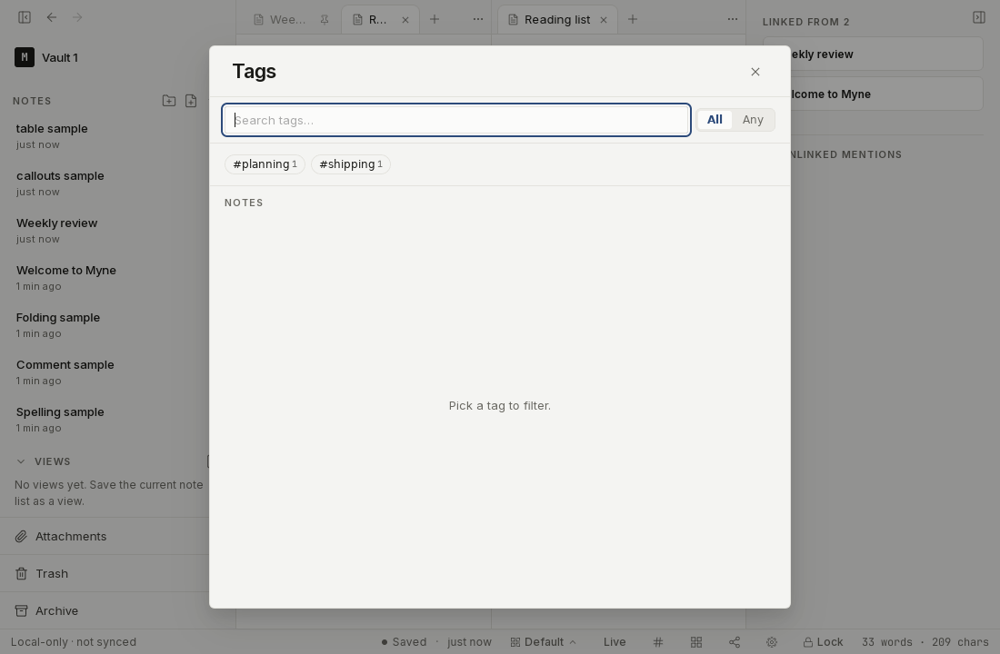

Tags are a lightweight way to group related notes (`#project`, `#reading/2026`), written inline in your text. This article is about what tags *do*; the exact syntax for writing one is in [HTML and inline extras](/user-guide/markdown/html-and-inline-extras/#tags).

## How Myne indexes tags

Myne reads the tags across your notes and treats them as structured metadata:

- **Tags fold for matching.** `#Project` and `#project` are the same tag: matching folds case, and treats the different ways of encoding an accented character as one. It does not remove accents — `#café` and `#cafe` stay two tags.
- **Tags nest with slashes.** `#area/topic` is a tag in its own right, and it also counts under its parent `#area`, so grouping by `#area` includes everything beneath it.

Both the inline `#tags` you write in the body and a frontmatter `tags:` list feed this same index.

## Where tags surface

Tags are interactive in a few places:

- **In a note, a `#tag` renders as a chip.** When the cursor is elsewhere, each inline tag shows as a chip; clicking it opens the tag browser filtered to that one tag. To edit a tag, move the cursor into it (the chip turns back into plain text) or delete and retype it.
- **The tag browser** lets you browse and filter by tag across the whole vault (below).
- **The graph view** has a tag filter that narrows the graph to notes carrying a tag (and its nested children). See [Graph view](/user-guide/find-and-connect/graph-view/).

## The tag browser

Open the tag browser from the command palette ("Browse tags…") or the **tags button** in the bottom bar. It lists every tag in the vault and lets you build a filter:

- **Select one or more tags** by clicking their chips. A search box narrows the chip list as you type, folding case the same way the index does.
- **Combine with All or Any.** With **All**, a note must carry every selected tag (AND); with **Any**, carrying any one of them is enough (OR). Selecting `#area` includes notes tagged with its nested children, matching the index.
- The matching notes appear in a list below; clicking one opens it.

When you type `#` in the editor, Myne also suggests existing tags that match what you've typed so far. The suggestions are tags that already exist — picking one inserts it. Typing a tag that doesn't exist yet stays plain text and gets indexed on save like any other inline tag.

### Save a tag filter as a view

With one or more tags selected, **Save as view** turns the current selection (and its All/Any setting) into a saved view, so you can return to the same filtered set later. See [Saved views](/user-guide/editor-and-writing/saved-views/).

## Limits

The tag browser and the editor `#tag` chips browse by tag, but tags are not folders: a note keeps its place in the tree regardless of how it's tagged. The browser reads Myne's tag index. That index is held in memory while the vault is unlocked and written into an encrypted index file in your vault when you lock or quit, so it is a stored cache — encrypted like your notes, and rebuilt from them if it is ever missing or behind. Selecting tags in the browser filters notes, but does not change them — the only way to add or remove a tag is to edit the note's text.
