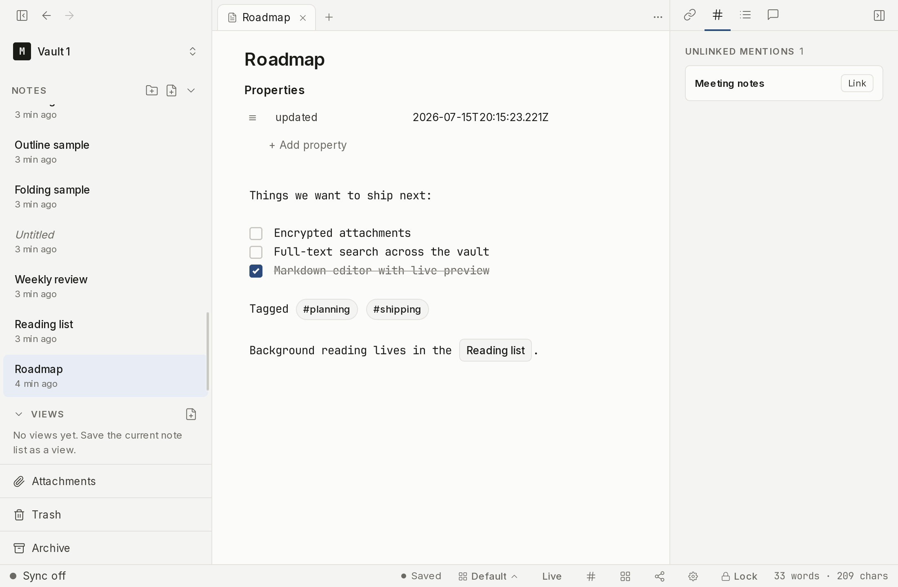

An unlinked mention is a note that writes the current note's title in its prose but never links to it. Myne can surface these so you can turn a passing mention into a real connection.

## Finding mentions

Unlinked mentions is one tab in the editor's multi-tab right panel, alongside [Backlinks](/user-guide/find-and-connect/backlinks/) and [Outline](/user-guide/find-and-connect/outline/).

1. If the right panel is hidden, show it with the sidebar toggle in the title bar, or run **Toggle backlinks sidebar** from the command palette.
2. In the tab strip along the top of the panel, click the Unlinked mentions tab. Each tab is an icon; hover to read its label.

Switching to the tab is what starts the scan, so reading a note never does this work in the background. When it is the active tab, Myne looks for other notes that mention this note's title. If new matches may have appeared since, a **refresh** action lets you re-run the scan.

Matching is by whole words and is not case-sensitive, so "Project Apollo" mentioned mid-sentence is found, but a title buried inside a longer word is not. Very common or very short titles are held back from the list, so the tab stays useful rather than flooding with noise.

## Linking a mention

Each mention has a **Link** action that turns that occurrence into a proper wikilink, writing the link into the mentioning note for you. It edits through the normal save path, so it won't overwrite unsaved changes in another open note; if there is nothing to change, the row simply stays put.

Once a mention is linked, it becomes a [backlink](/user-guide/find-and-connect/backlinks/) and drops off the unlinked-mentions list.

## Limits

Unlinked mentions are a suggestion surface, not an index: they are scanned on demand when the tab is active, not maintained continuously. They match on title text within the current vault.
