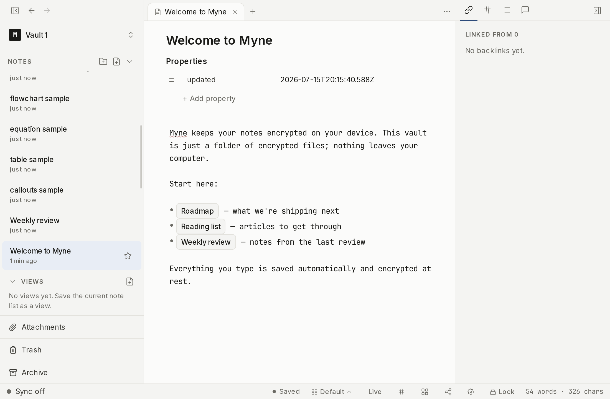

A wikilink connects one note to another inside your vault. You write it in double brackets, and Myne turns the connection into something you can use in three places. This article is about what wikilinks *do*; the exact syntax (aliases, headings, paths, embeds) is in [Footnotes and reference links](/user-guide/markdown/footnotes-and-reference-links/#wikilinks).

## What a link does

Write `[[Another note]]` and Myne renders it as a chip you can read past, and the link starts working:

1. **In the editor**: the chip stands in for the bracketed text, so the prose stays clean.
2. **In backlinks**: the linked note gains an entry pointing back to yours (see [Backlinks](/user-guide/find-and-connect/backlinks/)).
3. **In the graph**: the link becomes an edge between the two notes (see [Graph view](/user-guide/find-and-connect/graph-view/)).

## Resolved and unresolved links

A wikilink to a note that exists is **resolved**: it points somewhere, powers a backlink, and draws a graph edge. A link to a note that doesn't exist yet is **unresolved**. Myne keeps the text exactly as you wrote it, but with nothing to point at, it doesn't create a backlink or a graph edge. Create a note with that title and the link resolves.

## Link to a folder

Add a trailing slash and the link targets a folder instead of a note: `[[Projects/]]` resolves to that folder's index note. The slash is the only thing that tells the two apart — `[[Projects]]` looks for a note titled "Projects", `[[Projects/]]` looks for the folder. A resolved folder link behaves like any other resolved link: it powers a backlink and draws a graph edge, pointing at the index note that stands in for the folder. See [Folder notes](/user-guide/notes-and-organization/folder-notes/) for how a folder gets an index note.

A folder link can break in two ways, and the chip's hint tells you which. **`(no folder note)`** means the folder exists but has no index note to point at — give the folder one and the link resolves. **`(no match)`** means no folder by that name exists, the same broken state as an unresolved note link.

## Jump to a heading

A wikilink can point past a note's title to a spot inside it. Write `[[Note#Heading]]` and following the link opens the note and scrolls to that heading; the chip reads `Note › Heading` so you can see where it lands. If the heading isn't there — it was renamed or removed — the link still opens the note, just at the top rather than failing.

While you type a link, three prefixes help you fill in what comes after the note. `[[#` lists headings in the **current note**; `[[##` lists headings across the **whole vault**, so you can deep-link into another note without leaving your place; and `[[^^` lists the `^block-id` anchors that came in with an [imported Obsidian vault](/user-guide/attachments-and-import/import-from-obsidian/), so you can link to a marked line without remembering its id. Following one of these links scrolls to the anchor, opening the target note first when the link points somewhere else. Myne never mints new block-ids of its own, so headings are the anchor you author here.

## Limits

Wikilinks connect notes within the **current vault** only; there are no links across vaults. Resolution is by the note's title or vault path, as described in the syntax reference.
