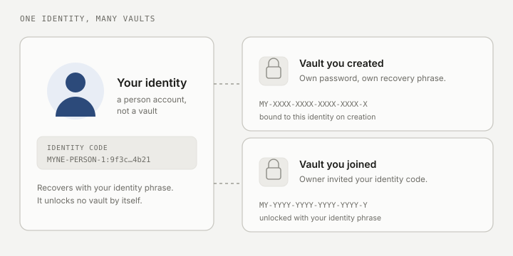

An **identity** is your person in Myne: the thing other people invite to a vault, and the thing that can own several vaults. It is separate from any vault. A vault is a folder of encrypted notes with its own password and its own recovery phrase; an identity is who you are, and it is what makes you reachable. Creating one is offered first on a fresh Myne, because it is the model the product is built around.

## Why creating an identity asks for a server

Myne has no email and no account sign-up. The way someone reaches you is not an address in a company's directory; it is a person account you register on a sync server, addressed by an identifier derived from your identity phrase. So creating an identity is the one first-run step that needs a server: Myne asks you for a sync server address before it can register you.

Set the address and press **Connect**. If the server uses `https`, Myne pins its certificate and shows you the fingerprint so you can compare it across your devices; a self-hosted server and a hosted one are the same trust boundary to Myne, and your notes are encrypted on your device before they leave it either way. The server stores ciphertext.

If you would rather not use a server at all, choose **Create a local vault instead** on the first screen. You get a normal vault with no identity, and nothing leaves your device. You can add an identity whenever you want later, from **Settings → Sync**.

## The identity phrase

Creating an identity shows you a 24-word **identity phrase**. It is not the same phrase as a vault's recovery phrase, and it does not unlock your vault. The two are deliberately independent:

- **The identity phrase** recovers your identity: it is how you prove you are you when you accept an invitation, and how you recover the identity on a new device.
- **A vault recovery phrase** recovers one vault's master key. Each vault you create has its own.

Keep both, and do not confuse them. Losing the identity phrase means losing the identity and every invitation addressed to it; it does not mean losing a vault, which still opens with its own password or its own phrase.

The identity phrase is shown once. Myne hides it until you reveal it and hides it again if you switch away from the window, and it deliberately does not ask you to type the words back, because this screen is about keeping the words safe rather than testing that you memorised them.

## After you create your identity

Myne lands you on your **identity home**. It shows your identity code (the public string you hand someone so they can invite you), and it lists any invitations addressed to you. From here you can:

- **Create a vault** bound to this identity.
- **Accept an invitation** to someone else's vault. You paste their identity code, compare a fingerprint with them out of band, and enter your own identity phrase to unlock the shared vault as a member.

A shared vault you join is unlocked with your **identity phrase**, never with a vault phrase you were never given.

## Adding an identity later

If you started with a local vault and no identity, open **Settings → Sync**. An **Identity** block offers **Add an identity**; it runs the same setup described above, including the server step. Existing vaults you already have are not disturbed, and Myne never prompts you to add an identity to a vault you did not ask it to.

## In a browser

The browser client does not offer an identity. It has no way to hold one, so its first run is a different flow: you enter an account number and a password to reach an existing vault. Everything about identities here applies to the desktop and mobile apps.
