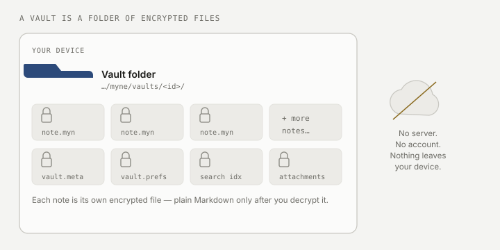

Creating your first vault opens with a short safety briefing, then runs a four-step wizard: set a master password, save your recovery phrase, confirm a few of its words, and save your account number. At the end Myne opens the vault on a small set of example notes it seeds for you. The whole thing takes a couple of minutes, but one decision in it is permanent, so read the briefing and the password step before you rush through them.

## Before you begin: the safety briefing

The first time you create a vault, Myne opens with a short briefing — three plain facts about how your vault is protected, so nothing about the recovery model surprises you later:

- **Your password unlocks your vault, and Myne does not store it.** There is no copy on any server to reset it from.
- **Your recovery phrase is your only backup.** It is the one way back in if you forget the password. If you lose both your password and recovery phrase, your notes are unrecoverable. We cannot help.
- **There is no email recovery, and there never will be.** Myne never asks for your email, so there is no reset link.

Each fact has a **Why?** you can expand for the reasoning, and its own acknowledgement checkbox. **Continue to vault creation** stays disabled until all three are ticked; **Back** returns to the Welcome screen without creating anything. The briefing is shown only the first time, on this create flow — when you later create an additional vault from the picker, Myne goes straight to the password step.

## Step 1: Set a master password

Choose a password that protects this vault. Myne enforces a floor: at least 12 characters, and a strength the meter accepts. There is no email, no security question, and no reset link behind it. The password is one of the two things that can open the vault.

After you continue, Myne pauses for about a second. That pause is the key derivation: Myne deliberately makes turning your password into a key slow, so that guessing passwords is expensive for anyone who copies your files.

> **This is the decision to understand.** Your vault has two credentials: this password and the recovery phrase you are about to see. Either one alone unlocks the vault. But if you lose **both**, the data is permanently unrecoverable. No support channel, no email, and no server can recover it or provide a partial way back; Myne never holds a copy of your keys. Save both before you go on.

## Step 2: Save your recovery phrase

Myne shows you a 24-word recovery phrase. This is your second credential, an independent way to unlock the vault if you forget the password. Write it down now. The phrase screen, its protective behaviours, and where to keep the words are covered in full in [Your recovery phrase](/user-guide/getting-started/your-recovery-phrase/).

## Step 3: Confirm a few words

To check that you actually recorded the phrase, Myne asks you to type back four of your 24 words. This catches the most common mistake: writing down only the first few lines. The full explanation of which words it asks for, and why, is in [Your recovery phrase](/user-guide/getting-started/your-recovery-phrase/#confirming-the-phrase).

## Step 4: Save your account number

Last, Myne shows your **account number**. It displays as `MY-` followed by five groups of four characters (for example, `MY-XXXX-XXXX-XXXX-XXXX-XXXX`), and it is **shown only once**, here at creation — Settings does not display it again. You can copy it or use **Save as file**, and you tick a box confirming you have saved it before the vault is created. You need it to add a second device later.

It is not a password, but it is not nothing either. If you use sync, anyone who has your account number can ask the sync server for your account's encrypted key file, from anywhere, with no device of yours and no login: that is how a new device of *yours* joins, and the server cannot tell the two apart. The file reveals nothing on its own; what it gives someone is the material to start guessing your master password on their own hardware, with nothing slowing them down but the strength of that password. So treat the number like cash rather than like a username — fine to type into your own devices, not something to put in a screenshot or a support thread. A vault you never sync has nothing on a server.

**Copy** tells you whether it worked, so a failed copy does not look like a successful one. What happens to the clipboard afterwards depends on where you are. On the desktop, Myne clears it after 30 seconds, and that clear runs inside Myne, so quitting within those 30 seconds leaves the number on the clipboard. On Android the clear is not selective: it cannot read the clipboard to check what is on it, so anything you copy inside those 30 seconds is cleared too. **In a browser nothing is cleared at all.** A page is not allowed to read the clipboard back, so no timer is scheduled, and the account number stays there until you copy something else.

**Save as file** differs in the same way. On the desktop it opens a save dialog and you pick the folder, and where your operating system supports it Myne writes the file readable only by your own user account. In a browser it is an ordinary download, landing wherever your browser puts downloads. Either way the result is a plain text file that anyone who reaches that location can read, so move it somewhere safe and delete the local copy.

## Your vault is ready

When the wizard finishes you see **Your vault is ready.** and a **Done** button that takes you straight into the [editor](/user-guide/editor-and-writing/overview/), with no second password prompt; the Unlock screen first appears the next time you launch Myne. Rather than an empty editor, your new vault opens on **Start here**, the first of five example notes Myne seeds under a single **Getting started** folder. They are ordinary notes (edit, rename or delete any of them), and right-clicking the folder and choosing **Delete** moves the whole set to Trash together, where you can still restore it. Two more things sit on that screen, on the desktop:

- **Show vault folder** opens the directory on disk where Myne keeps this vault's encrypted files.
- **Back up this vault now** writes an encrypted backup you can keep elsewhere. It is worth taking. How backups work and the habit worth building are in [Back up your vault](/user-guide/safety-and-recovery/back-up-your-vault/).

Neither appears in a browser, and neither is missing by accident: there is no folder to open and no save dialog to write a backup through, so both controls are left out of the browser build rather than shown and refused. Your notes there live in the browser's own storage for the site, and the server keeps the copy a new browser re-downloads. See [Myne in your browser](/user-guide/getting-started/myne-in-your-browser/).

## Limits

The wizard's protection is only as strong as the password and phrase you choose and keep. Myne enforces a password floor and shows the phrase once, but it cannot recover either for you, and it cannot stop someone who has written your phrase where others can read it. Treat both like keys to a safe. The account number is a third thing to keep to yourself for a different reason: it is what someone needs to start guessing your password offline, so on a synced vault your password's strength is the only thing standing between a leaked account number and your notes.
