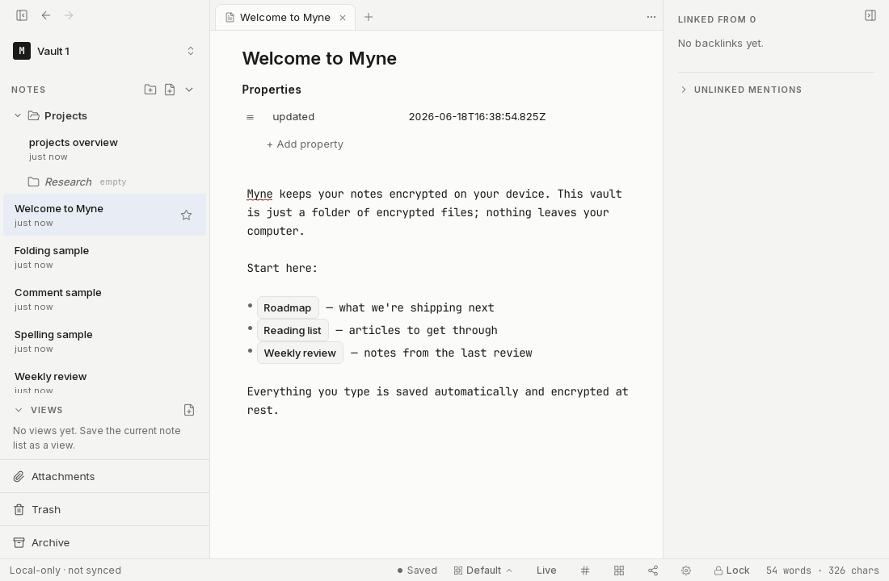

Once your vault is open, Myne is a single window with a few fixed regions. This tour names each one so the rest of the guide can refer to them without re-explaining. From left to right and top to bottom:

## The left sidebar

The left sidebar holds two things:

- **The vault-switcher chip** at the top shows which vault is open. If you keep more than one vault, this is where you switch between them; see [Multiple vaults](/user-guide/safety-and-recovery/multiple-vaults/).
- **The note tree** below it lists your notes and folders. Select a note to open it; this is where you create, rename, move, and organize notes.

## The tab strip and editor

The center is where you read and write. Notes open in **tabs** along the top, and you can **split the pane** to put two notes side by side. The **editor** itself fills the rest of the space: plain markdown, with autosave handling persistence (see [Your first note](/user-guide/getting-started/your-first-note/)).

In the top-left chrome, next to the sidebar toggle, two arrow buttons walk through the notes you have visited: **navigate back** (`⌘[` / `Ctrl [`) and **navigate forward** (`⌘]` / `Ctrl ]`). Each greys out when there is nowhere to go.

## The right sidebar

The right sidebar surfaces the connections to the note you are reading:

- **Backlinks**: other notes that link to this one.
- **Unlinked mentions**: notes that name this one without linking to it.

How these work, and the rest of Myne's linking and search tools, are covered in [Find & connect](/user-guide/find-and-connect/).

## The bottom bar

The status bar along the bottom carries small, persistent controls and readouts:

- **Local-only · not synced**: the honest state of your notes. Myne today runs entirely on your device; nothing leaves it.
- **Save status**: shows "Saving…" while a save is in flight, so you can see autosave working.
- **Workspace** chip: shows the active named workspace and lets you switch between, rename, or save the current layout as a [named workspace](/user-guide/notes-and-organization/named-workspaces/).
- **View mode**: shows the focused note's mode (Live, Reading, or Source) and cycles through them on click; see [View modes](/user-guide/editor-and-writing/view-modes/).
- **Views**: opens the [saved views](/user-guide/editor-and-writing/saved-views/) surface.
- **Graph**: opens the graph view of your notes and their links (also `⌘⇧G`).
- **Settings**: the gear opens settings (also `⌘,`).
- **Lock vault**: locks the vault immediately and returns to the Unlock screen.
- **Word count**: the [document-statistics](/user-guide/editor-and-writing/document-statistics/) readout for the current note (words and characters, with the full breakdown on hover); it follows your selection when you have one.

Right-click anywhere on the bottom bar to hide or show individual items — each readout and control above can be turned off. Your choices persist with the vault.

## The command palette

Press `⌘K` (or its alias `⌘P`) to open the **command palette**, a searchable list of actions like locking the vault, opening settings, showing the graph, importing an Obsidian vault, and managing templates. It is the fastest way to reach anything that isn't a click away.

## Shortcuts

Most of these are **defaults you can change**: Settings → Hotkeys lists every rebindable command and lets you record your own chord (see [Custom hotkeys](/user-guide/settings-and-privacy/custom-hotkeys/)). The values below are the shipped defaults. Two groups are fixed and cannot be rebound: the editor-formatting shortcuts (bold, italic, headings, lists, folding) and `Ctrl Tab` for cycling tabs.

| Action | macOS | Windows / Linux |
|---|---|---|
| Open command palette | ⌘K (alias ⌘P) | Ctrl K (alias Ctrl P) |
| New note in the focused pane | ⌘T | Ctrl T |
| Navigate back | ⌘[ | Ctrl [ |
| Navigate forward | ⌘] | Ctrl ] |
| Open settings | ⌘, | Ctrl , |
| Show graph view | ⌘⇧G | Ctrl Shift G |
| Toggle reading view | ⌘⇧E | Ctrl Shift E |
| Next / previous tab (fixed) | Ctrl Tab / Ctrl Shift Tab | Ctrl Tab / Ctrl Shift Tab |
| Split focused pane right / down | ⌘\ / ⌘⇧\ | Ctrl \ / Ctrl Shift \ |
