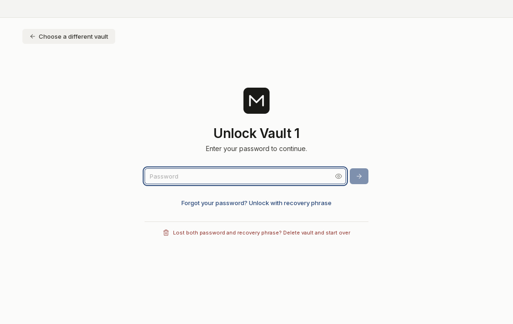

Once a vault exists, Myne keeps it locked until you enter its master password, and for a vault created today that is the only way in. This article covers what you see when you open the app, what the unlock screen offers and why the offer depends on the vault, the message you get when a password doesn't work and why it is deliberately vague, and how to lock the vault yourself when you step away.

## What you see when you open Myne

Myne checks your device on launch and opens the right screen for what it finds:

- **No vault yet** → the Welcome screen, with four doors: create an identity, create a local vault, restore one from a backup, or add this device to an account you already sync.
- **One vault** → the Unlock screen for that vault.
- **Two or more vaults** → the vault picker, where you choose which one to open.

If you keep more than one vault, [Multiple vaults](/user-guide/safety-and-recovery/multiple-vaults/) covers the picker, switching, and what each vault does and doesn't share.

## Unlocking

Type your master password and confirm. Myne derives your keys from the password and decrypts the vault; this takes about a second, which is deliberate: the key derivation is intentionally slow to make password guessing expensive. When it succeeds, you land in the editor.

### Quick unlock after auto-lock

If you turn on quick unlock, the Unlock screen leads with a faster re-entry option after the vault auto-locks: a PIN, or Touch ID on macOS. It shows one credential at a time: a **Use password instead** link switches to the master-password form, and a matching link switches back, so you can still type your password instead. Quick unlock is off until you enable it from Settings → Privacy → Locking. With a PIN, the master password is required again after you restart the app; a configured Touch ID credential can be used on a cold start, because macOS's own biometric prompt guards it. Touch ID is macOS-only and the app marks it experimental. See [Quick unlock](/user-guide/settings-and-privacy/quick-unlock/) for how to set it up and what it does and does not protect.

### The links under the password field

What sits under the password field depends on the vault, and Myne checks rather than guessing.

- **A vault created today** has no second credential, so there is no recovery link. The screen says the vault opens with its password only, which is the honest version of an empty space: a link that could only fail is worse than no link.
- **A vault that still carries its own recovery phrase** (created before 2026-10-30, and not yet upgraded) shows **Forgot your password? Unlock with recovery phrase**, which starts the recovery flow. [Upgrade your vault format](/user-guide/safety-and-recovery/upgrade-your-vault-format/) covers how such a vault moves to the password-only shape, and what that removes.
- **A vault an owner shared with you** has neither: it opens with the password, PIN or biometric you set for it on this device, and a forgotten one is replaced by a fresh invite rather than by a phrase.

**Lost both password and recovery phrase? Delete vault and start over** appears when both are gone, and it is irreversible: deleting the vault destroys its notes, and nothing brings them back except a backup you took earlier. If you keep more than one vault, a **Choose a different vault** link takes you back to the picker.

### When the password doesn't work

If unlocking fails, you see one message:

> Wrong password or vault file is corrupted.

The message is intentionally ambiguous, and the ambiguity is a privacy property, not a missing feature. Myne genuinely cannot tell you which of the two it is: distinguishing "wrong password" from "damaged file" would mean checking your data against something it could only know by holding a copy of what it is protecting. It refuses to know that. So it reports the honest, combined outcome. Check your password first; if you are sure it is right, the vault file may be damaged, and [Restore from a backup](/user-guide/safety-and-recovery/restore-from-a-backup/) is the way back.

## Restoring or joining instead of unlocking

The Welcome screen also carries a **Restore from backup** door. If you are setting up on a new machine, or your vault file is damaged, you restore from a `.myne-backup` file rather than unlocking an existing vault. The how and the caveats live in [Restore from a backup](/user-guide/safety-and-recovery/restore-from-a-backup/).

The third door, **Add this device to an account**, is for a vault that already exists on another device and syncs. You give the sync server and your identity phrase, and this device waits until a device already signed in approves it; the vault then arrives over sync rather than from a file, and it opens with its own master password. Before a device syncs for the first time, Myne shows you the beta terms and waits for you to accept them. They state what sync sends to the server you choose, what happens if you lose your master password, what happens if that server goes away, and what its operator can see and do. Each device is asked separately, because the acceptance is not carried across by sync. [Add a device](/user-guide/sync-and-devices/add-a-device/) covers that flow. The same door is reachable later from the vault picker and the vault switcher.

## Locking the vault

The bottom bar has a **Lock** control, next to Settings. Selecting it locks the vault immediately and returns you to the Unlock screen, which is useful when you leave your desk. The command palette carries the same action, listed there as **Lock vault**. Myne also locks the vault on its own after a period of inactivity; the timing and the screen-capture protection that goes with it are covered in [Auto-lock and screen-capture protection](/user-guide/settings-and-privacy/auto-lock-and-screen-capture/).

## Limits

The Unlock screen protects your vault against someone who has your computer but not your password; its strength is your password's strength and the deliberately slow key derivation behind it. For a vault created today there is no second credential behind it either, so that strength is the whole barrier rather than one of two: a forgotten password with no backup is a lost vault. It does not protect a vault that is already unlocked and open on screen; lock it when you step away. Quick unlock is a convenience layer over that same encrypted vault, not a stronger gate — [Quick unlock](/user-guide/settings-and-privacy/quick-unlock/) covers its trade-offs.
