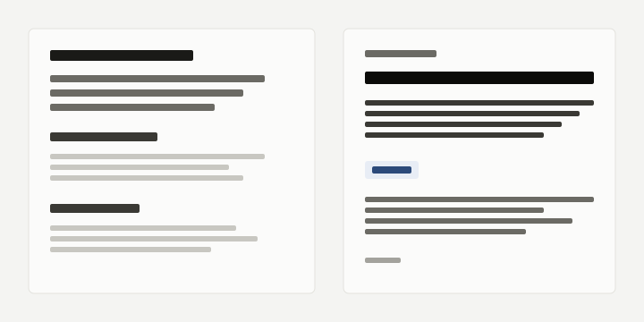

Myne is for people who write in markdown and want their notes encrypted on
disk by default. There is no email signup, no remote account, and no server
that can read what you write.

## What this section covers

You will create a vault, save a recovery phrase, and write your first note.
The whole thing should take about five minutes. Come back to *Daily use* once
the vault is set up.

### Before you start

You need the desktop app installed. If you do not have it yet, download it
from the releases page. Myne does not run in a browser — the vault file lives
on your device.
