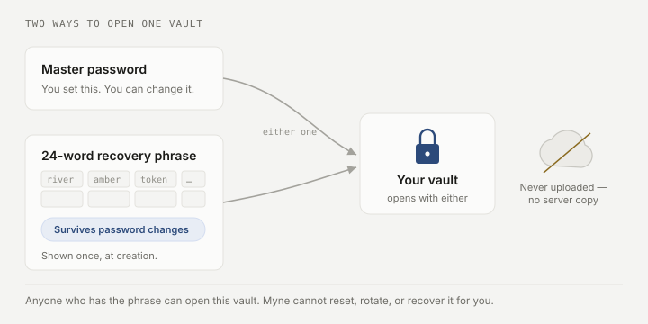

Your recovery phrase is 24 standard English words that act as a second, independent way to unlock your vault. You see it once, during vault creation. This article explains what it is, the confirmation step that follows it, how the phrase screen protects the words while they are on display, and where to keep them.

## What the phrase is

- **24 words from a standard list.** They are ordinary recovery words (the BIP-39 wordlist), chosen so they are easy to copy by hand and check for typos.
- **A second, independent credential.** The phrase unlocks the vault on its own; you do not need the password as well. It is the backstop for the day you forget the password.
- **It survives password changes.** Changing your master password does not change the phrase; the same 24 words keep working.
- **It is never sent anywhere.** There is no server copy and no upload, by design. That is also why no one can recover it for you; see the limit at the end.

## Confirming the phrase

After Myne shows you the phrase, it asks you to type **four** of the 24 words back. It does not pick them evenly: it asks for **one word from positions 1 to 8, two words from positions 9 to 16, and one word from positions 17 to 24**, so one of the four always comes from the **last third** of the list.

That bias is deliberate. The most common way people lose a phrase is writing down only the first few lines and stopping; guaranteeing a word from the end catches exactly that mistake before your vault depends on an incomplete copy.

Typing is forgiving about case and surrounding spaces. Myne compares the normalized words, so a stray capital or a trailing space will not block you. The words themselves must match.

## How the phrase screen protects the words

While the phrase is on screen, Myne guards it:

- The grid is **blurred until you choose to reveal it**, and it **re-blurs when you switch away** from the window (for example, when you Cmd-Tab to another app), so the words are not left uncovered behind other windows.
- **Copy** puts the phrase on your clipboard and tells you whether it worked, so a failure does not look like a success. Treat it as a way to move the phrase into a password manager, not as somewhere to keep it. What happens to the clipboard afterwards depends on where you are:
  - **On the desktop**, Myne clears it after 30 seconds, so the phrase does not linger for the next thing you paste. That clear runs inside Myne, so quitting the app within those 30 seconds leaves the phrase on the clipboard; clear it yourself if you do.
  - **In a browser**, nothing is cleared, and the screen says so rather than leaving you to assume otherwise. A page is not allowed to read the clipboard, and the clear is gated on reading the value back so that it can never destroy something you copied afterwards, so nothing is scheduled at all. The 24 words stay on your clipboard until you copy something else. Paste them into your password manager, then copy anything.
  - **On a phone**, Copy appears only where the system can hold the phrase to the standard this screen already asks for: confined to that one device, and expired on its own timer. iPhone can do both, so the button is there. Android can do neither, so the button is absent rather than present and weaker, and **Save to file** is what that screen offers instead. The desktop button is labelled **Save as file**.
- **In a browser, an extension can read this screen.** Myne says so on the phrase step, and there is nothing it can do about it: an extension you have granted access to the site reads the page directly, and no setting changes that. If you are not sure about every extension in that browser profile, create your vault in the desktop app, or use a clean profile for this step.
- **On a phone, you do not choose where the file goes.** Neither iPhone nor Android gives an app a way to ask, so **Save to file** writes `myne-recovery-phrase.txt` into Myne's own Documents folder and then offers you the system share sheet to send it somewhere. Two things follow from that. Your phone's automatic cloud backup would otherwise copy that folder to iCloud or Google Drive, carrying a saved recovery phrase off your device; Myne now tells both systems to leave that folder out, though the iPhone half of that has not yet been confirmed on a real device. And on a current Android, the system file browsers will not open that folder and the share sheet does nothing there, so the file is written and you cannot reach it. Type the words into a password manager on Android instead.
- **If you saved a recovery phrase on a phone before this changed**, and that phone's automatic backup was on, a copy of the phrase is inside an existing cloud backup and nothing in the app can reach in and remove it. The phrase cannot be rotated, so treat it as exposed: create a new vault and move your notes into it.
- If you try to **close the window mid-step**, Myne asks you to confirm, so you cannot lose the phrase by accidentally closing the wizard before you have saved it.

## Where to keep it

Store the phrase the way you would store a spare key:

- **On paper, somewhere safe** (a drawer, a safe, a sealed envelope) is the simplest good option.
- **In a password manager** is fine if you already trust one with your other secrets.
- **"Save as file"** writes a plaintext `myne-recovery-phrase.txt`. Where your operating system supports it, Myne writes that file readable only by your own user account, and never touches it again — after that, protecting it is yours. Use it only as a transfer step. A plaintext copy of the phrase left **on the same device it protects** defeats the point: anyone who reaches that device gets both the vault and the key to it. Move the file to separate, safe storage, then delete the local copy.

If you later forget your password, the phrase is how you get back in; see [If you forget your password](/user-guide/safety-and-recovery/if-you-forget-your-password/). The flow is "unlock with recovery phrase".

## Limits

The recovery phrase is exactly as powerful as your password: anyone who has it can open this vault, and any backup ever made of it, without the password. Myne cannot revoke it, rotate it, or recover it for you, because it never had a copy. Store it like a key, not like a note.
