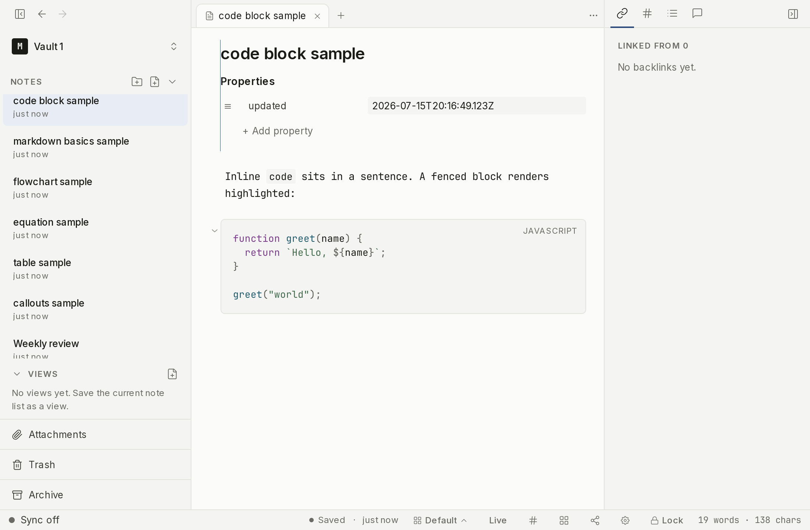

For anything longer than a word of code, use a fenced code block. Myne renders it as a card with syntax highlighting and a copy button.



## Writing a code block

Open and close the block with three backticks, and put the language after the opening fence:

````
```python
def greet(name):
    return f"Hello, {name}"
```
````

The language label appears on the card, and the code is highlighted for that language. If you start a fence and don't close it, Myne keeps the rest of the note as code until you add the closing fence. Typing the opening fence offers to auto-close it for you.

## Supported languages

Syntax highlighting is available for these languages. The name is case-insensitive, and any of the listed aliases works:

| Language | Tag | Aliases |
|---|---|---|
| JavaScript | `javascript` | `js`, `node`, `mjs`, `cjs` |
| JSX | `jsx` | none |
| TypeScript | `typescript` | `ts` |
| TSX | `tsx` | none |
| Python | `python` | `py`, `py3`, `python3` |
| Rust | `rust` | `rs` |
| JSON | `json` | none |
| HTML | `html` | `htm`, `xhtml` |
| CSS | `css` | none |
| YAML | `yaml` | `yml` |
| Shell | `bash` | `sh`, `shell`, `zsh`, `shellscript`, `console` |
| Diff | `diff` | `patch` |

A block with no language, or one Myne doesn't recognize, renders as a plain monospace card with no coloring; Myne does not guess. The language set is curated by the maintainers; you can't add more yourself.

## The copy button

The card's copy button copies the **code inside the block**: the lines between the fences, without the backticks or the language label, so you can paste it straight into a terminal or editor.

## Limits

Markdown special characters inside a code block are inert: a `[[wikilink]]` or a `#tag` written inside code stays as literal code text, not a link or a tag. Code blocks are for showing code, not running it; Myne never executes what's in them.
