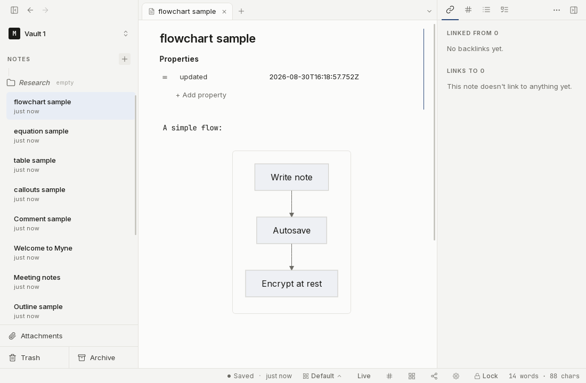
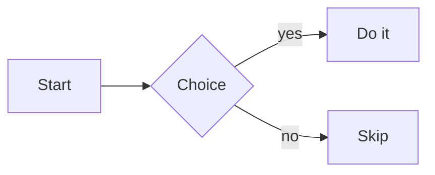

Myne renders Mermaid diagrams (flowcharts, sequence diagrams, and the rest of Mermaid's set) from a fenced code block, drawing them as images right in the note.



## Writing a diagram

Use a fenced code block with `mermaid` as the language:

````

````

When the diagram is valid, Myne replaces the block with the rendered image. Put your cursor back in the block to edit the source.

## Large diagrams

A diagram is drawn at its own size, whatever that turns out to be. A big flowchart with nested subgraphs is wide, and rather than shrinking it until the boxes are dots, Myne lets the diagram card itself scroll sideways. The rest of the note stays where it is; only the card moves.

That means a diagram stays legible in a narrow window and in a split pane, and it is the same picture you would get in a wide one. Scroll the card to see the far side of it.

## When a diagram can't render

If the Mermaid source has an error, or the renderer is still loading, Myne falls back to showing the block as an ordinary code card. You see your diagram source, not a broken image, so you can fix it. When the failure came from the source rather than from loading, a short line under the card says what went wrong.

## Limits

- **Mermaid only.** Other diagram languages, PlantUML for example, are not rendered; a ` ```plantuml ` block stays a plain code card.
- **Default styling.** Diagrams render on a light card whatever theme you use, because Mermaid's own palette is drawn for a light background; there are no per-diagram theme controls.
- **Local.** Diagrams are rendered on your device. Nothing is sent anywhere to draw them.
