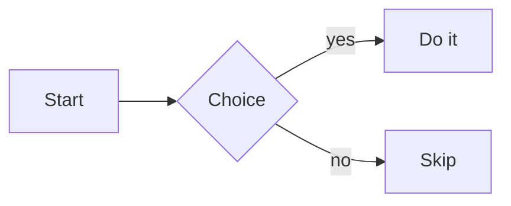

Myne renders Mermaid diagrams (flowcharts, sequence diagrams, and the rest of Mermaid's set) from a fenced code block, drawing them as images right in the note.


## Writing a diagram

Use a fenced code block with `mermaid` as the language:

````

````

When the diagram is valid, Myne replaces the block with the rendered image. Put your cursor back in the block to edit the source.

## When a diagram can't render

If the Mermaid source has an error, or the renderer is still loading, Myne falls back to showing the block as an ordinary code card. You see your diagram source, not a broken image, so you can fix it.

## Limits

- **Mermaid only.** Other diagram languages, PlantUML for example, are not rendered; a ` ```plantuml ` block stays a plain code card.
- **Default styling.** Diagrams render in Myne's default theme; there are no per-diagram theme controls.
- **Local.** Diagrams are rendered on your device. Nothing is sent anywhere to draw them.
