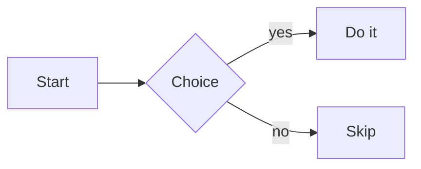

Myne renders Mermaid diagrams (flowcharts, sequence diagrams, and the rest of Mermaid's set) from a fenced code block, drawing them as images right in the note.


## Writing a diagram

Use a fenced code block with `mermaid` as the language:

````

````

When the diagram is valid, Myne replaces the block with a rendered diagram in a small viewer, fitted to the width of the note.

## Looking at a diagram

A control bar sits in the bottom-right corner of the diagram: zoom out, the current zoom percentage (click it to reset to fit), zoom in, pan up, pan down, pan left, pan right, edit the source, and expand.

- **Fit.** The diagram opens fitted to the width of the note. If it is taller than the viewer it stays inside a bounded box rather than stretching the note, so nothing is clipped and the rest of the note does not move.
- **Zoom and pan.** Use the buttons, drag the diagram to pan, or scroll while the pointer is over the diagram: a plain scroll wheel zooms it, with or without `Ctrl` (Windows and Linux) or `Cmd` (macOS). A scroll wheel anywhere else still scrolls the note as usual. On a touch screen, drag with one finger to pan and pinch with two to zoom.
- **Keyboard.** With the diagram focused, the arrow keys pan, `+` and `-` zoom, and `0` resets to fit.
- **Expand.** Opens the same diagram in a full-window view, closed with `Esc`, the close button, or a click outside it.

## Editing a diagram

Click **edit source** in the control bar, or double-click the diagram, to put your cursor back in the block and show the raw ```` ```mermaid ```` source. Opening a diagram never changes the note: zooming and panning are a view, and nothing is written to your text.

## When a diagram can't render

If the Mermaid source has an error, or the renderer is still loading, Myne falls back to showing the block as an ordinary code card. You see your diagram source, not a broken image, so you can fix it. When the failure came from the source rather than from loading, a short line under the card says what went wrong.

## Limits

- **Mermaid only.** Other diagram languages, PlantUML for example, are not rendered; a ` ```plantuml ` block stays a plain code card.
- **Default styling.** Diagrams follow the theme you are using, and there are no per-diagram theme controls.
- **Local.** Diagrams are rendered on your device. Nothing is sent anywhere to draw them.
