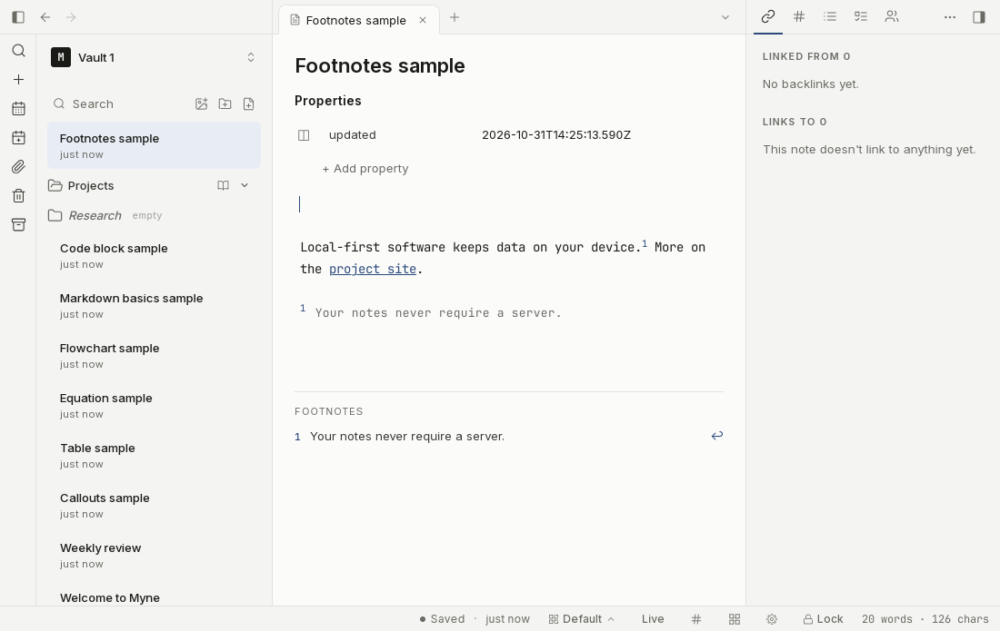

This article covers three ways of referring to things: footnotes, reference-style links, and wikilinks (the `[[Note]]` syntax Myne uses to connect notes inside a vault).



## Footnotes

A footnote has two parts: a marker in your text and a definition elsewhere in the note.

```
Here is a claim.[^1]

[^1]: And here is the supporting note.
```

The marker `[^1]` renders as a small reference; clicking it jumps to the definition. The identifier can be any short label, not just a number (`[^source]` works). Definitions are usually grouped at the end of the note, but Myne finds them wherever they are. A definition can span more than one paragraph: indent the continuation lines by four spaces. The definition ends at the first non-blank line indented less than that. A marker with no matching definition still renders as a marker, tinted to show that it points at nothing, and clicking it does nothing.

Myne also draws a **Footnotes** list at the end of the note, under a rule: every definition in the note, ordered by where its marker first appears, each with a ↩ that jumps back to the marker. A definition nothing refers to is listed after the rest and labelled **unreferenced**. The list is drawn, not written: your `[^1]:` lines stay exactly where you put them, and nothing is added to your file.

## Reference-style links

Instead of putting a URL inline, you can name it once and refer to it by label:

```
See the [project README][readme].

[readme]: https://example.com/readme
```

Myne renders the labelled usage as a link and hides the definition line. Labels are matched loosely: case and internal spacing don't have to match exactly. Reference **images** work the same way (`![alt][ref]`). These forms are recognized and rendered; Myne keeps your bytes as written.

## Wikilinks

Wikilinks are Myne's syntax for linking one note to another inside the same vault. You write a target inside double brackets, and the editor renders it as a single **chip**.

| You write | What it links to |
|---|---|
| `[[Note Title]]` | the note with that title |
| `[[Note Title\|Display]]` | the same note, but the chip shows "Display" |
| `[[Note Title#Heading]]` | a heading in that note (the chip shows "Note › Heading") |
| `[[Note Title^block-id]]` | a specific block (the chip shows the note; the block id is kept in the text) |
| `[[folder/path.md\|Display]]` | a note by its vault-relative path (Myne's own preferred form) |
| `[[Projects/]]` | the folder note of the folder "Projects" — the trailing slash is what makes it a folder link; see [Folder notes](/user-guide/notes-and-organization/folder-notes/) |
| `![[Note Title]]` | an embed — an "Embed: Note Title" chip, unless the target is a drawing note, which is drawn inline; see [Embeds](/user-guide/markdown/embeds/) |
| `![[att:<id>\|name]]` | an embedded attachment, rendered according to what the file is; see [Embeds](/user-guide/markdown/embeds/) |

A heading anchor matches the heading's plain text: formatting markers and any inline HTML around it are ignored, so `[[Notes#Desktop]]` finds a heading written `## **Desktop**` or `## <mark class="hl-green">Desktop</mark>`. Case does not have to match. If two headings share the same text, the link goes to the first one.

A chip is **atomic**: it behaves as one unit, so backspacing next to it removes the whole `[[…]]`, and selecting it selects the entire link. A wikilink never spans more than one line, and a `[[Note]]` written inside a code block stays as code, not a link.

### How a wikilink resolves

A title-only link like `[[Wednesday]]` resolves to the note titled "Wednesday" in the current vault; a path link resolves to that vault-relative path. An embed of an ordinary note is a labeled chip: Myne does **not** pull that note's text inline, and there is no transclusion. One target is drawn instead of labelled — an embed of a drawing note shows the drawing itself, and clicking it edits the drawing in place, where it sits in the note. The `![[…]]` text in your file is unchanged either way; [Embeds](/user-guide/markdown/embeds/) covers each target kind.

### Writing one

You can type a wikilink by hand, but you do not have to. Typing `[[` opens a picker that searches your notes and inserts the link for you; the same picker opens from the slash menu's **Wiki link** entry and with the shortcut below. What you type after `[[` chooses what it lists: plain text lists notes, `#` lists the headings in the note you are in, `##` lists headings anywhere in the vault, and `^^` lists block ids carried in from an imported vault. Hovering a finished link chip tells you where it resolves, or that it matches nothing. What these connections surface is covered in [Find & connect](/user-guide/find-and-connect/).

## Limits

All of these are render-only: Myne shows footnotes, reference links, and wikilinks as formatted text, but what is saved is exactly the markdown you typed. Wikilinks resolve only within the current vault; there are no cross-vault links.

## Shortcuts

| Action | macOS | Windows / Linux |
|---|---|---|
| Insert wikilink | ⌘⇧L | Ctrl Shift L |

This is the default. You can change it under **Settings → Hotkeys**, which also lists every shortcut in the app.
