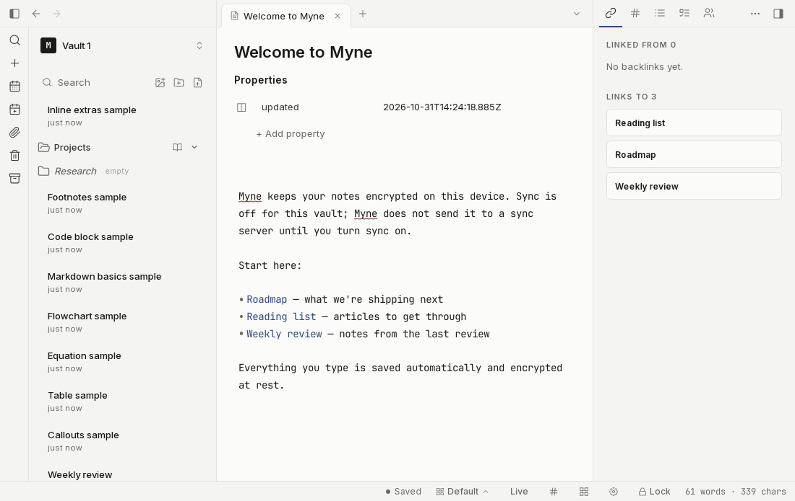

Frontmatter is an optional block of properties at the very top of a note, written in YAML. Myne owns a fixed set of fields in it and leaves everything else to you. This article covers the rules and the fields Myne manages.



## The frontmatter block

If a note has frontmatter, it must be the very first thing in the file: a line of exactly `---`, then valid YAML, then a closing line of exactly `---`.

```
---
title: Weekly review
tags: [planning, review]
---

The note body starts here.
```

When a note has frontmatter, the editor renders it as a **Properties** widget at the top of the note. The note's title sits above the list as its own field. Below it, each key is an editable name beside its value: a plain value is a text input, and a list value is a row of chips you can remove, with a field for adding another item. **+ Add property** adds a new key. Editing an input and pressing Enter or moving focus away writes the change straight back into the note's frontmatter.

A field Myne manages is the exception. While Myne is acting on the value, the row shows that value as plain text with no input, because the app action that owns the field is what writes it. The text stays selectable, and the action is always reachable somewhere else, such as a folder's context menu for a folder note. A managed value Myne does not recognize, and a line that arrived malformed from a hand edit or an import, keeps its ordinary editable row, so you can always repair what is in the file. Two managed fields stay editable this way: `conflict_of`, and `kind` while no action can clear a note's type. The `cover` row is editable too whenever nothing is drawing a cover above the title.

A value with structure the widget has no control for — nested keys under a key of yours, a multi-line block — gets no editable row of its own; its key line still appears, with nothing in the value field. The value itself stays in your file untouched, and to change it you edit the note in another editor.

## Fields Myne manages

Myne writes thirteen fields of its own. You rarely touch them directly; actions in the app keep them current:

| Field | What it records | Written by |
|---|---|---|
| `updated` | the last time you edited the note | autosave, on every save |
| `title` | the note's title | the rename action (and the importer, for imported files) |
| `folder` | the folder the note lives in; **absent means the vault root** | creating or moving the note |
| `trashed` | present means the note is in the Trash | the trash and restore actions |
| `template` | `true` means the note is a template | the template actions |
| `archived` | present means the note is in the Archive; its value records when you archived it | the archive and restore-from-archive actions; see [Archive](/user-guide/notes-and-organization/archive/) |
| `folder_index` | `true` means the note is its folder's folder note | the folder-note actions; see [Folder notes](/user-guide/notes-and-organization/folder-notes/) |
| `kind` | the note's type — `task` for a note-task, `drawing` for a drawing | the actions that declare a note a task or create a drawing; see [Tasks](/user-guide/notes-and-organization/tasks/) |
| `done` | present means a note-task is complete; its value records when | ticking a note-task off |
| `cover` | the note's cover image, as a reference to an attachment in your vault | the cover actions; see [Note covers](/user-guide/editor-and-writing/note-covers/) |
| `deleted`, `conflict`, `conflict_of` | sync bookkeeping: a note deleted on another device, and the two halves of a conflict copy | the sync engine; see [Sync & devices](/user-guide/sync-and-devices/) |

Several of these are **value-strict**, which protects you from accidents: `trashed`, `archived`, `deleted` and `done` only count when their value is a real timestamp, and `template`, `folder_index` and `conflict` only count when the value is exactly `true`. So your own `template: maybe` or `trashed: someday` won't quietly hide a note. `cover` is value-strict in its own way: it counts only when it holds exactly one attachment reference written by Myne, so a filename or a web address typed there is left alone and shows no cover. A note is at most one of archived or trashed: archiving a note clears any `trashed`, and trashing an archived note clears its `archived`. Neither archiving nor restoring from the Archive touches `updated`, since moving a note in or out of the Archive is not a content edit. The `folder` value is **virtual**: it is recorded inside the encrypted note, not as a real directory on disk, which is why your folder structure travels with the note even to another editor.

## Your own fields are kept

Myne **never strips frontmatter it doesn't recognize**. Any fields you add (`tags`, `aliases`, your own bookkeeping) are preserved exactly, on every save. Editing a note, renaming it, or moving it touches only the relevant managed field and leaves everything else byte-for-byte intact.

Myne's own fields count only at the top level of the block. A key with the same name nested inside one of your own — a `title:` under a `seo:` mapping, for example — belongs to you: Myne does not read it as the note's state and never rewrites it.

A note on tags: a frontmatter `tags:` list is a different surface from the inline `#tags` you write in the body. Both feed the same places; see [Tags](/user-guide/find-and-connect/tags/).

## Limits

The caret never enters the Properties block: clicking or arrowing into it puts the caret on the first line of the body instead, and a selection cannot span it. The controls this widget offers are the only way to edit frontmatter here, and a managed field it shows as plain text is the one part of the block you cannot edit in place. That is also why select-all selects the body and leaves your frontmatter alone. A find-and-replace match that falls inside the frontmatter is counted in the `k/N` total but is not highlighted on screen, because frontmatter renders as the Properties widget rather than as raw text and there is nothing in the note body to paint the match on; see [Find and replace](/user-guide/editor-and-writing/find-and-replace/). If you want a template's structure to include frontmatter, build it into the template; see [Templates](/user-guide/notes-and-organization/templates/).
