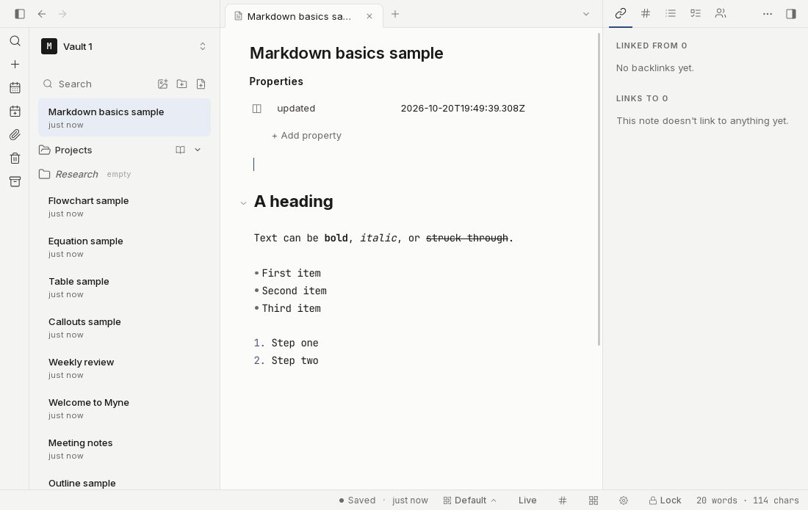

This article covers the everyday markdown you will use most. Myne renders it live: the markers fade and the formatting shows as you write. Put the caret on a marker — a heading's `#`, a quote's `>`, a bullet's `-` — and that marker comes back so you can edit it, while the rest of the line keeps its shape. Nothing is rewritten, and what you see is a view of the bytes you typed.



## Headings

Write headings with `#` markers, from `# Heading 1` through `###### Heading 6`. New headings always use this `#` form. (If you import notes that underline a heading with `===` or `---`, Myne reads and renders them, but it never converts your file to that form.)

You can cycle a line through heading levels with a shortcut (see Shortcuts below).

## Emphasis and inline code

- `*italic*` for *italic*, `**bold**` for **bold**.
- `~~text~~` for struck-through text.
- `` `code` `` for inline `code`.
- `==highlight==` for a highlighted span (the default yellow); the highlight palette has thirteen colors in all, stored as `<mark class="hl-*">` — see [HTML and inline extras](/user-guide/markdown/html-and-inline-extras/) for the full list. `~sub~` and `^sup^` for subscript and superscript.

Bold, italic, strikethrough and inline code all have toolbar buttons. Bold, italic and inline code also have keyboard shortcuts (see Shortcuts below); strikethrough has no default shortcut, so the toolbar button is the way to reach it.

## Lists

- **Bullet lists** start a line with `- `.
- **Numbered lists** start with `1. `.
- **Task lists** use `- [ ]` for an open item and `- [x]` for a done one; the checkbox is clickable. A task line can also carry a due date, a priority and a repeat rule, which you set from controls rather than type — see [Tasks](/user-guide/notes-and-organization/tasks/).

Lists nest by indenting, and **Tab** on a list line does it for you: it lines the item up under the one above, whatever marker that one uses. This matters most on task lists. Markdown treats four spaces after an ordinary paragraph as a continuation of that paragraph rather than as a list, so a checkbox indented by hand under a line of prose quietly stops being a task and drops out of the Tasks panel. Tab never indents a line that far, so a todo you nest stays a todo.

## Links, quotes, and rules

- **Links**: `[text](https://example.com)`. The URL hides while you read and comes back when your cursor is on the line.
- **Addresses on their own**: a web address typed bare, `https://example.com`, renders as a link, and so do the angle form `<https://example.com>` and a bare email address.
- **Block quotes**: prefix lines with `> `.
- **Horizontal rule**: a line of `---`.
- **Line breaks and escapes**: end a line with a backslash for a hard break, and put a backslash before a character (like `\*`) to keep it literal.

Of those link forms, only the bare and angle ones are clickable. Clicking one opens it outside Myne: your default browser for a web address, your mail app for an email address. A `[text](url)` link is styled but does not open on click; put your cursor on its line to see the address and copy it. Only `http`, `https` and `mailto` addresses are ever handed out that way, so a link written with any other scheme stays plain text rather than becoming one click from running.

## Definition lists

Myne renders a tight definition list: a term on one line, immediately followed by `: definition` lines with no blank line between them:

```
Term
: The definition.
: A second definition of the same term.
```

## Images

An image is ``. Myne **never fetches a remote image**: an image pointing at a web URL is not downloaded, by design, because loading it would reach out to a server and leak that you opened the note. Attachments you add to the vault are covered in [Attachments](/user-guide/attachments-and-import/attachments/).

## Find in note

To find text inside the note you are reading, open the find bar (see Shortcuts). It does a literal, in-note search with a case-sensitivity toggle and no regular expressions. A replace row lets you replace the current match or rewrite every occurrence in one undoable step — see [Find and replace in a note](/user-guide/editor-and-writing/find-and-replace/). The search runs in memory only; it is not written to disk.

Find looks inside the note you're reading; to search across every note in your vault, use [Search](/user-guide/find-and-connect/search/).

## Shortcuts

| Action | macOS | Windows / Linux |
|---|---|---|
| Bold | ⌘B | Ctrl B |
| Italic | ⌘I | Ctrl I |
| Inline code | ⌘E | Ctrl E |
| Cycle heading level | ⌘⇧H | Ctrl Shift H |
| Toggle bullet list | ⌘⇧8 | Ctrl Shift 8 |
| Toggle numbered list | ⌘⇧7 | Ctrl Shift 7 |
| Toggle task list | ⌘⇧M | Ctrl Shift M |
| Insert wikilink | ⌘⇧L | Ctrl Shift L |
| Find in note | ⌘F | Ctrl F |
| Select all (scoped) | ⌘A | Ctrl A |

**Select all (scoped)** is Myne's ⌘A: with your cursor in the body it selects the body and leaves the frontmatter alone, and with your cursor in the frontmatter it selects the frontmatter only. In a note with no frontmatter it selects the whole note.

These are the defaults. You can change any of them under **Settings → Hotkeys**, which also lists every shortcut in the app.
