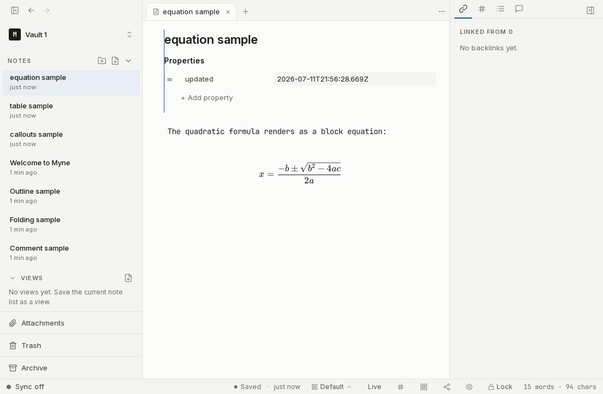

Myne renders mathematical notation with KaTeX. You write LaTeX between dollar-sign delimiters, and Myne typesets it, either inline within a sentence or as a centered block.

## Inline and block math

- **Inline**: wrap an expression in single dollar signs. `$E = mc^2$` renders within the line.
- **Block**: wrap it in double dollar signs on their own. `$$ \int_0^1 x^2 \, dx $$` renders centered on its own line. Block math can use LaTeX environments such as `\begin{aligned} … \end{aligned}`.

Myne recognizes `$` and `$$` only; the `\(…\)` and `\[…\]` delimiters are not used.

## Dollar signs and currency

So that ordinary prices don't turn into math, Myne is careful about when a `$` starts an expression:

- The opening `$` must **not** be followed by a space or a digit, so `$5` and `$ 100` stay as text (currency), but `$x$` is math.
- The closing `$` must **not** be preceded by a space.
- A `$…$` expression does not cross a line break.
- Dollar signs inside code (inline or fenced) are never treated as math.

This means a line like `It cost $5, not $10.` renders as plain text, while `$a + b$` renders as math.

## When the LaTeX is invalid

If an expression can't be parsed, Myne shows your **raw LaTeX** with a subtle hint rather than a red error box. Your text is never replaced with an error, so you can see and fix it in place.

## What math cannot do

The commands that would turn an equation into markup are refused: `\href`, `\url` and `\includegraphics` are shown as unsupported source rather than becoming a link or loading an image. Math typesets your notation; it is not a way to put a link or a remote resource in a note.

## Limits

KaTeX is loaded the first time a note needs it, so the very first math on screen may appear a moment after the rest of the note. Typesetting happens on your device: the math renderer and its fonts ship inside Myne, and rendering an equation makes no network request. Until you turn on sync or name a remote AI provider, Myne runs entirely on your device; nothing leaves it.
