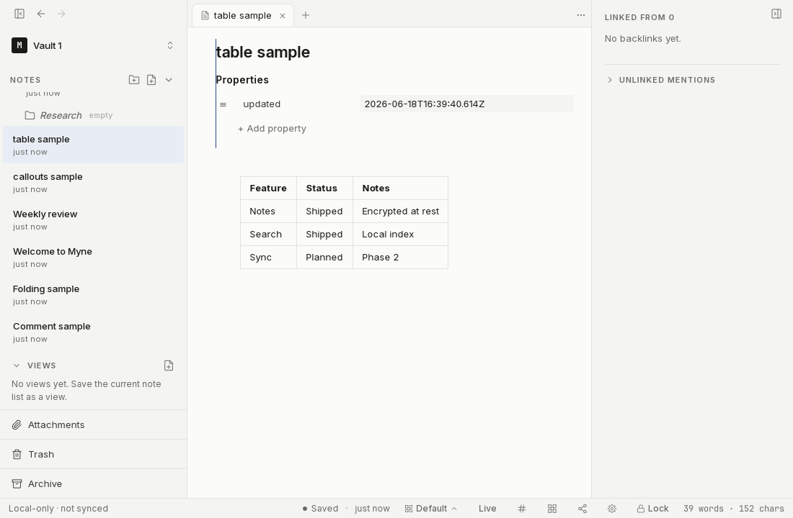

Myne renders standard pipe tables, and you can edit them in place. Insert a starter table from the slash menu, click any cell to edit it, and use Tab and the arrow keys to move between cells. The underlying text stays standard pipe-separated markdown.



## Inserting a table

Type `/` in the editor and choose **Table** from the slash menu (see [slash commands](/user-guide/editor-and-writing/slash-commands/)). Myne inserts an empty 2×2 starter — a header row, a divider row, and one body row — and places your cursor in the first cell, ready to type:

```
|  |  |
|---|---|
|  |  |
```

You can also write a table by hand. A table is rows of cells separated by pipes, with a divider row of dashes under the header:

```
| Item    | Qty |
|---------|-----|
| Apples  | 6   |
| Oranges | 2   |
```

The cells do not need to line up in the source; Myne renders them aligned regardless.

## Editing cells

Click any cell to edit it in place. Press Enter or click away to commit your change; press Escape to discard it and keep the cell's previous text. A cell understands a small amount of inline markdown — bold, italic, inline code, and links.

Move between cells without the mouse:

- **Tab** moves to the next cell, **Shift+Tab** to the previous one. Tab from the last cell adds a new row.
- The **arrow keys** move to the cell above, below, left, or right when your cursor is at the edge of the current cell's text.

## Adding, deleting, and reordering

Hover over a table to reveal its gutter controls:

- **Add a row** with the control below the last row; **add a column** with the control to the right of the last column.
- **Delete a row or column** with the delete control in its row or column gutter.
- **Reorder** a row or column by dragging its grip handle (in the left gutter for rows, the top gutter for columns) to a new position.

## Column alignment

Mark alignment in the divider row with colons:

- `:---` left-aligns the column.
- `---:` right-aligns it.
- `:---:` centers it.

```
| Left | Center | Right |
|:-----|:------:|------:|
| a    | b      | c     |
```

## Limits

The in-cell editor handles bold, italic, inline code, and links; other markdown inside a cell stays as literal text rather than rendering. Tables are standard markdown, so they travel to any other markdown editor unchanged — the editing controls are a convenience layer over the same pipe-separated text.
