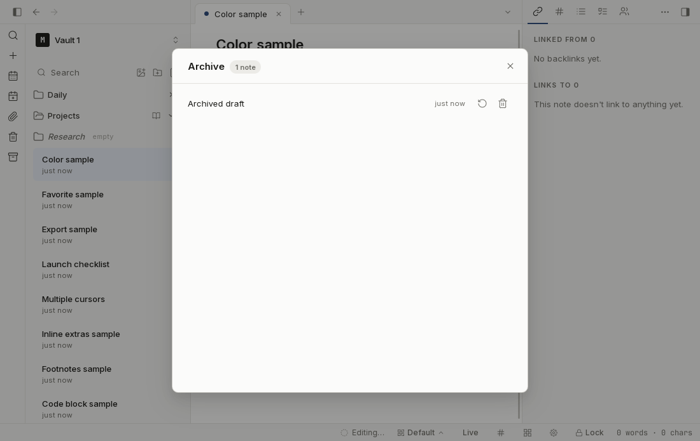

Archiving sets a note aside without deleting it. The note leaves the sidebar, the folder tree, and the Favorites list, but it is kept indefinitely — there is no auto-purge and no way to empty the Archive. Unlike a trashed note, an archived note stays findable in search and still resolves as a link target. A note can be live, archived, or trashed, but never two of those at once. You can also archive a whole folder as a unit, and you can turn the archive feature off entirely.

## Archiving a note

To archive a single note, right-click its row in the sidebar and choose **Archive**. The note leaves the working set straight away: it disappears from the sidebar tree, from the folder tree, and from the Favorites display. It does not go to the Trash, and nothing about its content changes. If the note is open, its tabs close in every pane — an archived note is not something you keep editing, and leaving the tab open would let the next autosave write the note back out of the Archive. To archive several notes at once, build a selection set first and use the bulk **Archive** action — see [Acting on several notes at once](/user-guide/notes-and-organization/bulk-note-actions/).

Archiving and trashing are two positions on one axis, so a note can only be in one of them. Archiving a note that was in the Trash clears its trashed marker; trashing a note that was archived clears its archived marker. You never have to manage that yourself — the app keeps the states exclusive.

The archived state lives inside the note, written into the encrypted `.myn` frontmatter (`archived:`) rather than as a device-local preference. It records when you archived the note, which is what the Archive panel sorts on.

## Archiving a folder

You can archive a folder as a whole. Right-click the folder in the sidebar and choose **Archive folder**. The folder and everything under it leaves the working set — it drops out of the sidebar tree, Favorites, quick-open, and saved-view results together.

Folder archiving is a separate layer from per-note archiving, and the two compose. A note you archived individually inside a folder stays archived on its own terms if you later archive and then restore the folder around it. Because folders in Myne are defined by each note's `folder:` field rather than being their own stored objects, an archived folder is recorded as a per-vault preference in the encrypted `vault.prefs` file, not in any note. Nothing in the notes themselves is rewritten when you archive or restore a folder.

Like an archived note, the notes inside an archived folder stay findable in search and resolvable as link targets — archiving a folder hides it from the working set, it does not put its notes out of reach.

## The Archive panel

Open the Archive from the **Archive** button on the left ribbon, beside **Views**, **Attachments** and **Trash**. When the Archive holds anything, the button shows a count. The panel opens as a modal, newest-first. Press **Esc**, click the backdrop, or use **Close** to dismiss it.

The panel lists two kinds of rows:

- **Archived folders** at the top. Nested archived folders fold under their archived ancestor rather than appearing twice.
- **Archived notes** that are not already covered by an archived folder, each with how long ago it was archived.

Each row offers two actions:

- **Restore** returns the note or folder to where it was, live again.
- **Delete** moves it to the Trash. For a folder, Myne asks you to confirm in a dialog that names the folder and counts its notes; the notes move to Trash and can be restored from there. From the Trash, permanent deletion is a separate, deliberate step — see [Trash](/user-guide/notes-and-organization/trash/).

There is no "empty archive" action. The Archive is meant to be kept, not cleared on a timer.

## Turning archiving off

If you do not want the archive feature at all, you can disable it. Open **Settings → Editor → Features** and turn **Archiving** off. This hides the archive entry points: the ribbon **Archive** button and the **Archive** / **Archive folder** context-menu actions.

Turning archiving off first restores every archived note to its folder, so no note is left set aside with no way to reach it, and clears any archived folders too. Because that restore runs before the setting is saved, a note can never end up archived while the controls that would surface it are hidden.

## Archive versus Trash

The Archive and the Trash both take a note out of the sidebar, but they behave differently on purpose.

A trashed note is hidden everywhere: it drops out of the sidebar and stops appearing in search results, and a link pointing at it reads as broken. An archived note is only set aside. It still turns up in full-text search and still resolves as a wikilink or backlink target, so the rest of your notes stay connected to it. In the command palette, an archived note that matches your search shows a small **Archive** badge so you can tell why it is not in the sidebar.

So: reach for the Archive when you want a note out of the way but still part of your knowledge base, and reach for the Trash when you want a note gone.

## Limits

Because an archived note stays in the encrypted search index and stays resolvable as a link target, its at-rest exposure is exactly that of any live note — archive is discoverable-but-hidden, not a quieter form of deletion. The same holds for the notes inside an archived folder. Archiving does not reduce what a copy of the vault folder can reveal about a note; if you want a note out of reach, delete it rather than archive it.

The Archive is kept indefinitely, with no auto-purge and no empty-archive action, so an archived note or folder persists until you restore it or delete it yourself.
