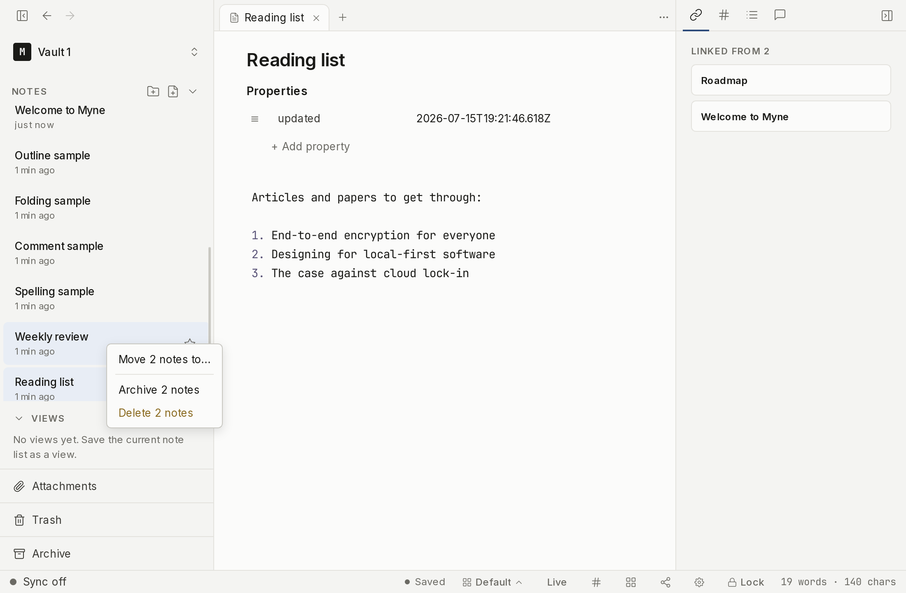

When you need to act on more than one note at a time, you can gather a set in the sidebar with Cmd/Ctrl-click or Shift-click, then move, archive, or delete the whole set in one step, or drag the selection onto a folder to move it there. This article also covers two single-note conveniences: duplicating a note, and opening a random one.

## Selecting multiple notes

A plain click on a note row opens it. To build a selection instead of opening, hold a modifier:

- **Cmd-click** (macOS) or **Ctrl-click** (Windows / Linux) toggles a note into or out of the selection, one row at a time.
- **Shift-click** range-selects every note from the last anchor row through the row you click, inclusive.

The whole gathered set paints with the same highlight as the open note, so you can see exactly what you have picked. The selection is a separate thing from the note that is open in the editor: building it does not change which note you are reading.

The selection collapses back to a single note the moment you do anything that is not a multi-select gesture: a plain click on a row, any cursor-moving arrow key, Escape, or a click on empty sidebar space all clear the set.

## Bulk move, archive, and delete

Once two or more notes are selected, right-click any row that is part of the selection to open a menu that acts on the whole set rather than the single row under the cursor:

- **Move N notes to…** opens a submenu listing **Vault root** plus every folder, indented by depth. Choosing a destination moves every selected note there.
- **Archive N notes** archives the whole set. Archived notes leave the sidebar and are recoverable from the Archive panel; see [Archive](/user-guide/notes-and-organization/archive/).
- **Delete N notes** moves the whole set to the Trash. This is reversible: an undo toast appears right after, and **Undo** restores every note you just trashed. The toast clears itself after a few seconds; after that, restore them from the Trash panel. See [Trash](/user-guide/notes-and-organization/trash/).

You can also press Delete or Backspace with a multi-selection active. The keyboard route asks you to confirm first, in a dialog that says how many notes are about to move to the Trash; the menu's **Delete** acts straight away and gives you the undo toast instead. Either way the notes go to the Trash and can be restored from there.

Bulk operations are best-effort: each note in the set is acted on independently. If one note in a large selection fails to move, archive, or trash, the others that succeeded stay done; successes are never rolled back just to make the whole set fail together.

## Dragging a selection

A multi-selection can be dragged the same way a single note can. Pick up any selected row and drop it onto a folder, and every note in the set moves into that folder at once. This is the drag-and-drop equivalent of the **Move N notes to…** menu.

## Duplicating a note

To copy a single note, right-click its row and choose **Duplicate**. The copy:

- Gets a new note identity of its own, separate from the original.
- Takes the source title with **(copy)** appended, or just **(copy)** when the source has no title.
- Lands in the same folder as the original and opens in the focused pane.
- Stays a template if the note you duplicated was a template.

Favorites and color labels are **not** carried over to the copy. Those are kept per note identity, and the duplicate is a fresh one, so it starts as a clean slate. The copy is a brand-new note; editing it does not touch the original.

## Opening a random note

For serendipitous review, the command palette has an **Open random note** action. It picks one note uniformly at random from your live notes; trashed notes and templates are excluded, matching what the sidebar shows. When two or more notes are eligible, the note that is currently open is dropped from the pool, so the pick always moves you to a different note. If there are no eligible notes, a toast reads **No notes to open.**

This action lives only in the command palette: there is no sidebar button and no default keyboard shortcut for it.

## Limits

A selection is ephemeral interface state, not anything stored: closing the app or clearing the set leaves no trace of what was selected.

Bulk move, archive, and trash each rewrite a note's frontmatter inside the encryption envelope that note already has; the operation changes where a note lives or whether it is hidden, not how it is encrypted. A bulk trash is reversible through the undo toast, and a bulk archive is recoverable from the Archive panel, so neither is a destructive step on its own. Emptying the Trash afterwards is the irreversible step, covered in [Trash](/user-guide/notes-and-organization/trash/).

Until you turn on sync or name a remote AI provider, Myne runs entirely on your device; nothing leaves it.

## Shortcuts

| Action | macOS | Windows / Linux |
|---|---|---|
| Bulk-move the multi-selection to a folder, by dragging | drag selection onto folder | drag selection onto folder |
| Send the multi-selection to Trash (asks to confirm) | Delete or Backspace | Delete or Backspace |
