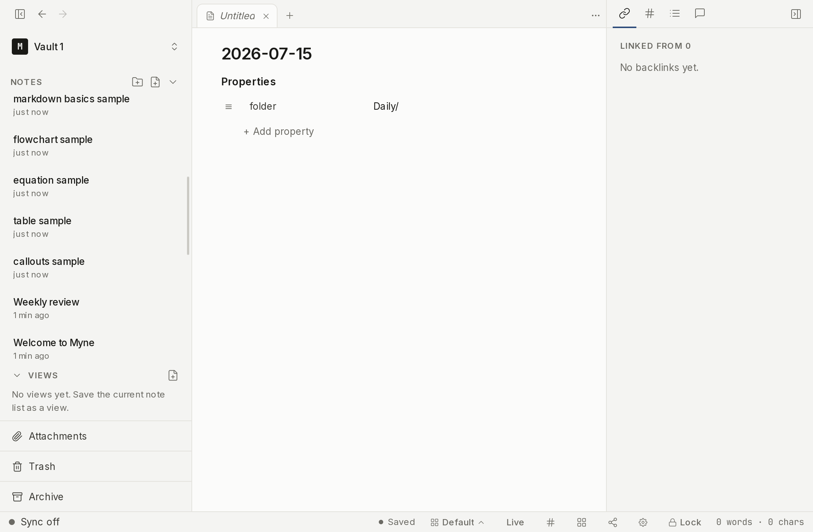

A daily note is one note per day: a journal, a log, a scratchpad that resets each morning. Myne's daily notes are deliberately plain. A single command opens today's note, creating it the first time and reopening it after.

## Opening today's note

Open the command palette and run **Open today's note**. The first time you run it on a given day, Myne creates that day's note; every time after, it reopens the same one. It is idempotent: you cannot end up with two notes for the same day by running it twice.

Daily notes live in their own folder with a date-based title, both of which you can set in Settings → **Editor**, under **Daily note folder** and **Daily note date format**. Once your vault has folders, the folder control is a picker over the ones you already have rather than a path you type, so filing daily notes somewhere new means creating that folder in the sidebar first. In a brand-new vault with no folders yet it is a plain text field instead, since a picker with nothing in it would be worse. Earlier days are reached by browsing that folder; there is no calendar and no date picker, by design. The command always means **today**.

## Pairing with a template

If you keep a template for your daily layout, set it as your **Daily note template** in Settings → **Editor**, and each new day's note starts from it, date placeholders and all (see [Templates](/user-guide/notes-and-organization/templates/) for the placeholder set).

## Limits

A daily note is matched by its folder and its title together. If you rename today's note, or move it out of your daily-note folder, **Open today's note** no longer recognizes it and will create a fresh one for the day. Keep both if you want the command to keep finding it.
