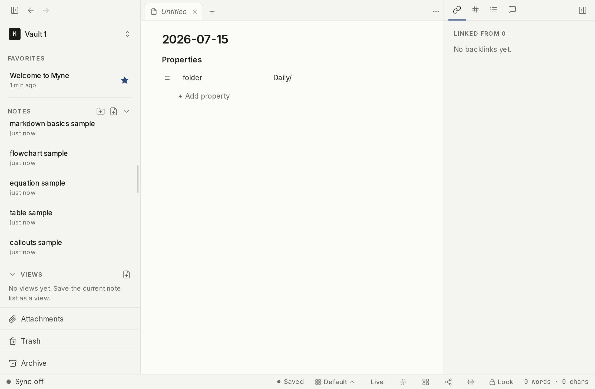

Favorites give you quick access to the notes you open most, without disturbing how they are filed. This article covers what favoriting does and what it doesn't.

## A shortcut, not a move

Marking a note as a favorite adds it to a **Favorites** section at the top of the sidebar. It does **not** move the note: the original stays exactly where it lives in your folder tree. A favorite is a shortcut to the note, so you can reach it from the top of the sidebar and still find it in its folder.

To favorite or unfavorite a note, toggle it from the note's menu. You can reorder the favorites list to suit how you work; the order is yours to set.

## Where favorites are stored

Your favorites list is part of your vault's encrypted preferences, the same place your other settings live. It is stored on your device, inside the vault, and is not visible outside the app.

## Limits

Favorites are pointers. Removing a note from Favorites does nothing to the note itself; deleting the underlying note (see [Trash](/user-guide/notes-and-organization/trash/)) removes it from Favorites along with everywhere else.
