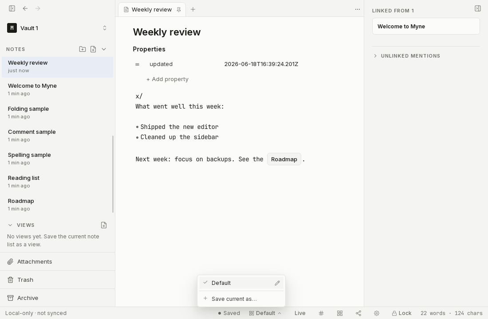

Save the current editor layout under a name like Writing or Research, then switch between named workspaces as your task changes. Switching auto-saves the layout you are leaving, so each workspace keeps its own arrangement. Like the rest of your layout, workspaces are saved best-effort rather than on every keystroke.

## What a workspace saves

A named workspace stores the arrangement of your editor, not the notes themselves. Saved under a name you choose, it captures the set of open tabs, the split-pane layout, which pane is focused, each tab's cursor and scroll position, and each tab's view mode (see [View modes](/user-guide/editor-and-writing/view-modes/)). It does not copy or move any note; switching workspaces rearranges what is on screen, while your notes stay exactly where they are in the vault.

## Saving and switching workspaces

You start with a single workspace named Default. From there you can build as many as you like:

- **Save current as…** clones the layout you are in under a new name and switches to the clone. The workspace you were in is left untouched, so this is how you branch a fresh layout off the current one.
- **Switch** moves to another workspace. The layout you are leaving is auto-saved first, so you can always switch back and find it the way you left it.
- **Rename** changes a workspace's name. Switching is by stable identity, so renaming never breaks which workspace is active.
- **Delete** removes a workspace.

The discoverable surface is the workspace chip at the right of the bottom bar, which shows the active workspace's name. Click its up-chevron to open a dropdown that lists your workspaces, with a pencil to rename each row and a **Save current as…** entry at the bottom. Selecting a different row switches to it.

## Renaming and deleting workspaces

Rename a workspace from the pencil next to its row in the dropdown, or with the **Rename workspace…** command. A text prompt opens with the current name filled in; edit it and choose **Rename**.

Delete the active workspace with the **Delete workspace…** command. If you delete the last remaining workspace, Myne does not leave you with none — it creates a fresh, empty workspace named Default in its place, so there is always at least one to work in.

## How layouts are saved

Myne does not write your workspace to disk on every keystroke. Layout changes are saved best-effort: writes are coalesced to at most once every five minutes or so of active use, and again whenever you close or lock Myne normally. Switching workspaces auto-saves the layout you are leaving into memory, but that staged layout reaches disk on the same coalesced schedule.

The practical consequence: if Myne is interrupted by a hard crash or power loss, it may restore a workspace layout up to about five minutes older than your very last arrangement. Your notes themselves are not at risk from this — their content is handled by autosave (see [Notes and folders](/user-guide/notes-and-organization/notes-and-folders/)); only the arrangement of tabs, panes, and workspaces can lag.

The workspace chip fades along with the rest of the chrome in [focus mode](/user-guide/editor-and-writing/focus-mode/). While you are in focus mode, reach the workspace commands through the command palette instead.

## Limits

Workspace names and layouts stay inside the encrypted `vault.workspace` blob — they are not written to disk in the clear. Because layout changes are saved on a coalesced, roughly five-minute schedule rather than per switch, someone who can read your vault folder can at most infer that *some* workspace change happened within a five-minute window, from the file's modification time. They cannot see the content of that change: not your workspace names, not the layouts, and not which notes any workspace holds. This is a deliberate, bounded trade described in [How Myne protects your notes](/user-guide/settings-and-privacy/privacy-model/).

## Shortcuts

The workspace actions live in the command palette under the View category — **Save workspace as…**, **Switch workspace…**, **Rename workspace…**, and **Delete workspace…**. None has a default keyboard shortcut; they are rebindable only, so you can assign your own in [custom hotkeys](/user-guide/settings-and-privacy/custom-hotkeys/). From the palette, **Switch workspace…** cycles to the next workspace in order.

| Action | macOS | Windows / Linux |
|---|---|---|
| Open command palette | ⌘K (alias ⌘P) | Ctrl K |
| Save / switch / rename / delete workspace | no default — rebindable | no default — rebindable |
