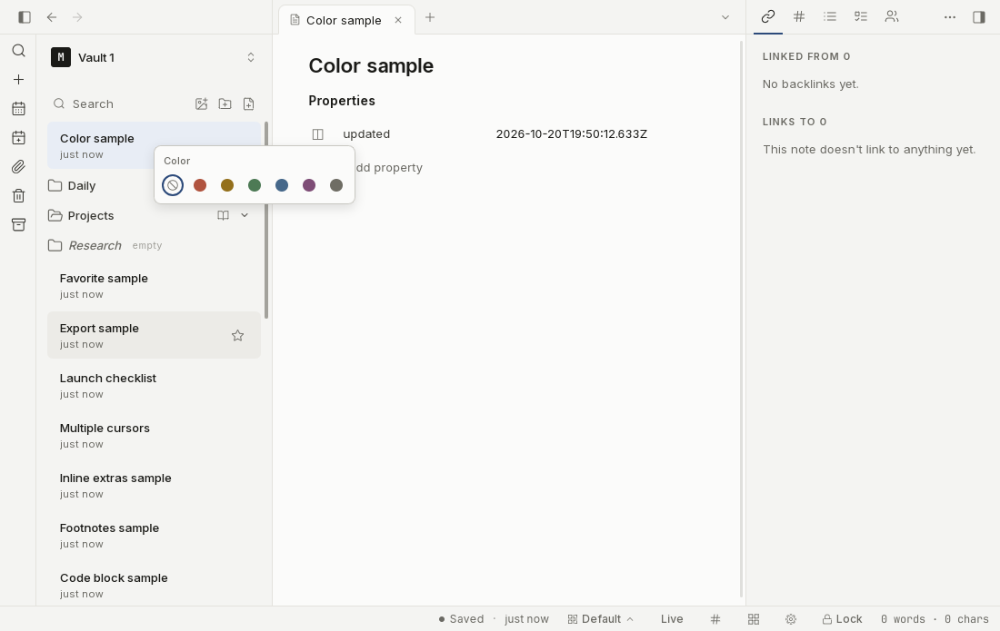

You can mark a note or a folder with a color, and give a folder a custom icon, to make the sidebar easier to scan. The color paints the thing it belongs to: a folder tints its own icon, a note gets a faint wash across its row, and an open note carries the same color onto its tab. Folders can also swap their default glyph for one of a curated icon set.

## Coloring a note

Right-click a note in the sidebar and choose **Color…**. A small picker opens with six named color swatches — Clay, Ochre, Moss, Slate, Plum, and Stone — plus a **None** option. Click a swatch to apply it; the picker closes right away, with no separate confirm step.

A colored note does not get a dot beside its title. Instead the whole row takes a low-alpha wash of the color, so it reads as marked without spending any width on a marker. The title text itself stays in the standard ink color — the color marks the row, never the words.

Notes take a color only. The custom-icon picker below is for folders, which have an icon to swap; a note does not.

## Coloring a folder and choosing its icon

Right-click a folder and choose **Customize…**. The same six color swatches appear at the top, and below them an **Icon** section: a **Default** reset followed by a grid of glyphs — book, briefcase, calendar, home, and so on. Pick a color, an icon, or both; each choice applies immediately and closes the picker.

A folder's color tints its own icon rather than adding a separate mark, so the glyph you choose is the thing that carries the color. The icons are single-color stroke glyphs from a curated set — no emoji, and no uploading your own image. That set was recently doubled to 32 glyphs, up from a smaller starting set that ran short once a vault filled up, so a personal folder no longer has to share a glyph with a work one.

## Where the color shows up

A color you set follows the item it belongs to across the interface:

- **A folder** tints its sidebar icon — the default folder glyph or whichever custom icon you assigned.
- **A note** washes its whole sidebar row in a faint tint, with no leading dot.
- **An open note** also tints its icon in the tab strip from the same color, so a note you marked stays recognizable once you have it open.

In every case the title text stays in the ink ramp. This is deliberate: color marks the row or the icon, and never tints the note's prose. For the rest of what you can rearrange in the sidebar, see [Customizing the sidebar](/user-guide/notes-and-organization/sidebar-customization/); for how notes and folders themselves work, see [Notes and folders](/user-guide/notes-and-organization/notes-and-folders/).

## Clearing a color or icon

To remove a color, open the same picker — **Color…** on a note, **Customize…** on a folder — and choose **None**. To put a folder's icon back to the plain folder glyph, choose **Default** in the icon grid. Both take effect immediately.

A folder's color and icon are independent: clearing one leaves the other in place.

## Limits

Colors and icons are cosmetic. A note keeps its color by its own identity, so renaming or moving the note keeps it; a folder's color and icon are tied to the folder, so they follow it when you rename or move it and are removed when you delete it.

These decorations are stored as encrypted content inside your vault, alongside the rest of your organization such as the sidebar order — not as a separate device-local setting. So they travel with the vault: they are included in a [vault backup](/user-guide/safety-and-recovery/back-up-your-vault/) and, with [sync](/user-guide/sync-and-devices/) on, carried to your other devices. Until you turn on sync or name a remote AI provider, Myne runs entirely on your device; nothing leaves it.

Because these are decoration and nothing depends on them, a tampered or out-of-date copy of the vault can at most surface the wrong color or icon — it cannot reveal or change a note's contents.
