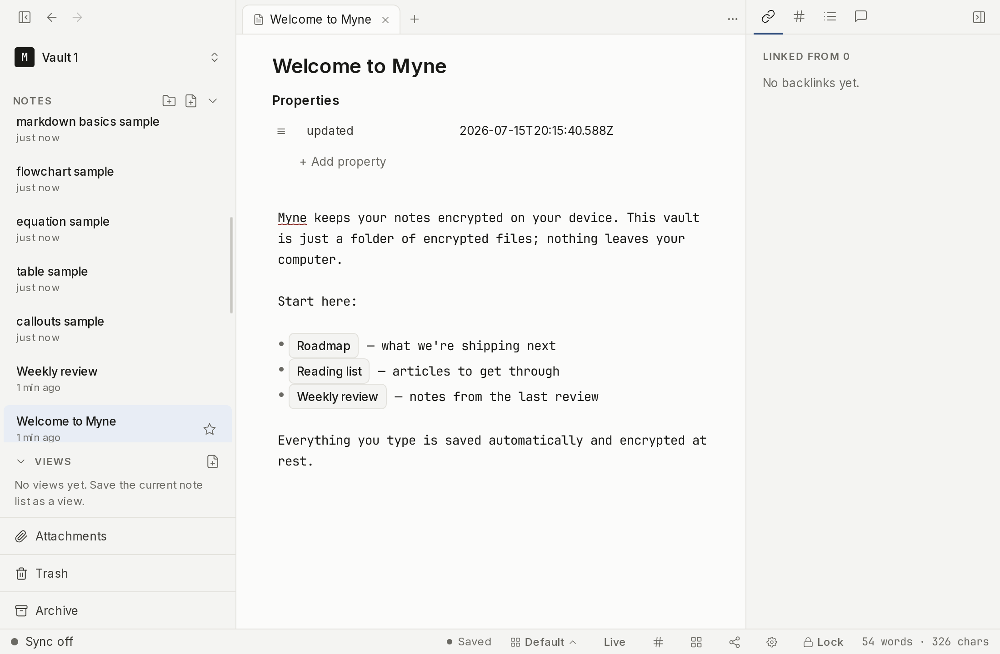

Notes and folders are the backbone of a vault. This article covers creating and naming notes, how folders work, how autosave keeps your edits, and what happens when you delete something.

## Creating a note

Every plain "new note" action (the sidebar control, `⌘N`, the new-note-in-pane shortcut) makes an **instant blank note** and drops you into it, ready to type. There is no dialog and no template to pick. If you want a note built from a template, that is a separate, deliberate path; see [Templates](/user-guide/notes-and-organization/templates/).

The first line of the note becomes its title. Renaming a note updates wherever its title comes from: the heading in the note, or the `title` in its frontmatter if it has one.

To copy a note as a starting point, **Duplicate** makes a clone with a fresh title. When you want to act on several notes at once, you can select multiple notes and move, archive, or delete them together, or drag a selection into a folder; an **Open random note** action in the command palette pulls up a live note at random for serendipitous review. These are covered in [Bulk note actions](/user-guide/notes-and-organization/bulk-note-actions/).

## Folders

Folders group your notes in the sidebar. You can nest them, drag notes between them, and create as many as you like. Deleting a folder that still contains notes moves the whole subtree to the Trash rather than destroying it, so nothing is lost to a misclick (see [Trash](/user-guide/notes-and-organization/trash/)).

A folder can have an **index note** — an ordinary note marked as that folder's landing page, pinned and badged at the top of the folder. A wikilink that ends in a slash, like `[[Projects/]]`, opens the folder's index note. See [Folder notes](/user-guide/notes-and-organization/folder-notes/).

### Private by design

Folders are an organizational layer, not a disk layout. The folder names you choose, and the structure you build, live **inside** the encrypted vault. They never become real directories on disk, so the names are not visible to anyone who only sees the vault folder. What that protects, and what it doesn't, is covered in [How Myne protects your notes](/user-guide/settings-and-privacy/privacy-model/).

## Autosave, in detail

Myne autosaves; there is no save button. Concretely:

- It saves about **one second** after you stop typing.
- If you type continuously, it saves at least **every ten seconds** anyway.
- It also flushes immediately when you switch away from the window, lock the vault, or close the app.

So in a normal session nothing is ever unsaved for long. In the worst case, a hard crash or power loss mid-edit, you could lose **at most about the last ten seconds** of typing. If a save ever fails, Myne shows the error and a **Retry** so you know, rather than failing silently. Each note also records its own "last edited" time inside the encrypted note.

## Setting notes aside

The Archive is a separate place to set notes aside without deleting them: an archived note leaves the active sidebar but is not headed for deletion the way a trashed note is, and you can bring it back to its folder unchanged at any time. Archiving and Trash are distinct — a note is one or the other, never both. See [Archive](/user-guide/notes-and-organization/archive/).

## Limits

Autosave bounds your exposure to a hard crash at roughly ten seconds; it cannot protect against a disk that loses already-written data, which is what [backups](/user-guide/safety-and-recovery/back-up-your-vault/) are for. Deletion sends notes to the Trash, but emptying the Trash is permanent, as covered next.
