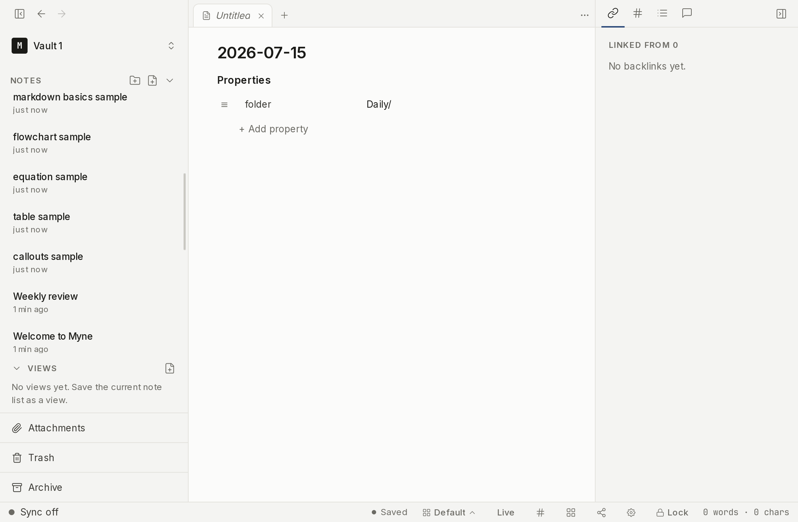

A periodic note is one note per stretch of time: a day, a week or a month. A journal, a weekly review, a monthly plan. Myne's periodic notes are deliberately plain. Each is an ordinary note, and one command opens the current one, creating it the first time and reopening it after.



## Opening the current note

Open the command palette and run **Open today's note**, **Open this week's note** or **Open this month's note**. The first time you run one in a given period, Myne creates that period's note; every time after, it reopens the same one. It is idempotent: you cannot end up with two notes for the same week by running it twice, and running the weekly command on Monday and again on Friday lands you in the same note.

Earlier periods are reached by browsing the folder they are filed in. There is no calendar, no date picker and no previous/next arrow, by design. Each command always means **the current one**.

## Settings

Each period has its own folder, title format and template, in Settings → **Editor**, under **Periodic notes**. The three sections, Daily, Weekly and Monthly, carry the same three controls.

Once your vault has folders, the folder control is a picker over the ones you already have rather than a path you type, so filing weekly notes somewhere new means creating that folder in the sidebar first. In a brand-new vault with no folders yet it is a plain text field instead, since a picker with nothing in it would be worse. A folder you choose here stays visible in the sidebar even before its first note exists.

The defaults are:

| Period  | Folder     | Title format |
| ------- | ---------- | ------------ |
| Daily   | `Daily/`   | `YYYY-MM-DD` |
| Weekly  | `Weekly/`  | `gggg-[W]ww` |
| Monthly | `Monthly/` | `YYYY-MM`    |

### Title formats

A title format is a small pattern. These pieces are replaced:

| Piece  | Means                                | Example |
| ------ | ------------------------------------ | ------- |
| `YYYY` | Four-digit year                      | `2026`  |
| `MM`   | Two-digit month                      | `08`    |
| `DD`   | Two-digit day                        | `24`    |
| `gggg` | Four-digit **week-year** (see below)  | `2026`  |
| `ww`   | Two-digit ISO week number            | `35`    |

Anything else is kept as written. To keep a letter that would otherwise be replaced, put it in square brackets: `gggg-[W]ww` gives `2026-W35`, and the `W` survives because the brackets protect it.

**A pattern you already use in another app will be SPELLED the same here, and `gggg` and `ww` always mean the ISO week, whatever that app was set to.** Most apps that use these letters let a locale decide where a week starts. Myne does not: weeks start Monday and the week number is the ISO one, always. That matches those apps under European locales and differs from their US default, so a `gggg-[W]ww` pattern carried over from an app on a US locale will produce a different week number for part of the year, and the notes it makes sit beside your old ones rather than in them. Myne freezes it this way on purpose: a week boundary that moved with a setting would change which note "open this week" opens, silently, for every note already written.

The same pieces work in all three formats, daily included. **If you set a daily note title format before periodic notes existed, check it once.** `gggg`, `ww` and square brackets used to be ordinary characters there and are pattern pieces now, so a format like `YYYY-MM-DD [journal]` used to produce `2026-08-26 [journal]` and now produces `2026-08-26 journal`. Myne finds a note by its folder and its title, so the first "Open today's note" after the change makes a new note rather than opening the one already there. Nothing is deleted: the older notes keep the titles they were written with and stay in the folder. This is the same thing that happens whenever you edit a title format yourself.

### A note about weeks

Weeks start on **Monday**, and the week that contains the year's first Thursday is week 1. This is the ISO 8601 rule, and Myne does not offer a setting to change it, because changing it would quietly re-point every weekly note you already have.

One consequence is worth knowing: the first days of January can belong to the **previous** year's last week, and the last days of December to the **next** year's first. 1 January 2027 falls in week 53 of 2026, so its weekly note is titled `2026-W53`. That is why the week token is `gggg` and not `YYYY`: the week-year is what keeps one week as one note across the year boundary.

## Pairing with a template

If you keep a template for a period's layout, set it as that period's **Template**, and each new note for that period starts from it. Alongside the usual placeholders (see [Templates](/user-guide/notes-and-organization/templates/)), two name the period itself:

- `{{period_start}}`: the first day of the period
- `{{period_end}}`: the last day of the period

So a weekly template containing `Week of {{period_start}} to {{period_end}}` writes the real dates when the note is created. `{{date}}` always means today, in every template and every period, so it stays useful for "written on".

## From the terminal

If you use the Myne command-line tool, each period has a pair of commands:

```
myne weekly                  # print this week's note, creating it if needed
myne weekly:append "…"       # append a line to it
myne monthly
myne monthly:append "…"
```

`myne daily` and `myne daily:append` work as before. If you have set a display timezone in Settings, these commands print a short note saying they used this device's clock instead: the app applies your override, the command-line tool does not.

## Limits

A periodic note is matched by its folder and its title together. If you rename this week's note, or move it out of its folder, **Open this week's note** no longer recognizes it and will create a fresh one for the week. Keep both if you want the command to keep finding it.

These are settings the AI can change for you as well: the folder, the template and the date format for each period. Ask in the AI Chat tab, as [Let the AI change your notes](/user-guide/ai/agent-runs/#changing-settings) describes, and approve the change on the review screen.
