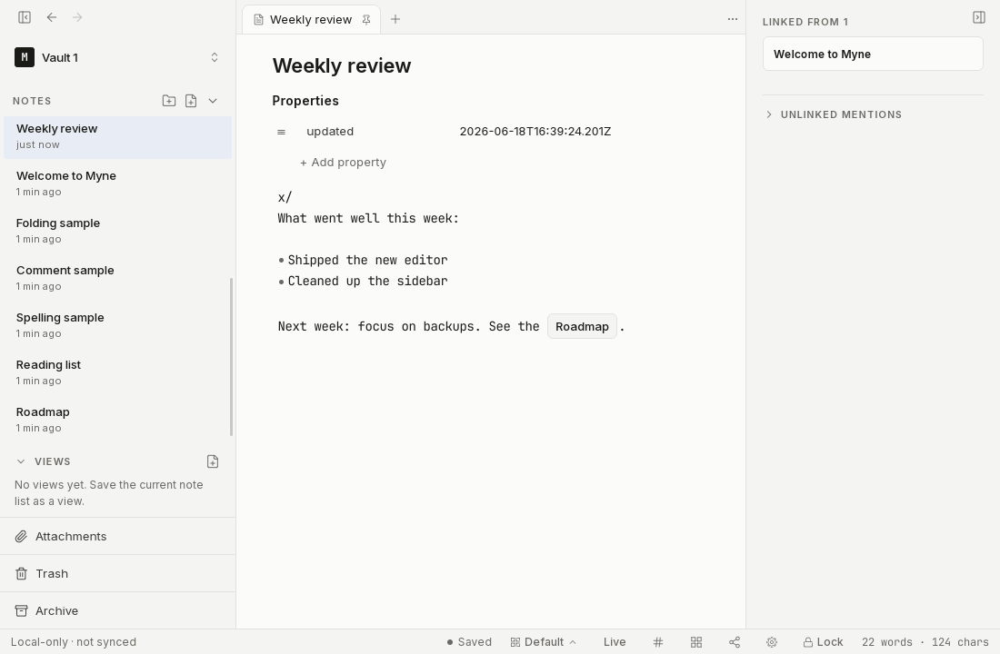

Pin a tab to keep it open: once a tab is pinned, selecting a note that would normally reuse the focused pane opens a new tab instead, so the pinned tab stays put. Separately, you can flip a pane between the normal horizontal tab strip and a stacked deck, where tabs overlap like a fanned set of cards. Both of these are per-pane states, and both persist across lock and unlock.

## Pinning a tab

By default, selecting a note in the sidebar reuses the focused pane's active tab rather than piling up new ones (see [Tabs and split view](/user-guide/notes-and-organization/tabs-and-split-view/)). Pinning a tab changes that for the tab you pin: navigation opens a **new** tab instead of replacing the pinned one, so a reference note you want to keep on screen stays open.

To pin a tab, right-click it and choose **Pin**. The tab's close control changes to a pin glyph in its place, and the tab becomes close-protected: its × close button is gone and middle-clicking the tab no longer closes it. Hovering the pin glyph shows the tooltip **Pinned — unpin to close**.

To close a pinned tab, right-click it and choose **Unpin** first, then close it as usual. The pinned state belongs to the tab, so it is restored along with the rest of your layout the next time you unlock the vault.

## Stacked tabs

A pane normally shows its tabs as a horizontal strip. You can instead render them as a **stacked deck**, where the tabs partially overlap like a fanned card deck and the active or hovered card lifts above the rest. This is purely a layout choice for that one pane; it does not change which tabs are open or what they hold.

Toggle it from the command palette with **Toggle stacked tabs**, in the View category. The toggle applies to the focused pane only, so you can stack one pane while leaving another as a normal strip. There is no pane-header button and no default keyboard shortcut for this — the command palette is the only way in. Like the pinned state, a pane's stacked layout is restored the next time you unlock the vault.

## Limits

The pinned and stacked flags ride inside the encrypted `vault.workspace` blob along with the rest of your editor layout — they are not written to disk in the clear. The workspace is written only when you close or lock Myne normally, and those writes are coalesced rather than fired on every change. Because of that, the blob's modification time is a coarse signal: someone who can read your vault folder can at most infer that *some* workspace change happened within a roughly five-minute window. They cannot see which tabs are pinned, which panes are stacked, or anything else about the layout. This is the same bounded trade described in [How Myne protects your notes](/user-guide/settings-and-privacy/privacy-model/) and in [Named workspaces](/user-guide/notes-and-organization/named-workspaces/).

## Shortcuts

The pin and unpin actions live in a tab's right-click menu and have no keyboard shortcut. Stacked tabs is reached only through the command palette.

| Action | macOS | Windows / Linux |
|---|---|---|
| Open command palette | ⌘K (alias ⌘P) | Ctrl K |
| Toggle stacked tabs (focused pane) | command palette only — no default | command palette only — no default |
| Pin / unpin a tab | right-click menu — no shortcut | right-click menu — no shortcut |
