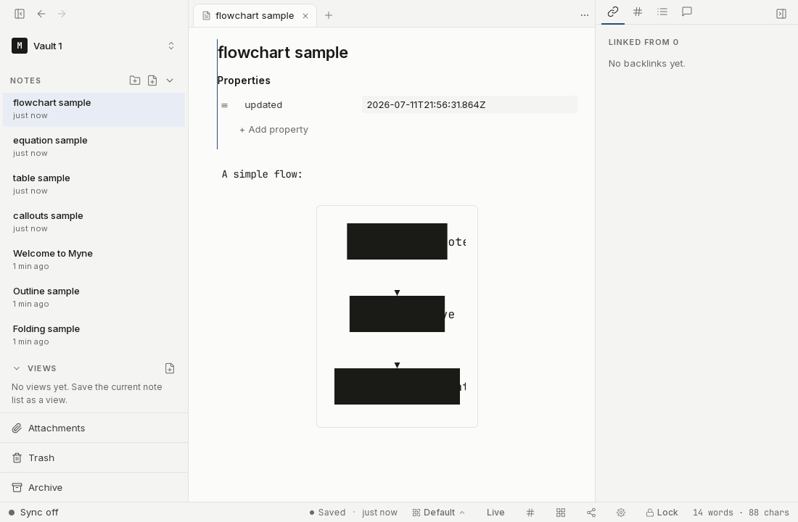

The sidebar is yours to arrange. You can set the order of notes and folders by hand, move a folder inside another one, keep empty folders as structure, and collapse what you are not using. The bottom bar can be rearranged too. This article covers what you can change and what Myne refuses.

## Reordering by hand

Drag notes and folders to set their order in the sidebar. The order you set is saved with your vault, so the tree stays the way you arranged it. You can also drag a note **into** a folder to file it there. Each folder keeps its own order: with sync on, rearranging one folder on one device and a different folder on another leaves both arrangements intact — the two do not race each other.

Folders re-nest as well as reorder, using the same three drop zones a note drag has. Drop a folder on the top or bottom edge of another row to place it among that row's siblings, or on the middle of a folder row to move it inside that folder. As a pointer-free alternative, right-click the folder and choose **Move folder to…**, which uses the same picker and the same guards.

Myne refuses three moves and says why rather than doing nothing: a folder into itself or into one of its own subfolders, a move into a folder that already holds a folder of that name, and a move that would make the path too long. Moving a folder re-files every note under it and rewrites any `[[Old/]]` links that pointed at it, so a folder note stays reachable.

## Selecting several at once

A plain click opens a note and clears any selection. To act on more than one note, build a selection set: Cmd-click (Ctrl-click on Windows and Linux) toggles a note in or out of the set, and Shift-click selects the range from the last note you clicked. With a set in hand, the right-click menu offers the bulk actions — move the whole set into a folder, send it to Trash, or archive it. See [Acting on several notes at once](/user-guide/notes-and-organization/bulk-note-actions/).

## Folder notes

A folder can have one note that stands in as its index — its "folder note". A folder note is hidden from the sidebar tree; double-click the folder row to open it, or to create one if the folder has none. Right-click the folder for the same actions (**Open folder note**, **Create folder note**, **Remove folder note**). To promote an existing note, right-click it and choose **Set as folder note**. The feature is off by default and its controls appear only once you turn on **Folder notes** in Settings → Files. See [Folder notes](/user-guide/notes-and-organization/folder-notes/).

## Empty folders and loose notes

Folders are kept on purpose. Once a folder holds a note, or once you make one to fill later, it stays: emptying it does not delete it. Deleting it yourself is the ordinary way one goes, and there is one case where a folder can still disappear on its own, described under [Notes and folders](/user-guide/notes-and-organization/notes-and-folders/): if Myne could not record the folder, or if the folder list was full, it works but does not survive its last note leaving. Notes do not have to live in a folder at all; **loose notes** at the top level are first-class, not an error state.

## Collapsing

Collapse a folder to tuck its contents away while you work elsewhere; expand it to bring them back. Which folders are open is remembered along with the rest of your layout, so the tree comes back the way you left it the next time you unlock the vault. It is kept separately from the manual order, and it is one set for the sidebar rather than one per workspace, so switching workspaces does not change what is collapsed.

## Navigation entries

**Views**, **Attachments**, **Trash** and **Archive** used to sit in the sidebar's footer. They live on the [left ribbon](/user-guide/getting-started/left-ribbon/) now, which is the only place they are, and the ribbon highlights whichever of them is the surface you are looking at. Trash and Archive each show a count when they hold anything.

**Views** opens a searchable, scrollable panel listing your saved views, with the one currently open marked by a checkmark. Opening a view puts its filtered set in a tab. See [Saved views](/user-guide/editor-and-writing/saved-views/). The Views entry is off for a new vault — turn it on under **Settings → Editor → Views**. A vault that already has saved views keeps the entry without your changing the setting.

**Archive** is for notes you want out of the tree but not deleted; open the panel to see what is archived and restore a note from it. See [Archiving notes](/user-guide/notes-and-organization/archive/).

## The bottom bar

The status bar along the bottom of the editor carries small readouts and controls — save status, the workspace chip, view mode, and so on; the [interface tour](/user-guide/getting-started/interface-tour/) lists them all.

You can rearrange these items. Drag a bottom-bar item left or right to set its position. As a pointer-free alternative, right-click an item and choose **Move left** or **Move right**; the same menu lets you **Hide** an item. The order you set is saved with your vault.

Two things sit outside the order you set. The side-by-side preview toggle is pinned to the start of the right-hand cluster and never moves. And sync state is not an item of its own: when a note's latest changes have not reached the server yet, a small marker appears beside **Save status**, so hiding Save status hides that marker with it.

To bring a hidden item back, right-click empty bar space and turn it on again in the visibility list; that list is the only way back.

## Limits

The sidebar and the bottom bar arrange how your notes are presented; they do not change what the notes are or where their content lives. Folder names and ordering live inside the encrypted vault; see [How Myne protects your notes](/user-guide/settings-and-privacy/privacy-model/).
