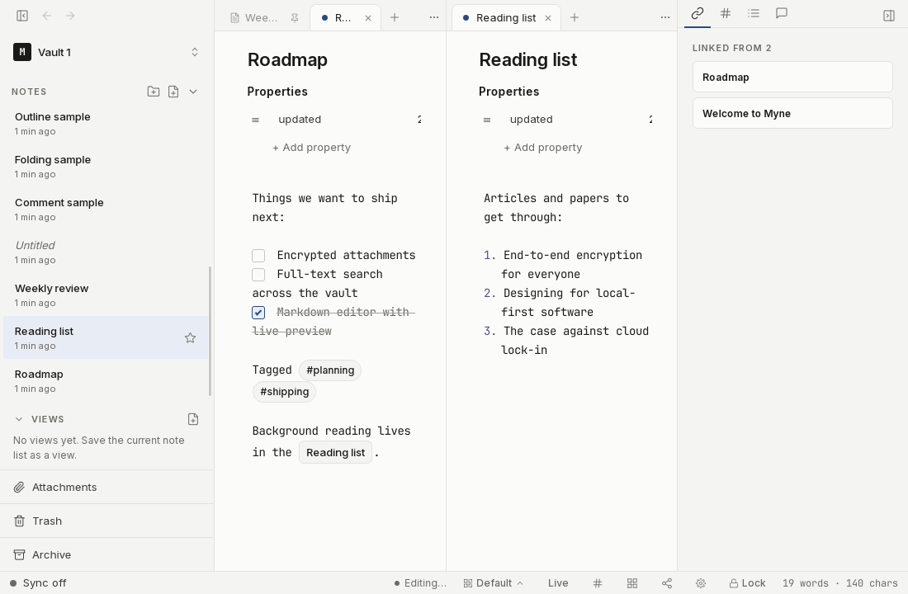

Myne lets you keep several notes open at once, in tabs and in side-by-side panes, and it remembers that layout between sessions. This article covers how tabs and splitting work and the one thing to know about how the layout is saved.

## Tabs

Selecting a note opens it in the **focused pane's active tab**; it reuses the tab you are in, rather than piling up new ones. When you want to keep the current note open alongside a new one, open the new note in a **new tab** instead. Tabs in a pane can be cycled with the keyboard (see Shortcuts below), and closing a tab leaves the others untouched.

A new, empty tab does not force a blank note on you. It shows a chooser: a search box over your notes, your most recent notes below it, and rows to create a new note or a new drawing instead. Trashed notes and templates are left out, matching what the sidebar shows. Press Esc to go back to the tab you were on, if the pane still has one.

Each tab carries its own **view mode** — Live preview, Reading, or Source — so you can read one tab while editing another, and ⇧⌘E toggles the focused tab between editing and reading. See [View modes](/user-guide/editor-and-writing/view-modes/) for what each mode shows.

You can also **pin** a tab so it is protected from being replaced by the next note you open — once a tab is pinned, navigating to a note opens it in a new tab instead of reusing the pinned one — and pinning also hides the tab's close button (right-click the tab to pin or unpin). You can **stack** a pane's tabs into an overlapping deck when you have many open. See [Pinned and stacked tabs](/user-guide/notes-and-organization/pinned-and-stacked-tabs/).

## Split view

**Split** the focused pane to put two notes side by side: right, for columns, or down, for stacked panes. Each pane has its own tabs and its own focus, so you can read one note while editing another. You always have at least one pane; everything stays inside the single Myne window, and there are no pop-out windows.

## Your workspace is remembered

Myne saves your open tabs and split layout and restores them the next time you unlock the vault, so you pick up where you left off.

You start in a workspace named **Default**, and you can keep several named workspaces — separate, switchable layout slots — for different kinds of work. Save the current arrangement under a name, switch between them, and rename or delete them from the workspace switcher in the bottom bar or from the command palette. See [Named workspaces](/user-guide/notes-and-organization/named-workspaces/) for the full walkthrough.

## Limits

The Default workspace's layout is saved when you **close or lock Myne normally**, and is otherwise written at most about once every five minutes while you work — not on every keystroke. So if Myne is interrupted by a hard crash or power loss, it may restore a slightly **older** layout than your very last arrangement. Your notes themselves are safe, since autosave handles their content (see [Notes and folders](/user-guide/notes-and-organization/notes-and-folders/)); only the arrangement of tabs and panes can lag.

## Shortcuts

| Action | macOS | Windows / Linux |
|---|---|---|
| New note in the focused pane | ⌘T | Ctrl T |
| Next / previous tab in the pane | Ctrl Tab / Ctrl Shift Tab | Ctrl Tab / Ctrl Shift Tab |
| Close the active tab | ⌘W | Ctrl W |
| Toggle the focused tab between editing and reading | ⇧⌘E | Ctrl Shift E |
| Split the focused pane right / down | ⌘\ / ⌘⇧&#124; | Ctrl \ / Ctrl Shift &#124; |

Split-down is the same physical keys as split-right plus Shift. Myne lists it as `|` because that is the character Shift and `\` produce together, and the Hotkeys panel spells it the same way.
